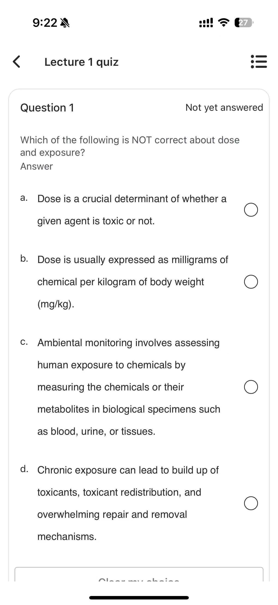
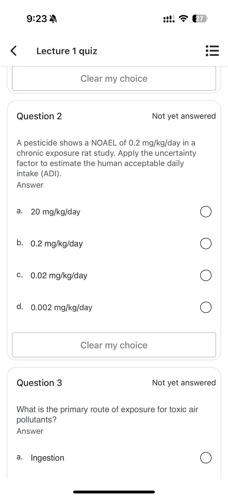
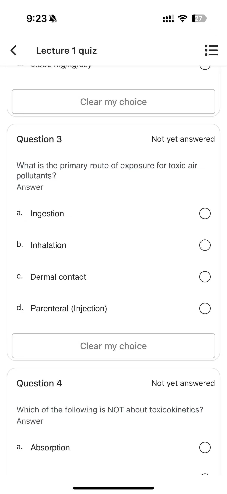
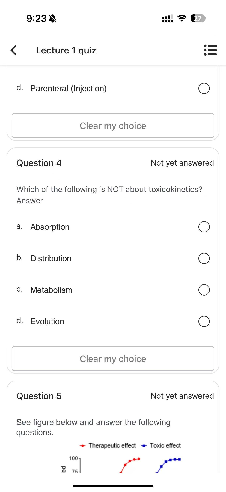
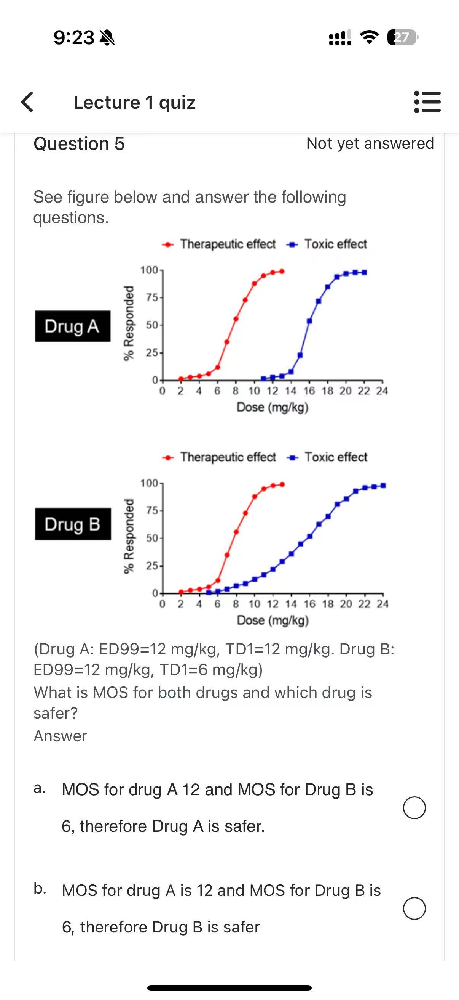
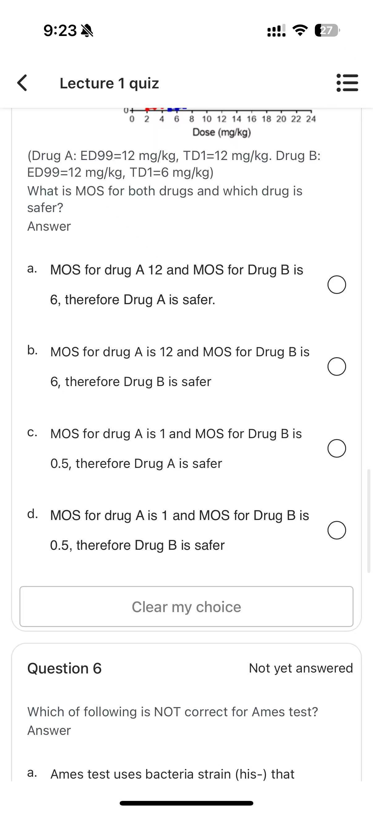
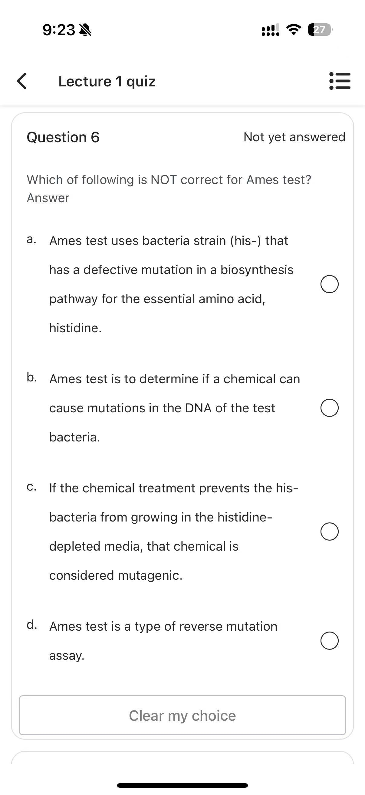
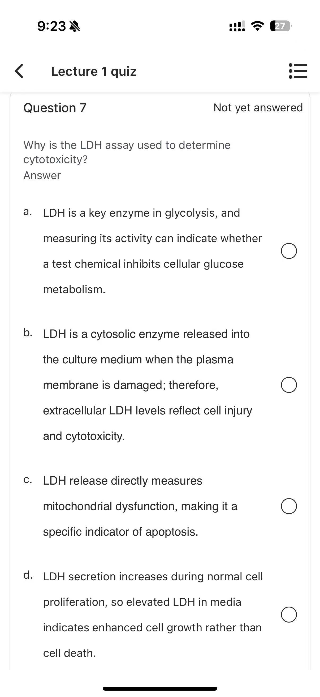
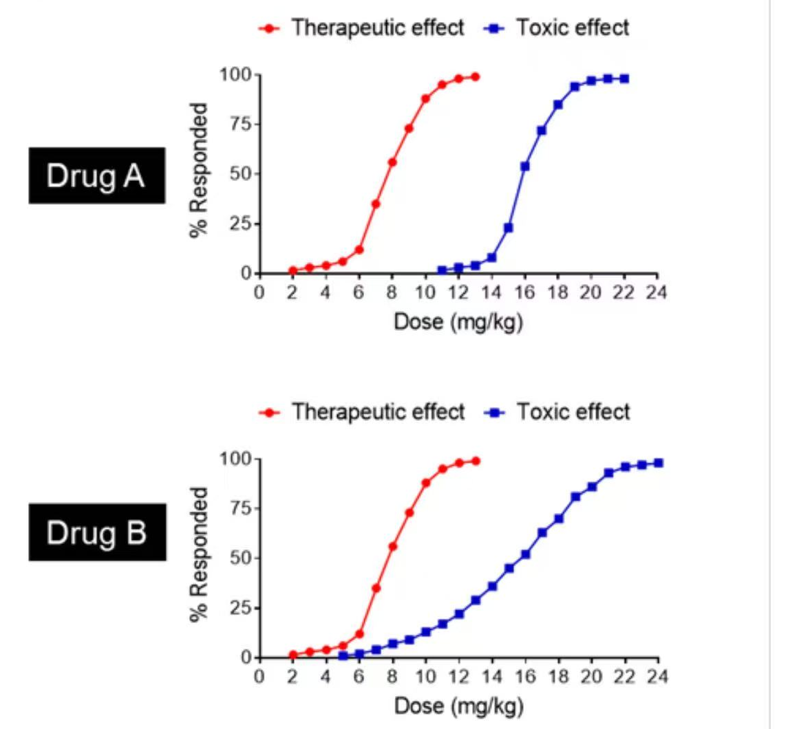

# quiz1 · Quiz-Lecture 1（7 题 · 毒理学一般原理）

> 来源：手机端学习平台 **Lecture 1 quiz** 界面截图 8 张，全部题目均显示 **Not yet answered**（未作答状态，故无勾选痕迹）。
> 已省略界面按钮文字（Clear my choice）。
> **正确选项以粗体标出**，答案依据 Lecture 1 英文原版课件（`原版课件/Lecture 1. General principles of toxicology.pdf`）逐题核对。
> 🆕 **每题末附「课件定位」** —— 双链直达中英对照课件 [Lecture 1](中英对照课件/lecture1.md) 中**对应知识点所在的 Slide**，即该文件里的 `### Slide N` 小节，点击可跳到那一页原版截图。
> 医学内容请以课件原文、教材（Casarett & Doull's Toxicology）与任课教师讲解为准复核，不可用于临床决策。
>
> 相关：Lecture 1. General principles of toxicology.pdf ·
> lecture1-毒理学一般原理 · 课程索引 · [quiz2](quiz2.md) · [quiz3](quiz3.md) · [quiz4](quiz4.md) · [quiz5](quiz5.md)

---

## 原图存档

展开 8 张原始截图（1206 × 2622）

---

## 试题1

Which of the following is NOT correct about dose and exposure?

- a. Dose is a crucial determinant of whether a given agent is toxic or not.
- b. Dose is usually expressed as milligrams of chemical per kilogram of body weight (mg/kg).
- **c. Environmental monitoring involves assessing human exposure to chemicals by measuring the chemicals or their metabolites in biological specimens such as blood, urine, or tissues.**
- d. Chronic exposure can lead to build up of toxicants, toxicant redistribution, and overwhelming repair and removal mechanisms.

> **✅ 答案 c** · 依据 **L1 p29**：课件把暴露评估分两条路 —— *Personal exposure assessment → **Biological monitoring***（量体内有多少，采样为血／尿／组织）；*Environmental exposure assessment → **Ambiental monitoring***（量环境介质 air, soil, water, food 里有多少）。c 项把**生物监测**的定义安到了「environmental monitoring」头上。
>
> 🔗 **课件定位**：[L1 · Slide 29 · Exposure assessment](中英对照课件/lecture1.md)

## 试题2

A pesticide shows a NOAEL of 0.2 mg/kg/day in a chronic exposure rat study. Apply the uncertainty factor to estimate the human acceptable daily intake (ADI).

- a. 20 mg/kg/day
- b. 0.2 mg/kg/day
- c. 0.02 mg/kg/day
- **d. 0.002 mg/kg/day**

> **✅ 答案 d** · 依据 **L1 p23**：`Human ADI = Animal NOAEL ÷ uncertainty factor (100)`，其中 10 为种间（inter-species）、10 为种内（intra-species）差异。0.2 ÷ 100 = **0.002 mg/kg/day**。
>
> 🔗 **课件定位**：[L1 · Slide 23 · Determining human safety](中英对照课件/lecture1.md)
> ↳ 前置：[Slide 19 · Point of departure (POD)](中英对照课件/lecture1.md) · [Slide 20 · 3 common types of POD（NOAEL / LOAEL / BMDL）](中英对照课件/lecture1.md)

## 试题3

What is the primary route of exposure for toxic air pollutants?

- a. Ingestion
- **b. Inhalation**
- c. Dermal contact
- d. Parenteral (Injection)

> **✅ 答案 b** · 依据 **L1 p26**：暴露途径与部位 —— `Inhalation (lungs)` · `Dermal contact (skin)` · `Ingestion (GI tract)` · `Injection`。空气污染物经**肺吸入**进入；课件另给出各途径的相对效力排序 `iv > inhale > ip > im > ingest > dermal`。
>
> 🔗 **课件定位**：[L1 · Slide 26 · Routes of exposure](中英对照课件/lecture1.md)
> ↳ 前置：[Slide 25 · Routes of exposure (exposure pathway)](中英对照课件/lecture1.md)

## 试题4

Which of the following is NOT about toxicokinetics?

- a. Absorption
- b. Distribution
- c. Metabolism
- **d. Evolution**

> **✅ 答案 d** · 依据 **L1 p32**：`ADME: Absorption, Distribution, Metabolism, and Excretion` —— 毒代动力学四要素。Evolution（进化）不属于。
>
> 🔗 **课件定位**：[L1 · Slide 32 · Toxicokinetics（ADME）](中英对照课件/lecture1.md)
> ↳ 前置：[Slide 31 · The fate of toxicants (toxicokinetics)](中英对照课件/lecture1.md)

## 试题5

See figure below and answer the following questions.

（Drug A: ED99=12 mg/kg, TD1=12 mg/kg. Drug B: ED99=12 mg/kg, TD1=6 mg/kg）

What is MOS for both drugs and which drug is safer?

- a. MOS for drug A 12 and MOS for Drug B is 6, therefore Drug A is safer.
- b. MOS for drug A is 12 and MOS for Drug B is 6, therefore Drug B is safer
- **c. MOS for drug A is 1 and MOS for Drug B is 0.5, therefore Drug A is safer**
- d. MOS for drug A is 1 and MOS for Drug B is 0.5, therefore Drug B is safer

> **✅ 答案 c** · 依据 **L1 p44–45**：`Margin of Safety (MOS) = TD1 / ED99`，课件举例正是 `ED99 = 12 mg/kg, TD1 = 6 mg/kg → MOS = 0.5`。
> 代入本题：Drug A MOS = 12/12 = **1**；Drug B MOS = 6/12 = **0.5**。MOS 是「毒性起始剂量 ÷ 有效剂量」的比值，**比值越大越安全**，故 A 更安全（选项 a/b 把 TD1、ED99 的绝对值当成了 MOS，算错）。
> ⚠️ 课件另注：MOS < 1 时医生必须谨慎用药 —— 两药中 B 已低于 1。
>
> 🔗 **课件定位**：[L1 · Slide 44 · Margin of Safety](中英对照课件/lecture1.md) · [L1 · Slide 45 · MOS 图示](中英对照课件/lecture1.md)
> ↳ 前置：[Slide 41 · Therapeutic index = TD50/ED50](中英对照课件/lecture1.md) · [Slide 43 · Therapeutic effect / Toxic effect 曲线](中英对照课件/lecture1.md)

## 试题6

Which of following is NOT correct for Ames test?

- a. Ames test uses bacteria strain (his–) that has a defective mutation in a biosynthesis pathway for the essential amino acid, histidine.
- b. Ames test is to determine if a chemical can cause mutations in the DNA of the test bacteria.
- **c. If the chemical treatment prevents the his- bacteria from growing in the histidine-depleted media, that chemical is considered mutagenic.**
- d. Ames test is a type of reverse mutation assay.

> **✅ 答案 c** · 依据 **L1 p50–51**：his⁻ 菌株不能自行合成组氨酸，在**缺组氨酸培养基中死亡**；若化学物致突变使其**回复突变（reverse mutation）**为 his⁺，则菌**存活生长**。课件原文：*"the mutation caused by the chemical allows the bacteria to **regain the ability to synthesize histidine**"*。c 项把方向写反了。
>
> 🔗 **课件定位**：[L1 · Slide 50 · Example of bacteria mutagenesis test（Ames test）](中英对照课件/lecture1.md) · [L1 · Slide 51 · Ames test example](中英对照课件/lecture1.md) · [L1 · Slide 52 · Ames test example](中英对照课件/lecture1.md)
> ↳ 前置：[Slide 49 · Test for genotoxicity and mutagenicity](中英对照课件/lecture1.md)

## 试题7

Why is the LDH assay used to determine cytotoxicity?

- a. LDH is a key enzyme in glycolysis, and measuring its activity can indicate whether a test chemical inhibits cellular glucose metabolism.
- **b. LDH is a cytosolic enzyme released into the culture medium when the plasma membrane is damaged; therefore, extracellular LDH levels reflect cell injury and cytotoxicity.**
- c. LDH release directly measures mitochondrial dysfunction, making it a specific indicator of apoptosis.
- d. LDH secretion increases during normal cell proliferation, so elevated LDH in media indicates enhanced cell growth rather than cell death.

> **✅ 答案 b** · 依据 **L1 p57 / p59–61**：`LDH (lactate dehydrogenase) release assay` 为体外细胞毒试验 —— 健康细胞 LDH 留在胞内，质膜受损后**泄漏到培养液**，胞外 LDH 活性（经 NADH + INT + diaphorase 显色为 formazan）随毒物浓度升高而升高，反映细胞损伤。
>
> 🔗 **课件定位**：[L1 · Slide 57 · LDH (lactate dehydrogenase) release assay](中英对照课件/lecture1.md) · [L1 · Slide 59 · Example of cytotoxicity test](中英对照课件/lecture1.md) · [L1 · Slide 60 · LDH release assay example](中英对照课件/lecture1.md) · [L1 · Slide 61 · LDH release assay example（INT 显色）](中英对照课件/lecture1.md)
> ↳ 前置：[Slide 56 · Test for cytotoxicity](中英对照课件/lecture1.md)

---

## 参考答案速查

| 试题 | 1 | 2 | 3 | 4 | 5 | 6 | 7 |
| --- | --- | --- | --- | --- | --- | --- | --- |
| 答案 | **c** | **d** | **b** | **d** | **c** | **c** | **b** |
| 课件 Slide | 29 | 23 | 26 | 32 | 44 · 45 | 50 – 52 | 57 · 59 – 61 |

---

## 知识点汇总（Lecture 1 原课件）

### 1. 剂量—反应关系与剂量单位
- 「剂量决定毒性」是毒理学核心概念；剂量常以 **mg/kg 体重**表示。
- 由于种间与个体差异，动物试验结果需外推至人。

### 2. 安全限值：ADI 与不确定系数（L1 p19–23）
- `Safe level = POD ÷ UF`；**POD（point of departure）** 有三种：**NOAEL / LOAEL / BMDL**。
  - NOAEL：No Observed Adverse Effect Level
  - LOAEL：Lowest Observed Adverse Effect Level
  - BMDL：Benchmark Dose Lower Confidence Limit
- `Human ADI = Animal NOAEL ÷ 100`（10 种间 × 10 种内）。
- 若用 LOAEL 代替 NOAEL，需再乘额外的安全系数 10。

### 3. 暴露途径（L1 p25–26）
- `Inhalation (lungs)` · `Dermal contact (skin)` · `Ingestion (GI tract)` · `Injection（iv / im / ip）`
- 途径效力排序：**iv > inhale > ip > im > ingest > dermal**
- 影响毒性的因素另含：毒物性质、暴露频率、暴露时长、暴露途径。

### 4. 暴露评估的两条路线（L1 p29）
- **Personal exposure assessment → Biological monitoring**：测体内负荷（血 / 尿 / 组织中的化学物或其代谢物）。
- **Environmental exposure assessment → Ambiental monitoring**：测环境介质（air, soil, water, food）中的浓度。

### 5. 毒代动力学（ADME，L1 p32）
- **A**bsorption 吸收 → **D**istribution 分布 → **M**etabolism 代谢 → **E**xcretion 排泄。

### 6. 治疗指数与安全范围（L1 p40–45）
- **Therapeutic Index (TI)** = `TD50 / ED50`（或 LD50/ED50），是相对安全性的粗略指标；课件举例：青霉素 TI > 100、地高辛 TI ≈ 2。
- **TI 的局限**：两条剂量—反应曲线斜率不同时，TI 相同不代表安全性相同 —— 故引入 **Margin of Safety (MOS)**。
- **MOS = TD1 / ED99**（毒性起始剂量 ÷ 99% 有效剂量）。**MOS 越大越安全**；MOS < 1 需慎用。

### 7. Ames 试验（L1 p50–52）
- 菌株：**Salmonella his⁻**（组氨酸生物合成通路缺陷，不能自行合成组氨酸）。
- 判读：化学物致**回复突变**使细菌**恢复合成组氨酸的能力** → 在缺组氨酸培养基上**存活生长** = 致突变。
- 属于 **reverse mutation assay**（反向突变试验）。

### 8. 体外细胞毒试验：LDH 释放（L1 p57–61）
- **LDH = lactate dehydrogenase**，胞质酶；正常时留在胞内。
- 质膜受损 → LDH 释放入培养液 → 胞外 LDH 活性**反映细胞损伤 / 细胞毒性**。
- 检测原理：LDH 催化 NAD⁺→NADH，NADH 经 diaphorase 还原 INT 生成有色 formazan。

---

相关：课程索引 · [quiz2](quiz2.md) · [quiz3](quiz3.md) · [quiz4](quiz4.md) · [quiz5](quiz5.md)
