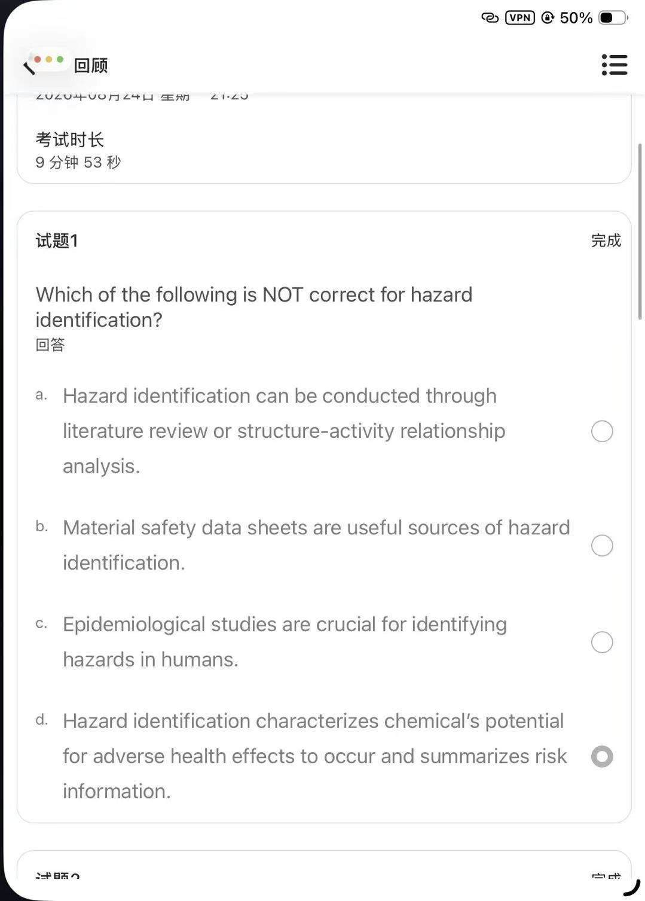
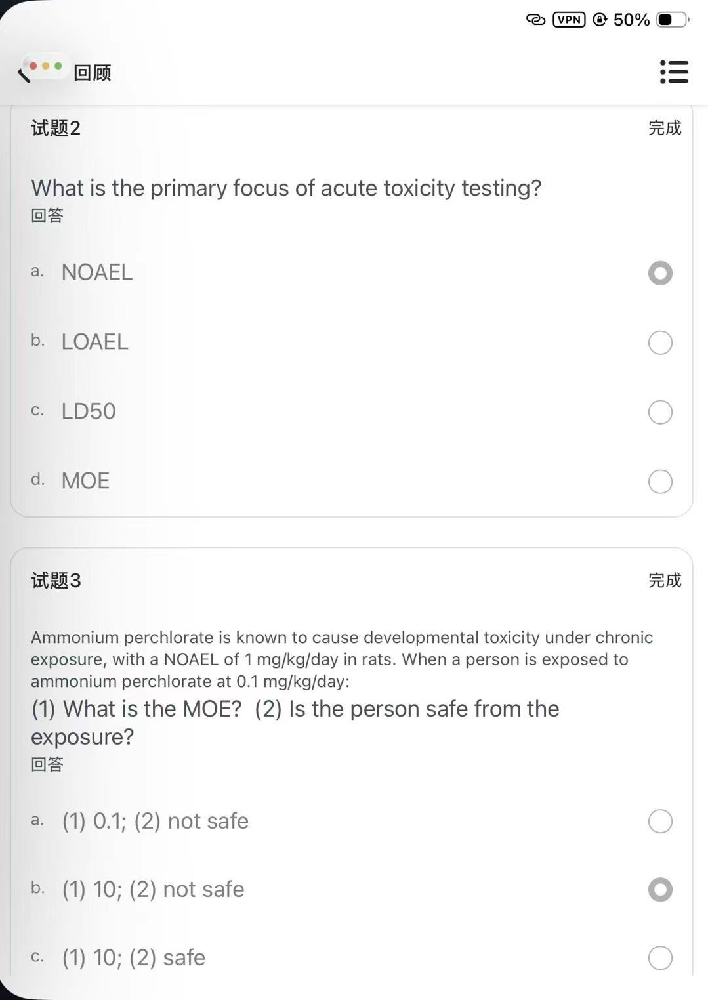
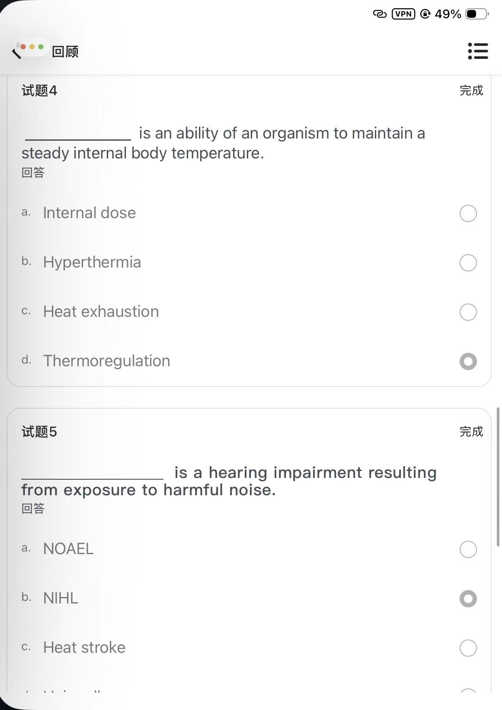
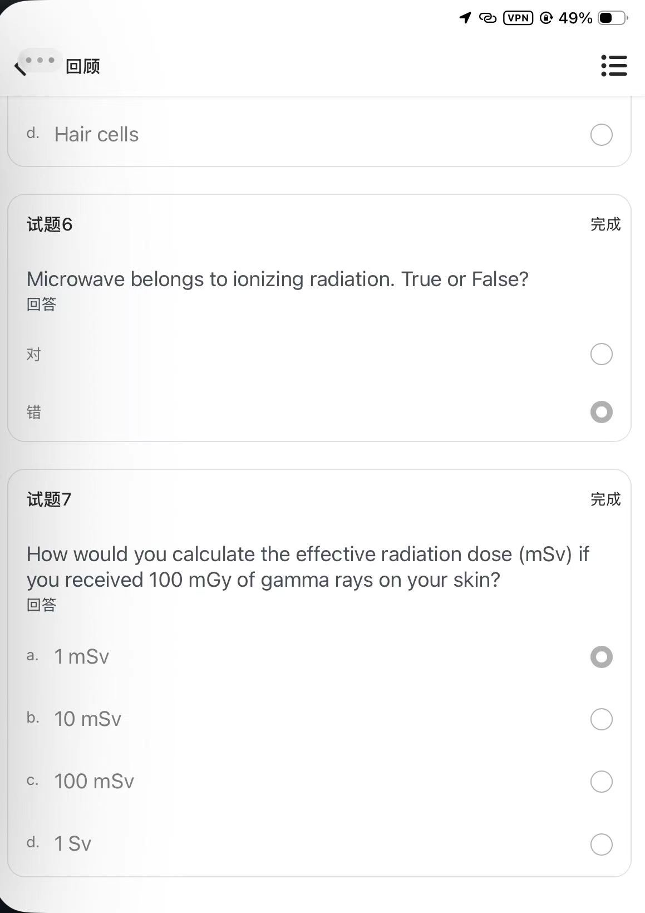

# quiz2 · Quiz-Lecture 2（7 题 · 风险评估与毒物）

> 来源：iPad 端题库 App「回顾」界面截图 4 张，试卷显示**考试时长 9 分 53 秒**。
> 选项后的 **【已选】** 表示截图中该选项被勾选（回顾模式保留的作答痕迹，**不代表判对**）。
> 🆕 **每题末附「课件定位」** —— 双链直达中英对照课件 [Lecture 2](中英对照课件/lecture2.md) 中**对应知识点所在的 Slide**，即该文件里的 `### Slide N` 小节，点击可跳到那一页原版截图。
> **正确选项以粗体标出**，答案依据 Lecture 2 英文原版课件（`原版课件/Lecture 2. Risk assessment and toxic agents.pdf`）逐题核对。
> 医学内容请以课件原文、教材（Casarett & Doull's Toxicology）与任课教师讲解为准复核，不可用于临床决策。
>
> 相关：Lecture 2. Risk assessment and toxic agents.pdf ·
> HSCI7005_Lecture2_风险评估与毒物_中文翻译 · 课程索引 · [quiz1](quiz1.md) · [quiz3](quiz3.md) · [quiz4](quiz4.md) · [quiz5](quiz5.md)

---

## 原图存档

展开 4 张原始截图（1206 × 2622）

---

## 试题1

Which of the following is NOT correct for hazard identification?

- a. Hazard identification can be conducted through literature review or structure-activity relationship analysis.
- b. Material safety data sheets are useful sources of hazard identification.
- c. Epidemiological studies are crucial for identifying hazards in humans.
- **d. Hazard identification characterizes chemical's potential for adverse health effects to occur and summarizes risk information.** 【已选】

> **✅ 答案 d** · 依据 **L2 p11 / p14 / p29**：危害识别只回答「某物质**是否**有危害、会造成**哪类**健康效应」（L2 p11 定义）；其手段为 *literature review · epidemiological studies · in vitro / in vivo testing · structure-activity relationship (SAR) analysis*（p13），来源含 *Material Safety Data Sheets*（p14）—— a、b、c 均正确。而**汇总风险信息属于 Step 4 风险表征（risk characterization）**，不是危害识别（p29），故 d 的后半句错。
> 📌 本题作答正确。
>
> 🔗 **课件定位**：[L2 · Slide 11 · Step 1. Hazard Identification](中英对照课件/lecture2.md) · [L2 · Slide 29 · Step 4. Risk Characterization](中英对照课件/lecture2.md)
> ↳ 前置：[Slide 13 · How to identify hazard](中英对照课件/lecture2.md) · [Slide 14 · Sources of hazard information](中英对照课件/lecture2.md)

## 试题2

What is the primary focus of acute toxicity testing?

- a. NOAEL 【已选】
- b. LOAEL
- **c. LD50**
- d. MOE

> **✅ 答案 c** · 依据 **L2 p17**：*"Acute toxicity testing — To evaluate the adverse effects of short-term exposure… Single or repeated exposure within a 24-hour period and observation for up to 2 weeks after dosing. **The primary focus is to determine LD50.**"*（单次／24 h 内染毒、观察至 14 天，主要终点为 LD50）。NOAEL / LOAEL 来自亚慢性与慢性试验（p18–19）。
> ⚠️ 截图中作答为 **a（NOAEL）**，与课件不符。
>
> 🔗 **课件定位**：[L2 · Slide 17 · Step 2. Toxicity Assessment — Acute toxicity（终点 LD50）](中英对照课件/lecture2.md)
> ↳ 前置：[Slide 16 · Step 2. Toxicity Assessment](中英对照课件/lecture2.md) · [Slide 18 · Step 2. Toxicity Assessment — Subchronic](中英对照课件/lecture2.md) · [Slide 19 · Step 2. Toxicity Assessment — Chronic](中英对照课件/lecture2.md)

## 试题3

Ammonium perchlorate is known to cause developmental toxicity under chronic exposure, with a NOAEL of 1 mg/kg/day in rats. When a person is exposed to ammonium perchlorate at 0.1 mg/kg/day:
(1) What is the MOE? (2) Is the person safe from the exposure?

- a. (1) 0.1; (2) not safe
- **b. (1) 10; (2) not safe** 【已选】
- c. (1) 10; (2) safe
- d. （原始截图在 c 项后截断，d 项文字缺失；因不影响判题，暂不补）

> **✅ 答案 b** · 依据 **L2 p30**：*"The Risk characterization for non-carcinogenic effects is expressed as a **Margin of Exposure (MOE)**. MOE = NOAEL / EXPOSURE level. **A MOE ≥ 100 is generally considered to be safe** for non-carcinogens."*
> 代入：MOE = 1 ÷ 0.1 = **10**；10 < 100 → **不安全**。
> 📌 本题作答正确。
>
> 🔗 **课件定位**：[L2 · Slide 30 · Step 4. Risk Characterization — Non-carcinogens（MOE）](中英对照课件/lecture2.md)
> ↳ 前置：[Slide 31 · Step 4. Risk Characterization — Carcinogens](中英对照课件/lecture2.md) · [Slide 32 · Cancer risk value = Daily exposure × Cancer Slope factor](中英对照课件/lecture2.md)

## 试题4

__________ is an ability of an organism to maintain a steady internal body temperature.

- a. Internal dose
- b. Hyperthermia
- c. Heat exhaustion
- **d. Thermoregulation** 【已选】

> **✅ 答案 d** · 依据 **L2 p62**：*"**Thermoregulation**: ability of an organism to maintain a steady internal body temperature"*（下丘脑为整合中枢）。Hyperthermia / heat exhaustion 是调节失衡的**后果**，不是该能力本身。
> 📌 本题作答正确。
>
> 🔗 **课件定位**：[L2 · Slide 62 · Thermoregulation](中英对照课件/lecture2.md)
> ↳ 前置：[Slide 60 · Heat-related illnesses — Heat exhaustion](中英对照课件/lecture2.md) · [Slide 61 · Heat-related illnesses — Heat stroke](中英对照课件/lecture2.md) · [Slide 63 · Heat injuries](中英对照课件/lecture2.md)

## 试题5

__________ is a hearing impairment resulting from exposure to harmful noise.

- a. NOAEL
- **b. NIHL** 【已选】
- c. Heat stroke
- d. Hair cells

> **✅ 答案 b** · 依据 **L2 p70**：*"Noise-induced hearing loss (**NIHL**) is a hearing impairment resulting from exposure to harmful noise"*（可由一次强脉冲声或长期噪声致；≥85 dB 长期或反复暴露可致听力损失；听毛细胞受损死亡为机制，p70–71）。
> 📌 本题作答正确。
>
> 🔗 **课件定位**：[L2 · Slide 70 · Noise-Induced Hearing Loss (NIHL)](中英对照课件/lecture2.md)
> ↳ 前置：[Slide 71 · Noise-Induced Hearing Loss (NIHL) — Damaged hair cells](中英对照课件/lecture2.md) · [Slide 72 · Hearing loss levels](中英对照课件/lecture2.md)

## 试题6

Microwave belongs to ionizing radiation. True or False?

- 对
- **错** 【已选】

> **✅ 答案：错（False）** · 依据 **L2 p46**：*"**Non-ionizing radiation** (e.g. visible light, radio waves and **microwaves**)"*；*"Ionizing radiation (e.g. **x-rays**, cosmic rays and naturally occurring radioactive materials)"*。微波属**非电离辐射**（p47 电磁波谱亦将微波划在 Non-ionizing 一侧）。
> 📌 本题作答正确。
>
> 🔗 **课件定位**：[L2 · Slide 46 · Types of radiation（ionizing vs non-ionizing）](中英对照课件/lecture2.md)
> ↳ 前置：[Slide 47 · Electromagnetic spectrum](中英对照课件/lecture2.md)

## 试题7

How would you calculate the effective radiation dose (mSv) if you received 100 mGy of gamma rays on your skin?

- **a. 1 mSv** 【已选】
- b. 10 mSv
- c. 100 mSv
- d. 1 Sv

> **✅ 答案 a** · 依据 **L2 p50–51**：`Effective dose (Sv) = Absorbed dose (Gy) × W_R（radiation weighting factor）× W_T（tissue weighting factor）`。
> 计算：100 mGy = 0.1 Gy；γ 射线 **W_R = 1**，皮肤 **W_T = 0.01** → 0.1 × 1 × 0.01 = 0.001 Sv = **1 mSv**。
> 📌 本题作答正确。

---

## 参考答案速查

| 试题 | 1 | 2 | 3 | 4 | 5 | 6 | 7 |
| --- | --- | --- | --- | --- | --- | --- | --- |
| 答案 | **d** | **c** | **b** | **d** | **b** | **错（False）** | **a** |
| 截图作答 | d ✅ | a ❌ | b ✅ | d ✅ | b ✅ | 错 ✅ | a ✅ |
| 课件 Slide | 11 · 29（+13·14） | 17（+16·18·19） | 30（+31·32） | 62（+60·61·63） | 70（+71·72） | 46（+47） | 50 · 51（+48·49·52） |

---

## 知识点汇总（Lecture 2 原课件）

### 1. 风险评估四步骤（L2 p10–p31）
1. **Hazard Identification 危害识别** —— 某物质**是否**有危害、会造成**哪类**健康效应（p11）。
   - 识别手段（p13）：① Literature review ② Epidemiological studies ③ In vitro / in vivo（animal）testing ④ **Structure-activity relationship (SAR) analysis**
   - 危害信息来源（p14）：**Material Safety Data Sheets (MSDS)** 等。
2. **Toxicity Assessment 毒性评估** —— 剂量—反应关系评定。
3. **Exposure Assessment 暴露评估** —— 见下第 2 项。
4. **Risk Characterization 风险表征** —— 整合前三步，**给出人群发生不良效应的概率与允许暴露水平**（p29）。

### 2. 暴露评估的两条路线（L2 p25–27）
- **Personal exposure studies → Biological monitoring**：测体内负荷（血 / 尿 / 组织 / 脂肪中蓄积的量）。
- **Environmental exposure studies → Ambiental monitoring**：测环境介质（air, soil, water, food）中的量。

### 3. 毒性试验的分层与终点（L2 p16–19）
- **Acute toxicity testing 急性毒性**：单次或 24 h 内多次染毒，观察至 14 天；典型动物为大小鼠；**主要终点是 LD50**。
- **Subchronic (repeated-dose) 亚慢性**：反复染毒，得到 NOAEL / LOAEL。
- **Chronic toxicity and carcinogenicity testing 慢性与致癌试验**。

### 4. MOE（Margin of Exposure，L2 p30–31）
- 用于**非致癌物**的风险表征：`MOE = NOAEL ÷ 人群暴露水平`。
- **MOE ≥ 100 一般视为安全**；数值越大越安全。

### 5. 物理性毒物：辐射（L2 p46–52）
- **非电离辐射**：可见光、无线电波、**微波** —— 只能使分子内原子振动/移动，**能量不足以打出电子**。
- **电离辐射**：**X 射线**、宇宙射线、天然放射性物质 —— 能量足以**击出原子中的电子**，损伤组织与 DNA。
- **吸收剂量 Absorbed dose** 用 **Gray (Gy)**；**有效剂量 Effective dose** 用 **Sievert (Sv)**。
- `Effective dose (Sv) = Absorbed dose (Gy) × W_R × W_T`。
  - **W_R 辐射权重因子**：γ / X 射线 = 1
  - **W_T 组织权重因子**：皮肤 = 0.01
- 换算示例：皮肤受 100 mGy γ 射线 → 0.1 Gy × 1 × 0.01 = **1 mSv**。

### 6. 物理性毒物：热（L2 p62 前后）
- **Thermoregulation 体温调节**：机体维持**稳定体内温度**的能力，下丘脑为整合中枢。
- 失衡后果：**Heat exhaustion 热衰竭**、**Heat stroke 热射病**（不及时处理可致命）。

### 7. 物理性毒物：噪声（L2 p69–73）
- **NIHL（Noise-Induced Hearing Loss）噪声性听力损失**：因暴露于有害噪声导致的听力损害。
- 可由**一次性强脉冲声**（如爆炸）或**长期噪声**（如木工房）引起；**长期或反复 ≥85 dB** 即可致听力损失。
- 可为暂时性或永久性；机制为**内耳感觉毛细胞（sensory hair cells）受损并最终死亡**。
- 预防：识别噪声源、减少暴露、远离声源、佩戴护听器、必要时做听力评估。

---

相关：课程索引 · [quiz1](quiz1.md) · [quiz3](quiz3.md) · [quiz4](quiz4.md) · [quiz5](quiz5.md)
>
> 🔗 **课件定位**：[L2 · Slide 50 · Effective dose: Measuring Health Effects](中英对照课件/lecture2.md) · [L2 · Slide 51 · Radiation weighting factor / tissue weighting factor](中英对照课件/lecture2.md)
> ↳ 前置：[Slide 48 · Dose of radiation（Absorbed dose / Effective dose）](中英对照课件/lecture2.md) · [Slide 49 · Absorbed dose: Measuring Radiation Dose](中英对照课件/lecture2.md) · [Slide 52 · Effective radiation dose examples (mSv)](中英对照课件/lecture2.md)

