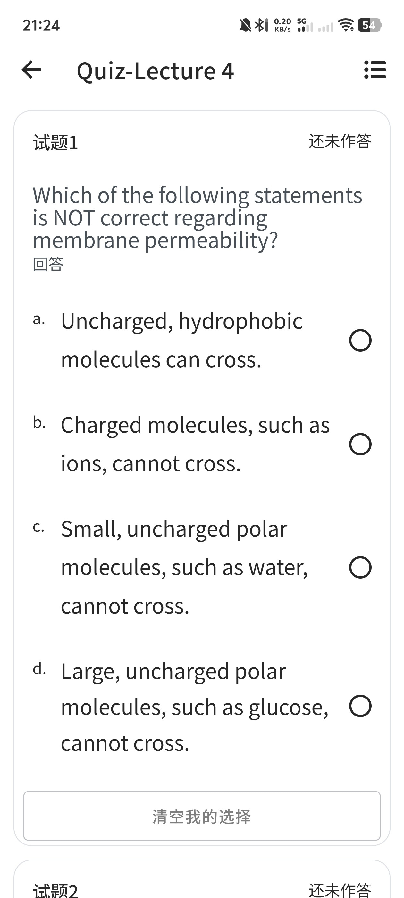
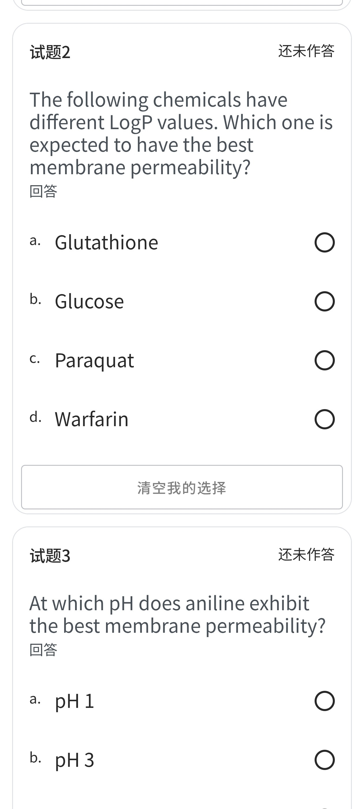
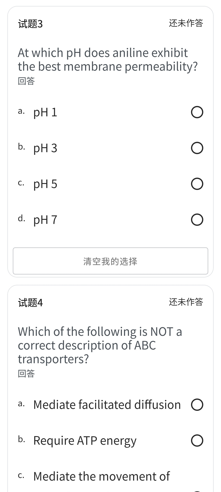
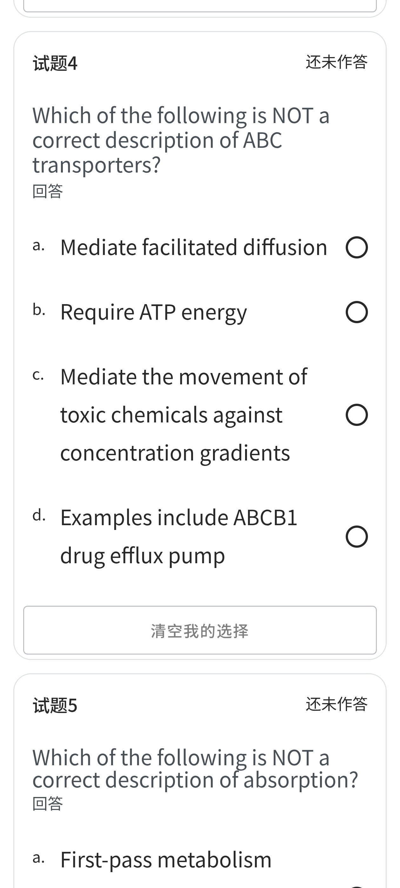
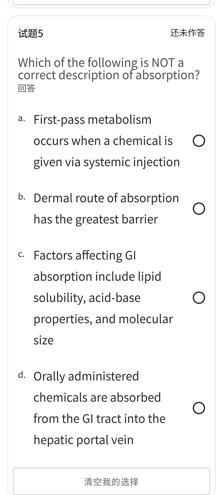
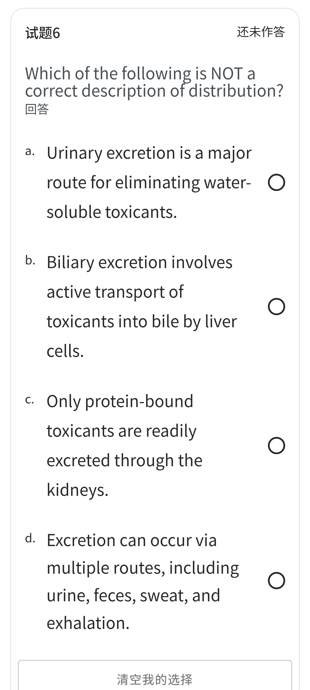
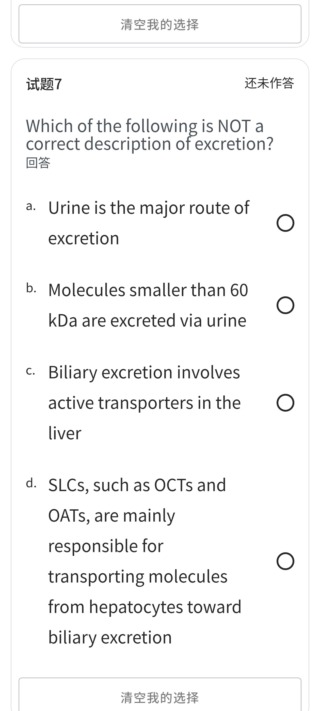

# quiz4 · Quiz-Lecture 4（7 题 · 毒代动力学）

> 来源：手机端 **Quiz-Lecture 4** 界面高清截图 7 张（**全部显示「还未作答」**，故无勾选痕迹）。
> 本页题干与选项已按高清截图**重新校对**（旧版为 146×1920 低分辨率尽力识别稿，若干项已修正，见下方「本次校对修正」）。
> 🆕 **每题末附「课件定位」** —— 双链直达中英对照课件 [Lecture 4](中英对照课件/lecture4.md) 中**对应知识点所在的 Slide**，即该文件里的 `### Slide N` 小节，点击可跳到那一页原版截图。
> **正确选项以粗体标出**，答案依据 Lecture 4 英文原版课件（`原版课件/Lecture 4. Toxicokinetics (pharmacokinetics).pdf`）逐题核对。
> 医学内容请以课件原文、教材（Casarett & Doull's Toxicology）与任课教师讲解为准复核，不可用于临床决策。
>
> 相关：Lecture 4. Toxicokinetics (pharmacokinetics).pdf ·
> HSCI7005_Lecture4_毒代动力学_中文翻译 · 课程索引 · [quiz1](quiz1.md) · [quiz2](quiz2.md) · [quiz3](quiz3.md) · [quiz5](quiz5.md)

---

## 原图存档

展开 7 张高清原始截图

> 📎 旧版 146×1920 低分辨率长截图另存为 `HSCI7005-Quiz-Lecture4-原图-低分辨率.jpg`（仅作历史存档，文字以本页为准）。

---

## 试题1

Which of the following statements is NOT correct regarding membrane permeability?

- a. Uncharged, hydrophobic molecules can cross.
- b. Charged molecules, such as ions, cannot cross.
- **c. Small, uncharged polar molecules, such as water, cannot cross.**
- d. Large, uncharged polar molecules, such as glucose, cannot cross.

> **✅ 答案 c** · 依据 **L4 p6**（*Getting across cell membranes*）：*"Lipid bilayer membranes are semipermeable. • Uncharged, hydrophobic molecules **can** cross. • Charged molecules, such as ions **cannot** cross. • **Small, uncharged polar molecules, such as water can cross** • Large, uncharged polar molecules, such as glucose cannot cross..."* —— c 项把「水可以穿过」写成了「不能」。
>
> 🔗 **课件定位**：[L4 · Slide 6 · Getting across cell membranes](中英对照课件/lecture4.md)
> ↳ 前置：[Slide 7 · Getting across cell membranes（连续屏障）](中英对照课件/lecture4.md)

## 试题2

The following chemicals have different LogP values. Which one is expected to have the best membrane permeability?

- a. Glutathione
- b. Glucose
- c. Paraquat
- **d. Warfarin**

> **✅ 答案 d** · 依据 **L4 p10–11**：*"Lipophilicity of chemicals or toxicants — **LogP is a measure of how hydrophilic or lipophilic a molecule is**"*，课件给出横轴 `Hydrophilic (−) → (+) Lipophilic` 的多种化合物 LogP 图。简单扩散取决于**大小、亲脂性、电荷（电离度）**（p9），**LogP 越大越亲脂 → 跨膜越好**。
> 本题四项中：Glutathione（谷胱甘肽，极亲水）、Glucose（葡萄糖，亲水）、**Paraquat**（百草枯，永久带正电的季铵盐、几乎不跨膜）、**Warfarin**（华法林，亲脂性最强）→ Warfarin 跨膜最好。
>
> 🔗 **课件定位**：[L4 · Slide 10 · Properties that affect simple diffusion — Lipophilicity（LogP）](中英对照课件/lecture4.md) · [L4 · Slide 11 · Properties that affect simple diffusion — 各化合物 LogP 图](中英对照课件/lecture4.md)
> ↳ 前置：[Slide 9 · 1. Simple diffusion](中英对照课件/lecture4.md)

## 试题3

At which pH does aniline exhibit the best membrane permeability?

- a. pH 1
- b. pH 3
- c. pH 5
- **d. pH 7**

> **✅ 答案 d** · 依据 **L4 p12**（*Properties that affect simple diffusion — **Ionization**：Benzoic acid / Aniline*，课件以 pH–电离曲线说明）。简单扩散取决于**电离度**（p9）：**只有非电离（不带电）态才易穿过脂双层**。
> **苯胺（aniline）是弱碱**，其共轭酸 pKa ≈ 4.6。pH 越高（越碱），非电离态占比越大：pH 7 时几乎全部为非电离态（≈99.8%），故 **pH 7 通透性最好**；pH 1–3 时基本被质子化带电，难以跨膜。
>
> 🔗 **课件定位**：[L4 · Slide 12 · Properties that affect simple diffusion — Ionization（苯甲酸 / 苯胺）](中英对照课件/lecture4.md)
> ↳ 前置：[Slide 10 · Properties that affect simple diffusion — Lipophilicity（LogP）](中英对照课件/lecture4.md)

## 试题4

Which of the following is NOT a correct description of ABC transporters?

- **a. Mediate facilitated diffusion**
- b. Require ATP energy
- c. Mediate the movement of toxic chemicals against concentration gradients
- d. Examples include ABCB1 drug efflux pump

> **✅ 答案 a** · 依据 **L4 p15–16**：膜转运分四类 —— 简单扩散、滤过、**易化扩散（facilitated diffusion，代表 = SLC transporters）**、**主动转运（active transport，代表 = ABC transporters）**。
> *"Active transport: Carrier-mediated • Movement **against** electrochemical or concentration gradients • **Requires energy (ATP)** • Example: the **ABC transporters**"*（p15）；*"ABC transporters: ATP-binding cassette transporters • Actively transport foreign substances out of cells: **use ATP** • Example: **ABCB1**（P-glycoprotein 1; Pgp; MDR1）"*（p16）。
> 故 b、c、d 均正确；**易化扩散属 SLC，不属 ABC**。
>
> 🔗 **课件定位**：[L4 · Slide 15 · 3. Transporter-mediated membrane transport / 3.1 Active transport](中英对照课件/lecture4.md) · [L4 · Slide 16 · Active transport — ABC transporters（耗 ATP，逆浓度梯度）](中英对照课件/lecture4.md)
> ↳ 前置：[Slide 17 · ABCB1 (P-glycoprotein / MDR1) functions](中英对照课件/lecture4.md)

## 试题5

Which of the following is NOT a correct description of absorption?

- **a. First-pass metabolism occurs when a chemical is given via systemic injection**
- b. Dermal route of absorption has the greatest barrier
- c. Factors affecting GI absorption include lipid solubility, acid-base properties, and molecular size
- d. Orally administered chemicals are absorbed from the GI tract into the hepatic portal vein

> **✅ 答案 a** · 依据 **L4 p28–29**：*"**First-pass effect (metabolism)**: If a chemical is given **orally and swallowed**, it must be absorbed from the gastrointestinal (GI) tract into the **portal circulation** → metabolism"*（肝首过）。图中亦标出 `IV (intravenous) injection` 与 `Oral administration` 两条并列通路 —— **静脉注射绕过首过效应**，不会发生首过代谢。
> b 依据 **p23**：*"Dermal route … **The greatest barrier to absorption among the three major routes** of exposure"*；c 依据 **p27**：*"Factors that affect GI absorption … **Lipid solubility, acid-base properties; Particle / molecular size**"*；d 依据 p28 的肝门静脉通路。
>
> 🔗 **课件定位**：[L4 · Slide 28 · First-pass effect (metabolism)](中英对照课件/lecture4.md) · [L4 · Slide 29 · First-pass effect](中英对照课件/lecture4.md)
> ↳ 前置：[Slide 23 · Dermal route of absorption](中英对照课件/lecture4.md) · [Slide 27 · Factors that affect GI absorption of toxicants](中英对照课件/lecture4.md)

## 试题6

Which of the following is NOT a correct description of distribution?

- a. Urinary excretion is a major route for eliminating water-soluble toxicants.
- b. Biliary excretion involves active transport of toxicants into bile by liver cells.
- **c. Only protein-bound toxicants are readily excreted through the kidneys.**
- d. Excretion can occur via multiple routes, including urine, feces, sweat, and exhalation.

> **✅ 答案 c** · 依据 **L4 p40**：*"**Toxicity is typically manifested by the amount of unbound toxicants** • Toxicant displaced from plasma proteins → increased **free fraction**, increased distribution to tissues, increased toxicity."* —— 起效与被排泄的是**游离型（unbound / free fraction）**，与蛋白结合的部分被"扣住"、不易被肾排泄，故 c 说反了。
> a、b、d 依据 **p47 / p52–53**：排泄途径 = *"Urine: major route • Feces • Expired air • **All body secretions**"*；胆汁排泄 *"Involves **active transport systems** in the liver"*。
> ⚠️ 本题题干写「distribution」而四个选项全在讲**排泄（excretion）**，课件中 distribution 一节（p36–45）并不含这些内容；按课件判断，答案仍为 **c**。
>
> 🔗 **课件定位**：[L4 · Slide 40 · Toxicant-protein binding](中英对照课件/lecture4.md)
> ↳ 前置：[Slide 47 · Excretion: the way out](中英对照课件/lecture4.md) · [Slide 52 · Fecal excretion](中英对照课件/lecture4.md) · [Slide 53 · Fecal excretion — The biliary route](中英对照课件/lecture4.md)

## 试题7

Which of the following is NOT a correct description of excretion?

- a. Urine is the major route of excretion
- b. Molecules smaller than 60 kDa are excreted via urine
- c. Biliary excretion involves active transporters in the liver
- **d. SLCs, such as OCTs and OATs, are mainly responsible for transporting molecules from hepatocytes toward biliary excretion**

> **✅ 答案 d** · 依据 **L4 p19 vs p53**：**SLC（OATP / OAT / OCT）负责把毒物从血液「摄取」进肝细胞** —— 课件原句 *"OATP, OAT, OCT: xenobiotic **uptake into liver cells** for metabolism"*；而**把毒物从肝细胞排入胆汁**的是**主动转运系统（ABC 类外排泵）**（p53：*"The biliary route … Involves active transport systems in the liver"*）。d 项把方向说反了。
> a 依据 **p47**（*"Urine: major route"*）；b 依据 **p51**（肾单位滤过 *"Up to 60 kDa"*，即小于约 60 kDa 者可经肾小球滤过排出）；c 依据 p53。

---

## 参考答案速查

| 试题 | 1 | 2 | 3 | 4 | 5 | 6 | 7 |
| --- | --- | --- | --- | --- | --- | --- | --- |
| 答案 | **c** | **d** | **d** | **a** | **a** | **c** | **d** |
| 课件 Slide | 6（+7） | 10 · 11（+9） | 12（+10） | 15 · 16（+17） | 28 · 29（+23·27） | 40（+47·52·53） | 19 · 53（+20·47·51） |

---

## 知识点汇总（Lecture 4 原课件）

### 1. 毒代动力学（Toxicokinetics = Pharmacokinetics）
- 回答「**机体对毒物做了什么**」：**A**bsorption 吸收 → **D**istribution 分布 → **M**etabolism 代谢 → **E**xcretion 排泄（ADME）。

### 2. 跨膜转运四类型（L4 p6–p19）
| 类型 | 特点 | 代表 |
| --- | --- | --- |
| **Simple diffusion 简单扩散** | 高浓度→低浓度；取决于**大小、亲脂性、电荷（电离度）** | 多数小分子毒物 |
| **Filtration 滤过** | 高压力→低压力；取决于**分子大小 / 孔道大小** | 肾小球滤过 |
| **Facilitated diffusion 易化扩散** | 载体介导；**不耗 ATP**，利用电化学梯度 | **SLC**（OATP、OAT、OCT） |
| **Active transport 主动转运** | 载体介导；**逆浓度梯度、耗 ATP** | **ABC**（ABCB1 / P-gp / MDR1） |

- **膜通透性规则**（p6）：不带电疏水分子**可过**；离子**不可**；**小分子不带电极性物质（水）可过**；**大分子不带电极性物质（葡萄糖）不可过**。
- **LogP**：亲水 ↔ 亲脂的量化指标，**越大越亲脂 → 简单扩散越好**（p10–11）。
- **电离（p12）**：**只有非电离态易跨膜**。弱酸在酸性 pH 下、弱碱在碱性 pH 下更易跨膜（例：苯甲酸、**苯胺**）。

### 3. ABC 转运体（L4 p16–18）
- ATP-binding cassette transporters；**耗 ATP 把外源物泵出细胞**。
- 代表 **ABCB1（P-glycoprotein 1 / Pgp / MDR1）**。
- 分布于：血脑屏障、血睾屏障、胎盘屏障、小肠（降低口服吸收）、肝（肝胆排泄）、肾（肾排泄）、肿瘤（多药耐药）。
- 突变 → 药物敏感；肿瘤中过表达 → 耐药。

### 4. SLC 转运体（L4 p19）
- Solute Carriers；**利用电化学梯度的易化扩散**。
- 代表：**OATP**（SLCO / SLC21 家族）、**OAT**（SLC22）、**OCT**（SLC22）。
- 主要功能：**把内源物与外源物摄取进肝细胞**以供代谢（**方向是"血 → 肝细胞"**）。

### 5. 吸收（L4 p22–p31）
- 定义：毒物穿过体膜进入血流的过程。
- 三大暴露部位：**皮肤（经皮）、肺（吸入）、GI 道（经口）**。
- **经皮**：三大途径中**屏障最强**（角质化厚膜、血管在真皮）。
- **经肺**：膜极薄（0.4–1.5 µm）、面积大、血流丰富 → 气体分子快速扩散；鼻/咽/气管/支气管为前置防护。
- **经消化道**：取决于**脂溶性、酸碱性质、颗粒/分子大小**。
- **首过效应（First-pass effect）**：口服药经 GI 吸收 → **肝门静脉** → 肝脏代谢，生物利用度降低；**IV / IM 注射绕过首过**。

### 6. 分布（L4 p36–p45）
- 初始速率由**血流**与**扩散速率**决定；最终分布取决于毒物对组织的**亲和力**。
- ↑分布：高血流、大孔毛细血管、特殊转运、组织亲和力。
- ↓分布：特殊屏障、细胞外排、与非靶蛋白结合、进入储存位点。
- **蛋白结合（p40）**：毒性由**游离（unbound）**部分体现；血浆蛋白载体包括 **albumin**、transferrin、ceruloplasmin、α/β-脂蛋白、LDL、HDL。
- **储存位点（p41）**：脂肪（亲脂物）、肝与肾（高结合容量 + 高血流）、骨（氟、铅等"类钙"物质）。
- **屏障（p42–45）**：血脑屏障（BBB，紧密连接 + ABC 外排）、血睾屏障（Sertoli 细胞间紧密连接 + 外排泵）、血胎盘屏障（多层细胞但**无紧密连接**，非真正屏障）。

### 7. 排泄（L4 p46–p53）
- 途径：**尿（主要）**、粪便、呼出气、**所有体分泌物**。
- **肾排泄四步**（p51）：① **Filtration 滤过（上限约 60 kDa）** ② Reabsorption 重吸收（被动扩散）③ **Secretion 分泌**（转运体介导，**OAT / OCT**）④ Excretion。
  - `Excretion = Filtration − Reabsorption + Secretion`
- **粪便排泄**：直接肠道排泄 + **胆汁排泄（the biliary route）** —— 由肝把废物/毒物经胆管排入肠；**靠肝脏的主动转运系统（外排泵）**；课件写 "Usually MW > 350 kDa"（疑为笔误，应为约 350 Da）。

### 8. 与毒代动力学相关的毒性（L4 p54–55）
- **器官特异性毒性**：如某些抗病毒药（替诺福韦 TF）在肾近端小管细胞蓄积 → 肾毒性。
- **药物—营养素 / 药物—药物相互作用**：一个药是转运体底物、另一个是该转运体抑制剂 → 改变毒代动力学 → 改变毒性（如 MDR1 例子）。

---

相关：课程索引 · [quiz1](quiz1.md) · [quiz2](quiz2.md) · [quiz3](quiz3.md) · [quiz5](quiz5.md)
>
> 🔗 **课件定位**：[L4 · Slide 19 · Facilitated diffusion (Passive transport) — Solute Carriers (SLCs)](中英对照课件/lecture4.md) · [L4 · Slide 53 · Fecal excretion — The biliary route](中英对照课件/lecture4.md)
> ↳ 前置：[Slide 20 · SLCs in hepatic uptake of xenobiotics](中英对照课件/lecture4.md) · [Slide 47 · Excretion: the way out](中英对照课件/lecture4.md) · [Slide 51 · Urinary excretion（Nephron 四步）](中英对照课件/lecture4.md)

