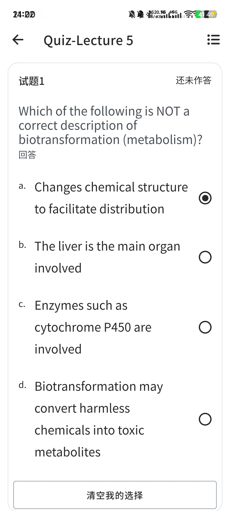
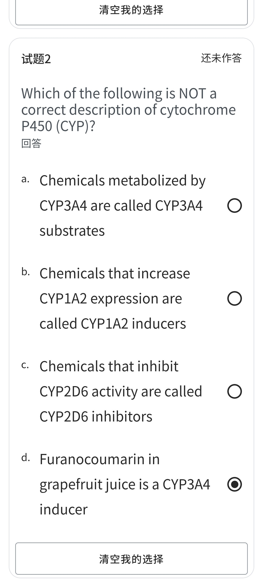
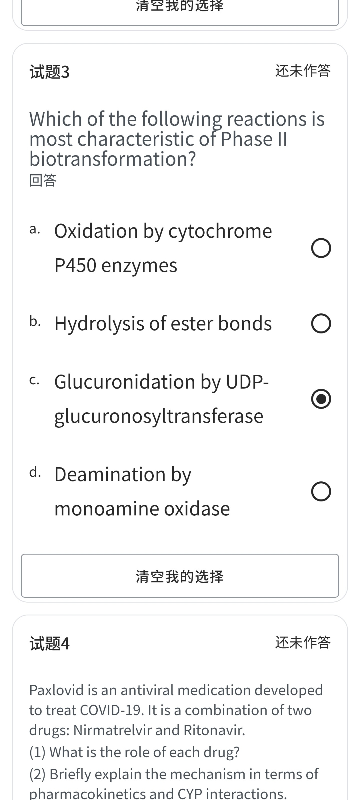
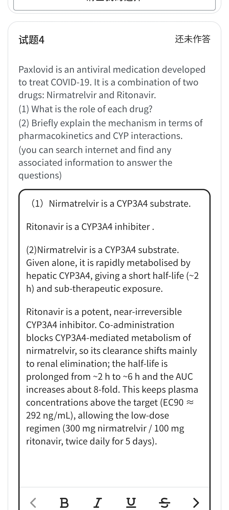
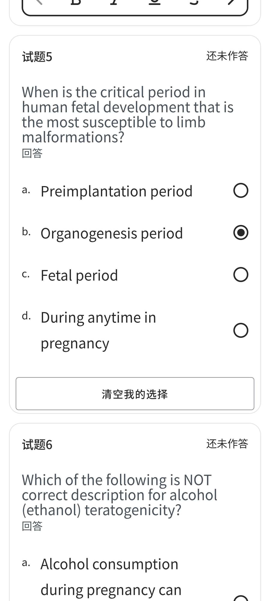
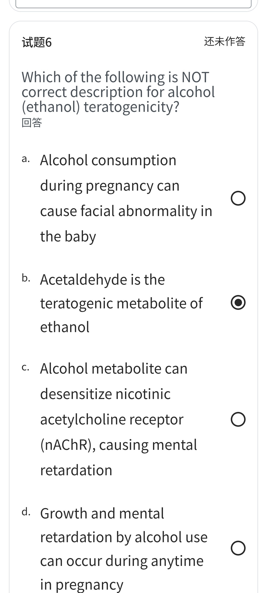
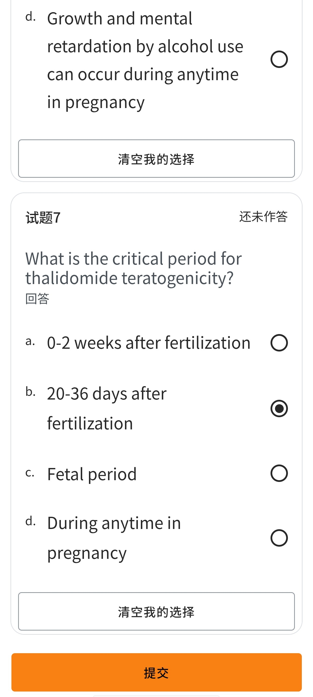

# quiz5 · Quiz-Lecture 5（7 题 · 生物转化与发育毒性）

> 来源：手机端 **Quiz-Lecture 5** 界面高清截图 7 张。本页题干与选项已按高清截图**重新校对**。
> ⚠️ 旧版（141×1920 低分辨率识别稿）**试题4 完全识别错误** —— 原稿误作「利福平 Rifampicin 药物相互作用题」，实为 **Paxlovid（尼马特雷韦 Nirmatrelvir + 利托那韦 Ritonavir）案例分析题**，已改正。
> 🆕 **每题末附「课件定位」** —— 双链直达中英对照课件 [Lecture 5](中英对照课件/lecture5.md) 中**对应知识点所在的 Slide**，即该文件里的 `### Slide N` 小节，点击可跳到那一页原版截图。
> **正确选项以粗体标出**，答案依据 Lecture 5 英文原版课件（`原版课件/Lecture 5. Biotransformation and Developmental toxicity.pdf`）逐题核对。
> 截图右侧实心圆点（◉）为学生**已勾选**的选项，供对照自评。
> 医学内容请以课件原文、教材（Casarett & Doull's Toxicology）与任课教师讲解为准复核，不可用于临床决策。
>
> 相关：Lecture 5. Biotransformation and Developmental toxicity.pdf ·
> lecture5-生物转化与发育毒性 · 课程索引 · [quiz1](quiz1.md) · [quiz2](quiz2.md) · [quiz3](quiz3.md) · [quiz4](quiz4.md)

---

## 原图存档

展开 7 张高清原始截图

> 📎 旧版 141×1920 低分辨率长截图另存为 `HSCI7005-Quiz-Lecture5-原图-低分辨率.jpg`（仅作历史存档，文字以本页为准）。

---

## 试题1

Which of the following is NOT a correct description of biotransformation (metabolism)?

- **a. Changes chemical structure to facilitate distribution** ← 学生已选
- b. The liver is the main organ involved
- c. Enzymes such as cytochrome P450 are involved
- d. Biotransformation may convert harmless chemicals into toxic metabolites

> **✅ 答案 a** · 依据 **L5 p6**：*"Biotransformation … **Goal: change the chemical structure to facilitate excretion**"* —— 生物转化的目的是**改变化学结构以促进排泄（excretion）**，而非促进分布（distribution）。a 项把 excretion 写成了 distribution，故为「不正确描述」。
> b 依据 p6：*"**Main organ involved: Liver**"*；c 依据 p12（Phase I 主要酶含 **CYP450**）与 p13（CYP 约占全部Ⅰ相代谢反应的 **80%**）；d 依据 p7：*"Potentially toxic xenobiotic → Detoxication → Inactive metabolite"* 或 *"Relatively harmless xenobiotic → **Metabolic activation** → Active / Toxic metabolite"*（无害物经代谢活化可变成有毒代谢物）。
>
> 🔗 **课件定位**：[L5 · Slide 6 · Biotransformation — 定义与目的（利于排泄）](中英对照课件/lecture5.md)
> ↳ 前置：[Slide 3 · Biotransformation — 毒物在体内的命运](中英对照课件/lecture5.md) · [Slide 7 · Biotransformation — Detoxication vs Metabolic activation](中英对照课件/lecture5.md) · [Slide 8 · General principles of biotransformation](中英对照课件/lecture5.md)

## 试题2

Which of the following is NOT a correct description of cytochrome P450 (CYP)?

- a. Chemicals metabolized by CYP3A4 are called CYP3A4 substrates
- b. Chemicals that increase CYP1A2 expression are called CYP1A2 inducers
- c. Chemicals that inhibit CYP2D6 activity are called CYP2D6 inhibitors
- **d. Furanocoumarin in grapefruit juice is a CYP3A4 inducer** ← 学生已选

> **✅ 答案 d** · 依据 **L5 p19–p20**：课件在「**drug overdose**（药物过量）」示例中把 **Furanocoumarin（呋喃香豆素，葡萄柚汁成分）** 与 **Ritonavir** 并列为 **CYP3A4 抑制剂**（图中两条支路：`CYP3A4 inactivation (inducer)` 与 `drug overdose (inhibitor)`）；p20：*"Grapefruit juice is known to interact with over 85 medications"*。d 项把**抑制剂**说成**诱导剂**，故为「不正确描述」。
> a、b、c 依据 **p16** 的定义：*"**CYP3A4 substrates**: Chemicals that are metabolized by CYP3A4. **CYP3A4 inducers**: Chemicals that increase the expression of CYP3A4. **CYP3A4 inhibitors**: Chemicals that inhibit the activity of CYP3A4."*
>
> 🔗 **课件定位**：[L5 · Slide 16 · Substrates, inducers and inhibitors of CYP3A4](中英对照课件/lecture5.md) · [L5 · Slide 19 · CYP-related drug-drug interactions — drug overdose 例](中英对照课件/lecture5.md) · [L5 · Slide 20 · Grapefruit juice 与 85+ 药物相互作用](中英对照课件/lecture5.md)
> ↳ 前置：[Slide 13 · Cytochrome P450 (CYPs)](中英对照课件/lecture5.md) · [Slide 14 · Cytochrome P450 members](中英对照课件/lecture5.md) · [Slide 18 · CYP-related drug-drug interactions — drug inactivation 例](中英对照课件/lecture5.md)

## 试题3

Which of the following reactions is most characteristic of Phase II biotransformation?

- a. Oxidation by cytochrome P450 enzymes
- b. Hydrolysis of ester bonds
- **c. Glucuronidation by UDP-glucuronosyltransferase** ← 学生已选
- d. Deamination by monoamine oxidase

> **✅ 答案 c** · 依据 **L5 p24–p25**：*"**Phase II reactions** — Major goal: prepare xenobiotics for **excretion** (urine or bile) • **Conjugation with glucuronic acid (Glucuronidation)** • Sulfation • Glutathione conjugation …"*；p25 明确 *"**UGT = UDP-glucuronosyltransferase**, UDP-GA = UDP-glucuronic acid"*。
> a、b、d 均属**Ⅰ相反应** —— 依据 **p9**：*"**Phase I**: Oxidation（CYP 主导）/ Hydrolysis / Reduction"*；**p12** 列出的Ⅰ相酶包含 **monoamine oxidase (MAO)** 与 **esterases (hydrolase)**。
>
> 🔗 **课件定位**：[L5 · Slide 24 · Phase II reactions](中英对照课件/lecture5.md) · [L5 · Slide 25 · Glucuronidation pathway](中英对照课件/lecture5.md)
> ↳ 前置：[Slide 9 · Four major reactions（Ⅰ相 / Ⅱ相）](中英对照课件/lecture5.md) · [Slide 12 · Principal Phase I enzymes](中英对照课件/lecture5.md) · [Slide 26 · Summary — Ⅰ相 / Ⅱ相总览](中英对照课件/lecture5.md)

## 试题4

**（案例分析题 · 简答）**

> Paxlovid is an antiviral medication developed to treat COVID-19. It is a combination of two drugs: Nirmatrelvir and Ritonavir.
> (1) What is the role of each drug?
> (2) Briefly explain the mechanism in terms of pharmacokinetics and CYP interactions.
> *(you can search internet and find any associated information to answer the questions)*

**学生作答（原图录入）**：

> (1) Nirmatrelvir is a **CYP3A4 substrate**. Ritonavir is a **CYP3A4 inhibitor**.
>
> (2) Nirmatrelvir is a CYP3A4 substrate. Given alone, it is **rapidly metabolised by hepatic CYP3A4**, giving a short half-life (~2 h) and sub-therapeutic exposure.
> Ritonavir is a **potent, near-irreversible CYP3A4 inhibitor**. Co-administration blocks CYP3A4-mediated metabolism of nirmatrelvir, so its clearance shifts mainly to renal elimination; the half-life is prolonged from ~2 h to ~6 h and the AUC increases about **8-fold**. This keeps plasma concentrations above the target (EC90 ≈ 292 ng/mL), allowing the low-dose regimen (**300 mg nirmatrelvir / 100 mg ritonavir, twice daily for 5 days**).

> **✅ 参考答案要点** · 依据 **L5 p17–p19**（CYP 相关药物相互作用原理）：
> 1. **Nirmatrelvir = CYP3A4 底物（substrate）**，本身抗病毒活性成分；**Ritonavir = CYP3A4 抑制剂（inhibitor）**，本身无抗 SARS-CoV-2 活性，仅作**药代动力学增效剂（booster）**。
> 2. 机制对应课件 **p17** 的「**drug overdose**」模型：`Drug B (substrate) + Drug A (inhibitor) → CYP3A 被抑制 → 底物代谢受阻、血药浓度升高`。Ritonavir 抑制 CYP3A4 → **nirmatrelvir 首过/肝代谢被阻断 → 半衰期延长、AUC 提高**，从而实现「少剂量即达有效暴露」。
> 3. 与 p17 的「drug inactivation（诱导剂 → 底物失效）」形成对照：诱导剂使底物**清除加快、疗效下降**；抑制剂使底物**蓄积、可致过量**。
> ⚠️ 学生的作答与课件原理一致，属可接受答案；具体数值（半衰期、AUC、EC90）来自网络资料，非课件内容，**以任课教师评分标准为准**。
>
> 🔗 **课件定位**：[L5 · Slide 17 · CYP-related drug-drug interactions](中英对照课件/lecture5.md) · [L5 · Slide 19 · CYP-related drug-drug interactions — drug overdose 例](中英对照课件/lecture5.md)
> ↳ 前置：[Slide 16 · Substrates, inducers and inhibitors of CYP3A4](中英对照课件/lecture5.md) · [Slide 18 · CYP-related drug-drug interactions — drug inactivation 例](中英对照课件/lecture5.md)

## 试题5

When is the critical period in human fetal development that is the most susceptible to limb malformations?

- a. Preimplantation period
- **b. Organogenesis period** ← 学生已选
- c. Fetal period
- d. During anytime in pregnancy

> **✅ 答案 b** · 依据 **L5 p39**：*"**Embryonic (organogenesis) Period (3–8 weeks)** — The stage of organ formation … Toxic agent exposure during organogenesis period: **Maximum susceptibility to malformations (heart, limb, facial features, …)**; Peak susceptibility coincides with the time of key developmental events."* —— 课件原文直接列出 **limb（肢体）**，故答案为器官形成期。
> 对照 **p36** 三阶段：Preimplantation (germinal) **0–2 周**；Embryonic (organogenesis) **3–8 周**；Fetal period **9 周至出生**。p38：着床前期为 *"**All-or-nothing**"*（全或无）；p40：胎儿期主要影响**生长与功能成熟**（低出生体重、CNS/生殖/肺/免疫系统），不造成典型结构畸形。
>
> 🔗 **课件定位**：[L5 · Slide 36 · Stages of fetal development](中英对照课件/lecture5.md) · [L5 · Slide 39 · Critical periods in human development — Embryonic / organogenesis (3–8 wk)](中英对照课件/lecture5.md)
> ↳ 前置：[Slide 37 · Critical period in developmental toxicity](中英对照课件/lecture5.md) · [Slide 38 · Critical periods in human development — Preimplantation (0–2 wk)](中英对照课件/lecture5.md) · [Slide 40 · Critical periods in human development — Fetal period (9 wk–birth)](中英对照课件/lecture5.md)

## 试题6

Which of the following is NOT correct description for alcohol (ethanol) teratogenicity?

- a. Alcohol consumption during pregnancy can cause facial abnormality in the baby
- b. Acetaldehyde is the teratogenic metabolite of ethanol ← 学生已选
- **c. Alcohol metabolite can desensitize nicotinic acetylcholine receptor (nAChR), causing mental retardation**
- d. Growth and mental retardation by alcohol use can occur during anytime in pregnancy

> **✅ 答案 c** · 依据 **L5 p48**：*"**Nicotine** activates and subsequently desensitizes nicotinic acetylcholine receptor (**nAChR**), hence acting as a nervous system teratogen."* —— 使 **nAChR 脱敏**的是**烟草中的尼古丁**，不是酒精代谢物；c 项张冠李戴，故为「不正确描述」。
> a 依据 **p44–p45**：FAS 表现为 *"**Facial abnormalities**, Growth retardation, Mental retardation"*，且 *"Exposure during first 3 months – structural defects e.g. **facial changes**"*；b 依据 **p46**：*"**Acetaldehyde is the teratogenic metabolite of ethanol**"*（属课件明确支持的**正确**表述，故不是答案）；d 依据 **p45**：*"There is **no critical period** known for alcohol use during pregnancy … **Growth and CNS defects by alcohol use can occur during anytime in pregnancy**"*。
> ⚠️ **学生勾选 b 为误选**（b 是正确表述），正确答案为 **c**。
>
> 🔗 **课件定位**：[L5 · Slide 46 · Teratogenic effects of Ethanol — 机制（acetaldehyde）](中英对照课件/lecture5.md) · [L5 · Slide 48 · Teratogenic effects of Tobacco smoke](中英对照课件/lecture5.md)
> ↳ 前置：[Slide 44 · 1. Alcohol (Ethanol)](中英对照课件/lecture5.md) · [Slide 45 · Teratogenic effects of Ethanol](中英对照课件/lecture5.md)

## 试题7

What is the critical period for thalidomide teratogenicity?

- a. 0–2 weeks after fertilization
- **b. 20–36 days after fertilization** ← 学生已选
- c. Fetal period
- d. During anytime in pregnancy

> **✅ 答案 b** · 依据 **L5 p52**：*"Thalidomide teratogenicity was later known to have a **short critical period: between days 20–36 after fertilization**."*
> 补充（p49–p51、p55）：沙利度胺由德国 Grünenthal 公司开发，1956 年在德国获批用于**止吐 / 助眠 / 妊娠晨吐**；1960–1961 年出现新生儿**罕见肢体畸形**激增，1962 年撤市（46 国约 1 万名患儿），被称为「史上最大人为医学灾难」；其致畸靶点后来被鉴定为 **Cereblon（CRBN）**。

---

## 参考答案速查

| 试题 | 1 | 2 | 3 | 4 | 5 | 6 | 7 |
| --- | --- | --- | --- | --- | --- | --- | --- |
| 答案 | **a** | **d** | **c** | 简答（要点见上） | **b** | **c** | **b** |
| 学生所选 | a ✅ | d ✅ | c ✅ | — | b ✅ | **b ❌** | b ✅ |
| 课件 Slide | 6（+3·7·8） | 16 · 19 · 20（+13·14·18） | 24 · 25（+9·12·26） | 17 · 19（+16·18） | 36 · 39（+37·38·40） | 46 · 48（+44·45） | 52（+49·50·51） |

---

## 知识点汇总（Lecture 5 原课件）

### 1. 生物转化总论（L5 p3–p8）
- 毒物在体内的命运：**A**bsorption → **D**istribution → **M**etabolism (Biotransformation) → **E**xcretion。
- 定义（p6）：体内发生的**化学结构改变**；**目的 = 提高水溶性以促进排泄**；**主要器官 = 肝脏**；部分外源物可**原形排出**。
- 代谢产物活性可与母体不同（p7）：**Detoxication 解毒**（有毒 → 无毒/低毒）或 **Metabolic activation 代谢活化**（无害 → 有毒）。
- 一般原则（p8）：把**亲脂（脂溶性）**化学物转成**亲水（水溶性）**；由少数**底物特异性宽泛**的酶完成；可来自**肠道菌群**；多数**可被诱导**；存在**种间与个体差异**。

### 2. Ⅰ相 / Ⅱ相反应（L5 p9、p24–p26）
| 相 | 反应类型 | 结果 | 代表酶 |
| --- | --- | --- | --- |
| **Ⅰ相 Phase I** | **氧化 / 水解 / 还原** | 提高亲水性；引入活性 O 或 N 原子，为Ⅱ相做准备 | **CYP450**（约 80%）、FMO、MAO、脱氢酶、酯酶、酰胺酶、还原酶 |
| **Ⅱ相 Phase II** | **结合反应（conjugation）** | 大幅提高水溶性 → 便于经**尿或胆汁**排泄 | UGT、硫酸转移酶、GST、乙酰化、甲基化酶 |

- Ⅱ相主要类型（p24）：**葡萄糖醛酸化（glucuronidation）**、硫酸化（sulfation）、谷胱甘肽结合、其他结合反应。
- **葡萄糖醛酸化通路**（p25）：**UGT = UDP-glucuronosyltransferase**，**UDP-GA = UDP-glucuronic acid**。

### 3. 细胞色素 P450（CYP450）（L5 p12–p19）
- 存在于所有物种；人类 **59 个 CYP**、至少 **14 个家族**（约 3/4 代谢内源物、1/4 代谢外源物）。
- 承担约 **80%** 的Ⅰ相代谢反应；**血红素蛋白（hemoprotein）**，活性中心含铁；多数亚型**可诱导**；位于主要器官/组织的**滑面 ER（微粒体）**；**肝与小肠中含量最高**。
- 命名基于序列同源性（p14）：**CYP3A4 / 2D6 / 2C9 / 2C19 / 1A2** 等；**遗传多态性**导致个体差异。
- 反应类型（p15）：**单加氧反应（monooxygenation）** —— 底物（R-H）与辅因子（NADPH）被氧化，氧被还原为水。
- **底物 / 诱导剂 / 抑制剂定义**（p16）：
  - **底物（substrate）** = 被某 CYP 代谢的化学物；
  - **诱导剂（inducer）** = 提高该 CYP **表达量**的化学物；
  - **抑制剂（inhibitor）** = 抑制该 CYP **活性**的化学物。

### 4. CYP 相关药物相互作用（L5 p17–p20）★ 试题4 考点
| 情形 | 图示逻辑 | 临床后果 | 课件例子 |
| --- | --- | --- | --- |
| **药物失效（inactivation）** | **诱导剂** B 加快 CYP3A 代谢 → 底物 A 清除加快 | 疗效下降 | **卡马西平 Carbamazepine** 加速代谢 **华法林**、**炔雌醇（口服避孕药）** |
| **药物过量（overdose）** | **抑制剂** B 阻断 CYP3A → 底物 A 蓄积 | 毒性/过量 | **利托那韦 Ritonavir**、**呋喃香豆素 Furanocoumarin（葡萄柚汁）** 抑制 CYP3A4 → **华法林**蓄积 |

- 葡萄柚汁已知与 **85 种以上**药物相互作用（p20）。
- **Paxlovid 实例**（试题4）：Nirmatrelvir 为 CYP3A4 **底物**，Ritonavir 为 CYP3A4 **抑制剂**，后者充当「增效剂」提高前者暴露 —— 正是上表「overdose」模型的**治疗性应用**（主动利用药物相互作用提升疗效）。

### 5. 酒精代谢酶（L5 p21–p23）
- **ADH（alcohol dehydrogenase）**：含锌胞质酶，肝中含量最高，有遗传多态性。
- **ALDH（aldehyde dehydrogenase）**：把醛氧化为羧酸；**ALDH1 胞质型、ALDH2 线粒体型**；**ALDH2 参与体内酒精清除**；有遗传多态性。
- **Asian flush syndrome（亚洲红脸症）**：ALDH2 缺陷 → **乙醛蓄积** → 面颈潮红、心率增快、头痛、恶心；在**中、韩、日人群高发（40–50%）**。

### 6. 发育毒性总论（L5 p29–p34）
- **发育毒性**：化学物 / 病原体 / 其他毒物导致的**发育畸形**；**致畸物（teratogen）** = 能引起出生缺陷的因子。
- 规模（p30）：人类**流产**中异常占比 **25–50%**；已知妊娠者流产率约 **10–20%**；每年约 **800 万**严重出生缺陷儿（全球出生数的 **6%**）。
- 已知病因（p31–p32）：遗传/染色体问题、孕期感染（CMV、HSV、风疹、水痘、寨卡…）、孕期用药/化学物/辐射、母体创伤与代谢失衡（**酒精、糖尿病、叶酸缺乏、高热**）、环境污染物。
- **四种表现**（p33）：死亡、**结构畸形**、**生长迟滞**、**功能损害**。
- **两大决定因素**（p34–p35）：**剂量（dose）** 与 **暴露时机（timing）**；致畸效应随剂量增加而频率与程度上升。

### 7. 发育关键期（L5 p36–p40）★ 试题5 考点
| 阶段 | 时间 | 特点 | 暴露后果 |
| --- | --- | --- | --- |
| **Preimplantation (germinal)** | **0–2 周** | 受精至着床 | **全或无（all-or-nothing）**，有例外 |
| **Embryonic (organogenesis)** | **3–8 周** | 器官形成；三胚层分化 | **畸形易感性最高（心、肢体、面部）** |
| **Fetal period** | **9 周–出生** | 组织分化、生长、生理成熟 | 影响**生长与功能成熟**：低出生体重、CNS/生殖/肺/免疫系统 |

- **关键期定义**（p37）：发育过程中**特定的时间窗**，此时暴露可造成**不可逆损害**（出生缺陷、发育障碍、功能损害）。

### 8. 三大发育毒物（L5 p43–p57）★ 试题6、7 考点
**① 酒精（Ethanol）**（p44–p46）
- 公认致畸物（Jones & Smith, 1973）；孕期饮酒全球患病率 **9.8%**；每年约 **119,000** 例 FAS 患儿。
- **FAS 三联**：**面部畸形** + **生长迟滞** + **智力障碍**（另有大/小异常）。
- 乙醇及其代谢物可穿过**胎盘屏障与血脑屏障**；**酒精无明确关键期** —— 前 3 个月致结构缺陷（面部改变），**生长与 CNS 缺陷可发生于孕期任何时间**。
- 致畸机制（尚未完全阐明）：**乙醛（acetaldehyde）是乙醇的致畸代谢物**，可诱导氧化应激、干扰细胞生长与分化，并抑制**视黄酸（retinoic acid）**信号。

**② 烟草烟雾（Tobacco smoke）**（p47–p48）
- 美国约 **25%** 孕妇持续吸烟；后果：自发流产、围产期死亡、低出生体重、神经管缺陷、先心病、**SIDS**、学习/行为/注意力障碍、肥胖与糖尿病风险升高；**二手烟**效应类似。
- 烟雾含 **>7,000** 种化学物，>100 种有毒、**70 种已知致癌物**。
- **CO**：与血红蛋白亲和力远高于氧，形成**碳氧血红蛋白（COHb）** → 供氧受损 → 胎儿发育损伤。
- **尼古丁**：激活后**脱敏 nAChR** → **神经系统致畸物**。

**③ 沙利度胺（Thalidomide）**（p49–p57）
- 德国 Grünenthal 开发；1956 德国获批、1958 英/加获批，用于**焦虑、失眠、妊娠晨吐**。
- 1960 德国出现罕见**肢体畸形**激增 → 1961 确认为致畸元凶 → **1962 撤市**（46 国约 **10,000** 名患儿）；美国因 FDA 审查员 **Frances Oldham Kelsey** 把关而**未上市**。
- 致畸特征：可穿胎盘屏障；**约 40% 婴儿围产期死亡**；存活者有**肢体、眼、泌尿道、心脏**问题。
- **关键期极短：受精后 20–36 天**（p52）；灾难根源 = 上市前**仅在非孕动物**做试验；此后**致畸试验成为药物临床前开发的强制环节**。
- 靶点（p55–p57）：**Cereblon（CRBN）** —— 沙利度胺使其 E3 泛素连接酶复合物降解 **neosubstrate**（Ikaros、Aiolos、SALL4、p63 等），从而兼具**抗癌 / 免疫刺激**与**致畸（SALL4 相关）**双重活性；2006 年其类似物获批治疗血液肿瘤，2010 年确定靶点。

---

相关：课程索引 · [quiz1](quiz1.md) · [quiz2](quiz2.md) · [quiz3](quiz3.md) · [quiz4](quiz4.md)
>
> 🔗 **课件定位**：[L5 · Slide 52 · Causes of the disaster（关键期 20–36 天）](中英对照课件/lecture5.md)
> ↳ 前置：[Slide 49 · 3. Thalidomide](中英对照课件/lecture5.md) · [Slide 50 · Developmental toxicity of Thalidomide](中英对照课件/lecture5.md) · [Slide 51 · Developmental toxicity of Thalidomide — 致畸表现](中英对照课件/lecture5.md)

