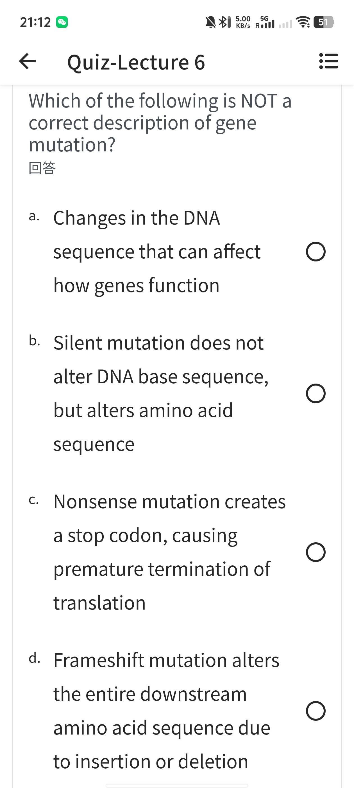
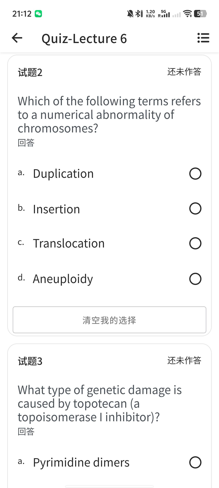
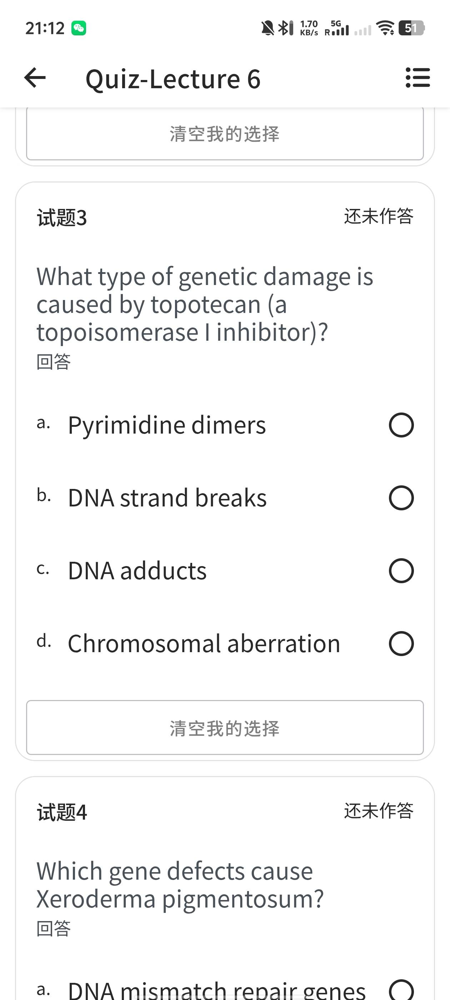
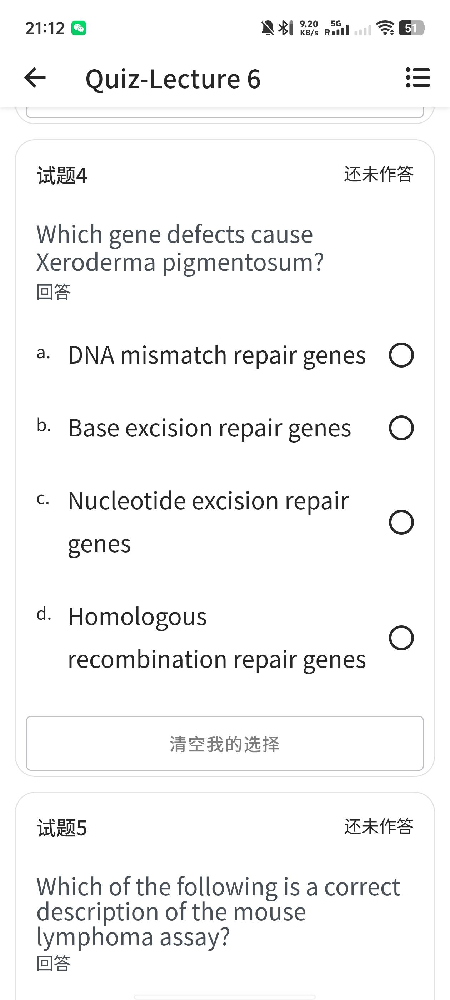
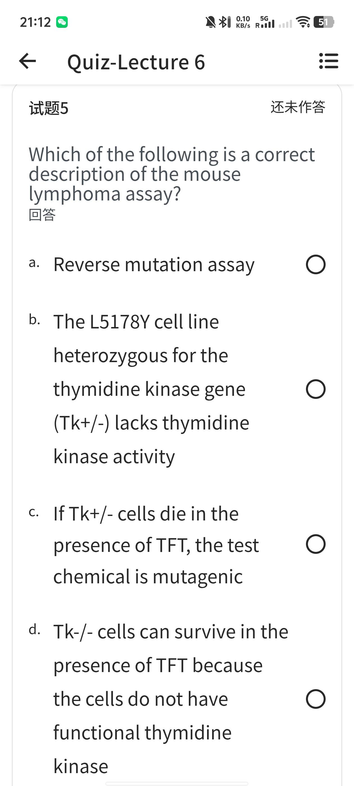
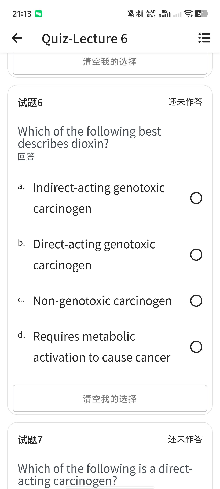
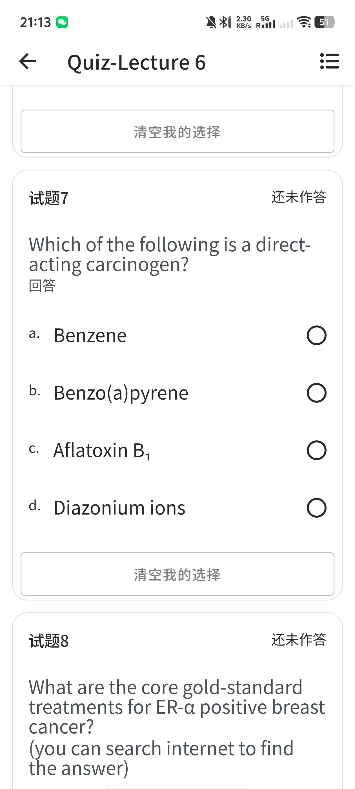
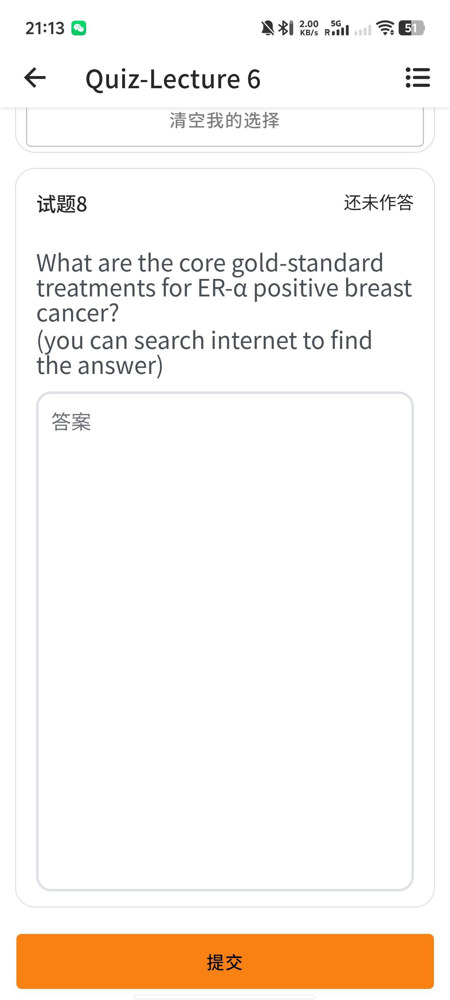

# quiz6 · Quiz-Lecture 6（8 题 · 基因毒性与化学致癌）

> 来源：手机端学习平台 **Quiz-Lecture 6** 界面截图 8 张，前 7 题均为选择、均显示**还未作答**（无勾选痕迹），第 8 题为**简答题**。
> **正确选项以粗体标出**，答案依据 Lecture 6 英文原版课件（`Lecture 6. Genotoxicity and chemical carcinogenesis.pdf`，67 页）逐题核对。
> 🆕 **每题末附「课件定位」** —— 双链直达 [中英对照课件 lecture6](中英对照课件/lecture6.md) 的对应 `### Slide N`（该文件第 N 页截图即 PDF 第 N 页，一一对应）。
> ✅ **Lecture 6 的「中英对照课件」已补齐**（`中英对照课件/lecture6.md`：67 页逐页截图 + 13 处《本科毒理学笔记》对照）。本题的「课件定位」已全部换成 `[lecture6#Slide N](中英对照课件/lecture6.md)`；对应 Slide 下方也有 `📝 **相关习题**` 回链，可双向跳转。
> ✅ 试题1–8 已**全部录入**（含 1 道简答题）。
> 医学内容请以课件原文、教材（Casarett & Doull's Toxicology）与任课教师讲解为准复核，不可用于临床决策。
>
> 相关：Lecture 6. Genotoxicity and chemical carcinogenesis.pdf · [lecture6](中英对照课件/lecture6.md) · 课程索引 · [quiz1](quiz1.md) · [quiz2](quiz2.md) · [quiz3](quiz3.md) · [quiz4](quiz4.md) · [quiz5](quiz5.md)

---

## 原图存档

展开 8 张原始截图

---

## 试题1

Which of the following is NOT a correct description of gene mutation?

- a. Changes in the DNA sequence that can affect how genes function
- **b. Silent mutation does not alter DNA base sequence, but alters amino acid sequence**
- c. Nonsense mutation creates a stop codon, causing premature termination of translation
- d. Frameshift mutation alters the entire downstream amino acid sequence due to insertion or deletion

> **✅ 答案 b** · 依据 **L6 p8**：课件原文 *"Silent Mutation — **Base change does not alter the amino acid**"*，给的例子正是 **DNA: GAA → GAG，两者都编码谷氨酸**。即沉默突变**碱基序列变了、氨基酸不变**；b 项把两点**全写反**（说不改碱基、反而改氨基酸），故为「不正确描述」。
> a 依据 **p7**：*"Gene mutations — Changes in the DNA sequence that can affect how genes function"*；c 依据 **p8**：*"**Nonsense Mutation** — Base change **creates a stop codon**, ending translation prematurely（TAC → TAG，酪氨酸 → 终止密码子）"*；d 依据 **p9**（Frameshift mutations）与 **p7**（*"Small additions or deletions causing frameshift"*）—— 插入/缺失使**下游全部**密码子读框移位。
>
> 🔗 **课件定位**：[L6 · Slide 7 · Types of genetic damage — Gene mutations](中英对照课件/lecture6.md) · [L6 · Slide 8 · Point mutations：Silent / Missense / Nonsense](中英对照课件/lecture6.md) · [L6 · Slide 9 · Frameshift mutations](中英对照课件/lecture6.md)

## 试题2

Which of the following terms refers to a numerical abnormality of chromosomes?

- a. Duplication
- b. Insertion
- c. Translocation
- **d. Aneuploidy**

> **✅ 答案 d** · 依据 **L6 p10**：染色体畸变分两类 —— **结构异常**：Deletion / Inversion / **Duplication** / **Insertion** / **Translocations**；**数目异常**：*"**Aneuploidy**: Gain or loss of chromosome(s)"*。a、b、c 全在结构异常列表里，只有 d 属数目异常。
> 补充 **p12**：数目异常的例子 —— **Patau syndrome（trisomy 13，13 三体）**。
>
> 🔗 **课件定位**：[L6 · Slide 10 · Chromosomal aberrations：结构 vs 数目](中英对照课件/lecture6.md) · [L6 · Slide 12 · Numerical abnormalities（Patau syndrome / trisomy 13）](中英对照课件/lecture6.md)
> ↳ 前置：[L6 · Slide 11 · Structural abnormalities 图示](中英对照课件/lecture6.md)

## 试题3

What type of genetic damage is caused by topotecan (a topoisomerase I inhibitor)?

- a. Pyrimidine dimers
- **b. DNA strand breaks**
- c. DNA adducts
- d. Chromosomal aberration

> **✅ 答案 b** · 依据 **L6 p17**：*"Chemicals **inducing DNA strand breaks** (Example: **Topoisomerase inhibitors**)"* —— 拓扑异构酶抑制剂直接归入「导致 DNA 链断裂」一类。
> 佐证 **p13**：单链断裂（SSB）成因里明确列 *"Topoisomerase inhibitors (e.g., **camptothecin**)"* —— **topotecan 正是喜树碱（camptothecin）的半合成衍生物**，抑制拓扑异构酶Ⅰ → DNA 复制时断裂。a（嘧啶二聚体）是 **UV** 的产物（p18）；c（DNA 加合物）来自**烷化剂/亲电基团共价结合**（p15–16）；d 是染色体层面的畸变（p10）。
>
> 🔗 **课件定位**：[L6 · Slide 17 · Genotoxic agents — Chemicals inducing DNA strand breaks（Topoisomerase inhibitors）](中英对照课件/lecture6.md)
> ↳ 前置：[L6 · Slide 13 · DNA strand breaks — SSB](中英对照课件/lecture6.md) · [L6 · Slide 14 · DNA strand breaks — DSB](中英对照课件/lecture6.md)

## 试题4

Which gene defects cause Xeroderma pigmentosum?

- a. DNA mismatch repair genes
- b. Base excision repair genes
- **c. Nucleotide excision repair genes**
- d. Homologous recombination repair genes

> **✅ 答案 c** · 依据 **L6 p20**：*"**Xeroderma pigmentosum (XP)**: a genetic disorder with **decreased ability to repair DNA damage caused by UV light**. **Due to mutations in genes involved in NER**（核苷酸切除修复）"*。
> 链条：**p18** UV-B → 环丁烷**嘧啶二聚体（CPD）** → **p19** 由 **NER（nucleotide excision repair）** 修复 → **p20** NER 基因突变 → XP：轻度日晒即严重晒伤、皮肤干燥色素沉着、皮肤癌及其他癌症风险显著升高。
>
> 🔗 **课件定位**：[L6 · Slide 20 · Xeroderma pigmentosum — 缺 NER 系统](中英对照课件/lecture6.md)
> ↳ 前置：[L6 · Slide 19 · Repair of pyrimidine dimer — NER](中英对照课件/lecture6.md) · [L6 · Slide 18 · UV-B → cyclobutane pyrimidine dimers (CPD)](中英对照课件/lecture6.md)

## 试题5

Which of the following is a correct description of the mouse lymphoma assay?

- a. Reverse mutation assay
- b. The L5178Y cell line heterozygous for the thymidine kinase gene (Tk+/-) lacks thymidine kinase activity
- c. If Tk+/- cells die in the presence of TFT, the test chemical is mutagenic
- **d. Tk-/- cells can survive in the presence of TFT because the cells do not have functional thymidine kinase**

> **✅ 答案 d** · 依据 **L6 p28** 的判读图：L5178Y（**Tk+/-**）经受试物处理后 ——
> • **发生突变（Tk-/-）**：无功能性胸苷激酶 → **不能磷酸化 TFT** → **在 TFT 中存活**，课件标注 *"**This chemical is mutagenic**"*；
> • **未突变（仍为 Tk+/-）**：保留 TK 活性 → 磷酸化 TFT → **TFT 单磷酸化物具细胞毒性 → 细胞死亡**（"Cells died"）。
> d 与课件完全一致。其余三项的问题：
> **a** 依据 **p26**：MLA 属 ***forward* mutation assay**（野生型基因 → 功能丧失），**reverse** 是 Ames test 的类型；
> **b** 依据 **p27**：*"L5178Y … **heterozygous** for the thymidine kinase gene (**Tk+/-**)"* —— 杂合子**保留一个野生型 Tk1 等位基因 → 仍有 TK 活性**（否则本底无法被 TFT 杀死），说「lacks activity」错；
> **c** 说反了方向 —— Tk+/- 在 TFT 中死亡是**本底行为**（与受试物是否致突变无关），判读指标是**是否长出存活克隆**。
>
> 🔗 **课件定位**：[L6 · Slide 26 · Forward vs reverse mutation assays](中英对照课件/lecture6.md) · [L6 · Slide 27 · Mouse Lymphoma Assay — L5178Y（Tk+/-）](中英对照课件/lecture6.md) · [L6 · Slide 28 · MLA 判读 — TFT 选择压](中英对照课件/lecture6.md)

---

## 试题6

Which of the following best describes dioxin?

- a. Indirect-acting genotoxic carcinogen
- b. Direct-acting genotoxic carcinogen
- **c. Non-genotoxic carcinogen**
- d. Requires metabolic activation to cause cancer

> **✅ 答案 c** · 依据 **L6 p42**：*"**Non-genotoxic chemicals** — **Do not damage DNA**; but altering gene expression … **E.g. Dioxin**"* —— 课件把 dioxin 明确归入**非遗传毒性致癌物**。
> 佐证 **p62**：*"**Non-genotoxic carcinogens** — **Non-mutagenic, no direct DNA damage or mutation**"*，且通常需**长期、较高剂量**暴露才成瘤，机制多样（改变基因表达、刺激细胞生长分裂、氧化应激、表观遗传等）。
> 机制见 **p63–p64**：TCDD 与胞质受体 **AHR（芳香烃受体）** 高亲和结合 → 转位入核 → 结合 **XRE** → 诱导基因转录 → **促细胞分裂、氧化应激、免疫抑制**；它是**促癌剂（promoter）**，而非 DNA 反应性致突变物。
> 逐项排除：a / b 都要求 "genotoxic（损伤 DNA）"，与 p42、p62 直接冲突；d「需代谢活化」是 **indirect-acting genotoxic carcinogen** 的定义（p43：*"require metabolic activation to be carcinogenic"*）—— dioxin 不靠代谢活化生成 DNA 反应性亲电体，AHR 受体通路 ≠ 代谢活化。
>
> 🔗 **课件定位**：[L6 · Slide 42 · Non-genotoxic chemicals（E.g. Dioxin）](中英对照课件/lecture6.md) · [L6 · Slide 62 · Non-genotoxic carcinogens 总论](中英对照课件/lecture6.md)
> ↳ 延伸：[L6 · Slide 63 · Dioxin (TCDD)：来源与食物链蓄积](中英对照课件/lecture6.md) · [L6 · Slide 64 · Dioxin 机制：AHR → XRE → 基因转录](中英对照课件/lecture6.md)

## 试题7

Which of the following is a direct-acting carcinogen?

- a. Benzene
- b. Benzo(a)pyrene
- c. Aflatoxin B₁
- **d. Diazonium ions**

> **✅ 答案 d** · 依据 **L6 p43**：*"**Direct-acting**: bind to DNA **without being metabolized**; activation-independent — **highly reactive electrophilic molecules**; tumor formation **at the site of exposure**"*；*"**Indirect-acting**: **require metabolic activation** to be carcinogenic"*。
> 课件正面实例在 **p44–p46**：先是目录幻灯片 *"Direct-acting carcinogens"*，再给出实例 *"**Methyl diazonium ion** — DNA adduct formation by methyl diazonium ion"* —— **重氮离子是强亲电试剂，无需代谢即可与 DNA 成加合物**，故为 d。
> 逐项排除（三者均须**代谢活化**，属间接致癌物）：
> • **a Benzene** —— p41 列作 genotoxic chemicals 代表，需经 CYP450 氧化生成反应性代谢物（如苯醌）；
> • **b Benzo(a)pyrene** —— p58–p59：PAH，须由 **CYP1A1** 逐步环氧化生成**终致癌物 BPDE**；
> • **c Aflatoxin B₁** —— p48：*"Epoxidation of aflatoxin B"*，由 **CYP3A4** 环氧化活化。
> 另 p47 的 NDMA 亦为间接实例（需 CYP 活化）。
>
> 🔗 **课件定位**：[L6 · Slide 43 · Direct vs indirect acting carcinogens](中英对照课件/lecture6.md) · [L6 · Slide 46 · Example of direct-acting carcinogen：Methyl diazonium ion](中英对照课件/lecture6.md)
> ↳ 对照：[L6 · Slide 48 · 间接实例：Aflatoxin B 环氧化（CYP3A4）](中英对照课件/lecture6.md) · [L6 · Slide 59 · 间接实例：Benzo(a)pyrene → 终致癌物（CYP1A1）](中英对照课件/lecture6.md)

## 试题8（简答）

What are the core gold-standard treatments for ER-α positive breast cancer?（题目注明可联网查答案）

> **✅ 标准答案要点**：**内分泌治疗（endocrine therapy）是 ER 阳性乳腺癌的金标准核心**，按**绝经状态**分层；可手术者叠加**手术 ± 放疗**。
>
> **① 早期（辅助）内分泌治疗** —— NCCN *Breast Cancer* v3.2024：
> - **绝经前**：**他莫昔芬（tamoxifen，SERM）5 年**（category 1）± **卵巢功能抑制/去势（OFS，如 GnRH 激动剂）**；或 **芳香化酶抑制剂（AI）+ OFS 5 年**（category 1）。
> - **绝经后**：**芳香化酶抑制剂（AI：来曲唑 letrozole / 阿那曲唑 anastrozole / 依西美坦 exemestane）5 年首选**（category 1）；他莫昔芬用于对 AI 禁忌、拒绝或不耐受者。
> - **延长疗程**：高危者可**延长至 10 年**（如 tamoxifen 后再 5 年，或 AI 后再 3–5 年）。
>
> **② 晚期 / 转移性（一线首选仍是内分泌治疗）**：AI（绝经后）；**氟维司群 fulvestrant（SERD）**；**CDK4/6 抑制剂（palbociclib / ribociclib / abemaciclib）+ AI 或 fulvestrant**；内分泌耐药后加 **mTOR 抑制剂 everolimus**，PIK3CA 突变者可用 **alpelisib**；仅在**内分泌耐药或有内脏危象**时才上**化疗**。
>
> **③ 局部治疗**：手术（保乳 + 前哨淋巴结活检，或全乳切除）± 放疗。
>
> **机制锚点（课件 p65）**：*"**Hormones promoting cancer** — **Estrogens and androgens**：promotion of cancer in estrogen- or androgen-dependent tissues（**breast cancer**、ovarian cancer、prostate cancer etc）"*，配图给出 **17β-estradiol（E2）= ER 激动剂** —— ER 阳性乳腺癌正是**激素依赖、非遗传毒性（促癌）机制**的典型，故**阻断雌激素信号（SERM / AI / SERD / OFS）**即治疗核心。
>
> 来源：NCCN Clinical Practice Guidelines in Oncology — *Breast Cancer*, Version 3.2024（JNCCN 22(5):331；jnccn.org）。⚠️ 本题为课程 quiz 简答，答题以课件 + 指南为准；临床决策须由肿瘤专科医师按个体情况制定，**本笔记不可用于临床**。
>
> 🔗 **课件定位**：[L6 · Slide 65 · Hormones promoting cancer（Estrogens → breast cancer；17β-estradiol / ER 激动剂）](中英对照课件/lecture6.md)
> ↳ 延伸：[L6 · Slide 66 · Summary — genotoxic vs non-genotoxic chemicals](中英对照课件/lecture6.md)

---

## 参考答案速查

| 试题 | 1 | 2 | 3 | 4 | 5 | 6 | 7 | 8 |
| --- | --- | --- | --- | --- | --- | --- | --- | --- |
| 答案 | **b** | **d** | **b** | **c** | **d** | **c** | **d** | 简答 |
| 课件 Slide | 7 · 8 · 9 | 10 · 12（+11） | 17（+13·14） | 20（+19·18） | 26 · 27 · 28 | 42 · 62（+63·64） | 43 · 46（+48·59） | 65（+66） |

---

## 知识点汇总（Lecture 6 原课件）

### 1. 基因毒性总论（L6 p4–p7）
- **Genotoxicity**：毒物损伤遗传物质（DNA 或染色体）的能力，可导致**突变、癌症、可遗传缺陷**；属**非器官定向毒性**（non-organ directed toxicity）。
- **三大类遗传损伤**（p6）：**基因突变** · **染色体畸变** · **DNA 链断裂与加合物**。
- 基因突变 = DNA 序列改变并影响基因功能：**碱基置换（点突变）** + **小片段插入/缺失 → 移码**（p7）。

### 2. 点突变三型（L6 p8）★ 试题1 考点
| 类型 | 碱基序列 | 氨基酸 | 课件例子 |
| --- | --- | --- | --- |
| **Silent 沉默** | **改变** | **不变** | GAA → GAG（都编码谷氨酸） |
| **Missense 错义** | 改变 | **改变**（换成另一种氨基酸） | GAG → GTG（谷氨酸 → 缬氨酸） |
| **Nonsense 无义** | 改变 | **提前出现终止密码子**，翻译提前终止 | TAC → TAG（酪氨酸 → Stop） |
| **Frameshift 移码** | 插入/缺失（非 3 的倍数） | **下游全部读框移位** | p9 |

### 3. 染色体畸变（L6 p10–p12）★ 试题2 考点
- **结构异常（Structural）**：Deletion 缺失 / Inversion 倒位 / Duplication 重复 / Insertion 插入 / Translocation 易位。
- **数目异常（Numerical）**：**Aneuploidy 非整倍体** —— 染色体** gaining or losing**。
- 数目异常实例：**Patau syndrome（trisomy 13，13 三体）**（p12）。

### 4. DNA 链断裂与加合物（L6 p13–p15）★ 试题3 考点
- **SSB 单链断裂**：成因 = ROS、电离辐射、**烷化剂**、**拓扑异构酶抑制剂（如 camptothecin）**；通常由 **BER（碱基切除修复）** 高效修复；未修复会**卡住复制叉并转为 DSB**。
- **DSB 双链断裂**：成因 = 电离辐射（X/γ）、化疗药（bleomycin、etoposide）、复制压力；**高细胞毒、高致突变** → 易位/缺失、遗传物质丢失、基因组不稳定、细胞死亡或癌变。
- **DNA adducts 加合物**：化学基团**共价**结合到碱基上 → 阻断复制/转录、碱基错插；未修复 → 点突变（G-T 颠换）、移码、染色体不稳定。

### 5. 基因毒物三大类（L6 p16–p21）
- **化学**：烷化剂（cisplatin、**氮芥**、MMS）、嵌入剂（吖啶橙、溴化乙锭、doxorubicin）、**诱导 DNA 链断裂者（拓扑异构酶抑制剂）**。
- **物理**：UV、辐射 —— **UV-B → 环丁烷嘧啶二聚体（CPD）**（p18）。
- **生物**：病毒/细菌 —— **插入致突变（insertional mutagenesis）**：逆转录病毒（HIV）与 DNA 病毒（HPV）把遗传物质整合进宿主基因组（p21）。

### 6. 嘧啶二聚体修复与 XP（L6 p18–p20）★ 试题4 考点
- 嘧啶二聚体由 **NER（核苷酸切除修复）** 通路修复（p19）。
- **Xeroderma pigmentosum（着色性干皮病）**：**NER 相关基因突变** → UV 损伤修复能力下降；轻度日晒即严重晒伤、皮肤干燥/色素沉着、**皮肤癌及其他癌症风险高**；患儿需穿 UV 防护服（p20）。

### 7. 遗传损伤的健康后果与术语（L6 p22–p23）
- **体细胞**：癌变（原癌基因激活 / 抑癌基因失活；起始→促发→进展）。
- **生殖细胞**：遗传病传给下一代。
- 术语：**Mutagen**（致突变物）、**Carcinogen**（致癌物）、**Clastogen**（致染色体断裂剂）、**Aneugen**（致非整倍体剂）。

### 8. 基因毒性评估（L6 p24–p25）
- **三大终点**：基因突变 / 结构性染色体畸变 / 数目性染色体畸变。
- **体外组合**：细菌回复突变（Ames）、哺乳细胞基因突变、染色体畸变、微核、彗星。
- **体内跟进**：红细胞微核、彗星、骨髓染色体畸变、转基因啮齿动物基因突变。

### 9. 正向 vs 反向突变试验 & 小鼠淋巴瘤试验（L6 p26–p28）★ 试题5 考点
| | **Forward 正向** | **Reverse 反向** |
| --- | --- | --- |
| 方向 | 野生型基因 → 功能丧失/改变（异常表型） | 突变体 → 恢复功能（回到野生型表型） |
| 代表 | **Mouse Lymphoma Assay (MLA)** | **Ames test** |

- **MLA 要点**：体外哺乳细胞**正向**突变试验；可检出**基因突变 + 染色体畸变**两类改变；细胞株 **L5178Y 小鼠淋巴瘤**，**Tk 基因杂合（Tk+/-）**；检测野生型 **Tk1** 等位基因的正向突变（p27）。
- **TFT（trifluorothymidine）判读**（p28）：Tk 酶把胸苷/ TFT 磷酸化 → **TFT 单磷酸化物具细胞毒性**。
  - **Tk+/-（未突变）**：有 TK 活性 → 磷酸化 TFT → **死亡**；
  - **Tk-/-（已突变）**：无功能性 TK → **不能磷酸化 TFT → 在 TFT 中存活** = 该化学物**致突变**。
- 对照记忆：Ames 用 his⁻ 菌株在**缺组氨酸**培养基上**存活**判为致突变；MLA 用 **TFT 杀死未突变者、留存活者**判为致突变 —— 方向相反、逻辑同源（都是「只有突变体能在选择压力下长出来」）。

### 10. 化学致癌物作用机制：遗传毒性 vs 非遗传毒性（L6 p41–p42）★ 试题6 考点
| | **Genotoxic 遗传毒性** | **Non-genotoxic 非遗传毒性** |
| --- | --- | --- |
| 与 DNA 关系 | **与 DNA 反应 → 突变** | **不损伤 DNA**，改变基因表达 |
| 角色 | 起始剂（initiator）或促癌剂（promoter） | 多为**促癌剂（promoter）** |
| 分型 | **Direct-acting / Indirect-acting** | 机制多样：生长刺激、氧化应激、表观遗传等 |
| 课件例子 | **Benzene** | **Dioxin (TCDD)** |

- **非遗传毒性致癌物共性**（p62）：**无致突变性、无直接 DNA 损伤**；通常需**长期且较高剂量**暴露才成瘤。
- **Dioxin (TCDD)**（p63–p64）：持久性有机污染物，食物链蓄积（**>90% 经动物脂肪性食物摄入**）；机制 = **高亲和结合 AHR → 入核 → 结合 XRE → 诱导基因转录 → 促细胞分裂 / 氧化应激 / 免疫抑制**。

### 11. 直接 vs 间接致癌物（L6 p43–p48）★ 试题7 考点
| | **Direct-acting 直接** | **Indirect-acting 间接** |
| --- | --- | --- |
| 活化 | **无需代谢**（activation-independent） | **需代谢活化** |
| 化学性质 | **高反应性亲电分子** | 前致癌物（procarcinogen） |
| 成瘤部位 | 常在**接触部位** | 常在代谢器官（肝） |
| 课件实例 | **Methyl diazonium ion（甲基重氮离子）** | NDMA；**Aflatoxin B₁**（CYP3A4 环氧化）；**Benzo(a)pyrene**（CYP1A1 → BPDE）；Benzene |

- 记忆锚：**「重氮离子（diazonium）＝直给」**；**「苯、苯并芘、黄曲霉毒素＝要先被肝脏加工」**。

### 12. 激素促癌与 ER 阳性乳腺癌（L6 p65）★ 试题8 考点
- 课件：*"**Hormones promoting cancer** — **Estrogens and androgens**：promotion of cancer in **estrogen- or androgen-dependent tissues（breast / ovarian / prostate cancer 等）**；**TSH** → thyroid tumors"*；配图 **17β-estradiol（E2）= ER 激动剂**。
- 含义：ER 阳性乳腺癌是**激素依赖性、非遗传毒性（促癌）机制**的典型 → **阻断雌激素信号**即治疗核心。
- 金标准（NCCN *Breast Cancer* v3.2024，辅助内分泌治疗按绝经状态分层）：
  - **绝经前**：tamoxifen 5 年 ± 卵巢功能抑制；或 **AI + OFS** 5 年。
  - **绝经后**：**AI 首选 5 年**（letrozole / anastrozole / exemestane）；tamoxifen 备选。
  - **延长**：高危者可达 **10 年**。
  - **晚期一线**：内分泌为主（AI / fulvestrant / AI + CDK4/6 抑制剂）；耐药后 everolimus 或 alpelisib；化疗仅用于内分泌耐药或内脏危象。
  - **局部**：手术 ± 放疗。

### 13. 多阶段致癌模型与致癌物定义（L6 p36–p40）
- **Carcinogenesis 致癌作用**：正常细胞 → 恶性细胞 → 反复分裂成瘤；源于**非致死性遗传损伤（突变）+ 基因表达改变**，是**多步骤**过程（p36）。
- **三阶段**（p37–p38）：**Initiation 起始**（DNA 损伤 → 起始细胞）→ **Promotion 促发**（起始细胞群**增殖**）→ **Progression 进展**（继续增殖 + 累积更多遗传改变 → 血管生成、侵袭、转移）。
- **Carcinogen 致癌物**（p39）：化学物（如 **dioxin、benzene**）、物理因素（电离辐射）、病毒（HPV、HBV）；**chronic toxins** 需反复/长期暴露，可能**无明显急性毒性即可致癌**。
- 里程碑（p40）：1775 年 **Percivall Pott** 提出**烟囱清扫工阴囊皮肤癌**与**煤烟**职业暴露相关 → 1930s Kennaway & Cook 分离出 PAH。

---

相关：课程索引 · [quiz1](quiz1.md) · [quiz2](quiz2.md) · [quiz3](quiz3.md) · [quiz4](quiz4.md) · [quiz5](quiz5.md)

