# 毒理学笔记（HSCI7005）

> 来源：`毒理学笔记.docx`（Word 原稿导入，2026-09-17）。图片已导出到 `50_Assets`，命名形如 `毒理学笔记-图NN.png`。
> 思维导图白板：31 张导图已转成 Obsidian Canvas，存放于 `01_Projects/HSCI7005毒理学/思维导图白板/`，每张图下方附有白板链接。
> 医学内容请以教材、指南与任课教师讲解为准复核，不可直接用于临床决策。
> 相关：毒理学基础 MOC · [课程索引](课程索引.md)

---
## 第一章 绪论

### 毒理学基本概念

#### 一、毒物、毒性与毒效应

##### （一）毒物poison：在一定条件下，较少的剂量可损伤机体的物质

##### （二）毒性toxicity：化学物能够损害机体的固有能力

剂量是决定化学物毒性的重要因素

##### （三）毒效应/毒作用toxic effect：毒物或药物使机体产生的有害生物学变化，如机体负荷增加、微小的生理和生化改变，亚临床表现、临床中毒甚至死亡

1.局部与全身毒效应：局部是毒物在机体接触部位直接引起的损害，全身是毒物被机体吸收并分布至靶器官或全身所引起

2.速发性与迟发性效应：速发性是机体与化学物一次接触后在短时间内出现的毒效应，迟发性是一次或多次接触后经过一定时间间隔才出现毒效应

3.可逆与不可逆效应：区别在于停止接触化学物之后，前者可逐渐消失，后者仍存在甚至加重。是否可逆主要取决于被损伤组织的再生能力，如中枢神经系统CNS的损伤大多不可逆

4.过敏性反应

5.特异体质反应：遗传决定，与基因多态性有关，与免疫性超敏反应无关

##### （四）非损害效应与损害效应

损害效应：影响机体行为的生物学变化、功能紊乱或病理性损害，或对外界环境应激反应的能力降低。损害效应是外源化学物毒性的具体表现，是毒理学的主要研究对象。

非损害效应：机体发生的生物学变化在适应代偿能力范围内，对其他外界不良因素的易感性也不增高。

##### 毒效应谱

机体接触外源化学物后，随着剂量增加而出现的一系列生物学效应，包括机体对外源化学物的负荷增加、意义不明的生理和生化改变、亚临床改变、中毒，甚至死亡。还包括致癌、致畸、致突变作用

##### 毒效应终点的观察指标

特异性指标和死亡指标，前者与特定化学物的因果关系有助于阐明中毒机制，后者是急性毒性评价的主要指标

#### 生物学标志biomarker
- 暴露生物学标志biomarker of exposure：分为体内剂量标志和生物效应剂量标志，用于定量测量人群个体的暴露水平。反映了该化学物在机体的暴露水平

如铅作业工人的血、尿铅含量可反映暴露水平，B(a)P与DNA结合形成加合物提示毒效应开始，加合物含量决定毒效应强度
- 效应生物学标志b o effect ：包括反映早期生物效应、结构和或功能改变、疾病。反映了机体对化学物暴露厚的生理生化反应

该标志可提供人体暴露与环境引起疾病的联系，有助于确定剂量-反应关系和将高水平暴露的动物实验资料外推到人群低水平暴露的危险度。

早期生物效应：DNA损伤

结构和或功能改变效应：尿ALA、血液红细胞游离原卟啉FEP、锌原卟啉ZPP

3、易感性生物学标志b o susceptibility ：用于鉴定易感个体和易感人群

#### 剂量与剂量-反应关系

##### 剂量-反应关系

1.剂量-量反应关系：表示化学物剂量与个体发生的量化效应-强度关系，如红细胞中碳氧血红蛋白含量随空气CO浓度增加而升高（化学物剂量和毒效应强度的关系）

2.剂量-质反应关系：表示化学物剂量与某一群体中质化效应-发生率关系（化学物剂量和毒效应发生率的关系）

##### 剂量-反应关系曲线
- 直线型
- S-型：50%反应率的斜率最大，常用引起50%反应率的剂量来表示化学物的毒性大小，如半数致死剂量LD50

对称S形曲线：少见，反映个体对化学物毒作用的易感性呈正态分布

非对称S形曲线：常见，反映个体对化学物毒作用的易感性呈偏态分布
- 干扰曲线：毒物致死作用或对细胞生长抑制作用有时可干扰曲线，中途改变其形态甚至中断

#### 毒性参数与安全限值

##### 毒性参数
- 上限参数：（急性毒性试验）以死亡为观察终点

绝对致死剂量或浓度LD100或LC100：引起全部动物死亡的最小剂量或浓度

半数致死剂量或浓度LD50或LC50

最小致死剂量或浓度MLD/LD01或MLC/LC01：引起个别动物死亡的最小剂量或浓度

最大非致死剂量MTD/LD0：不引起动物死亡的最大剂量或浓度
- 下限参数：（急性、短期、亚慢性和慢性毒性试验）以有害作用为观察终点

观察到有害作用的最低水平LOAEL：在规定的暴露条件下，外源化学物引起机体某种有害作用的最低剂量

未观察到有害作用水平NOAEL：在规定的暴露条件下，外源化学物不引起机体可检出有害作用的最高剂量

阈值：一种物质使机体开始发生效应的剂量或浓度，可用LOAEL或NOAEL作为阈值的近似值

##### 安全限值

########### 安全限值是对环境介质中的化学、物理、生物有害因素规定的限量要求，包括每日容许摄入量ADI、MAC、阈限值TLV、参考剂量RfD

########### 安全限值=NOAEL/安全系数，后者是物种间差异(X10)和个体间差异(X10)的乘积

#### 毒理学研究方法

体内试验：以整体实验动物为模型来观察外源化学物暴露后产生的毒效应，试验结果可外推至人

体外试验：采用游离器官、培养细胞、细胞器进行毒理学研究

流行病学调查：采用流行病学方法调查环境、职业外源化学物或偶然发生的意外事故对人群的影响

受控的临床研究：又称志愿者试验

中毒的临床观察

#### 靶器官、蓄积部位、效应器官

靶器官：化学物质被吸收后可随血流分布到全身各个组织器官，但其直接发挥毒作用的部位往往只限于一个或几个组织器官，这样的组织器官称为靶器官。机体内首先达到毒作用的临界浓度的器官，称为该毒物的靶器官

蓄积部位：贮存库，外源化学物在体内浓度最大的部位，但不一定表现出毒效应

效应器官：效应器官是外来化合物作用于机体，产生在动物实验或临床上所观察的毒性效应的器官。

异同：靶器官可以是效应器官，也可以不是效应器官。某些外来化合物的靶器官就是效能器官；某些外来化合物对靶器官的毒作用是通过某种病理生理机制由其他的器官（效应器官）表现出来。例：有机磷农药的靶器官是神经系统，而效应器官则是瞳孔、唾液腺和横纹肌等

#### 毒理学概念

定义：研究外源性因素（化学、物理、生物因素）对生物体和环境生态系统的损害效应、作用机制以及防治措施的综合学科

基本任务：发现毒性、研究机制、科学管理

研究领域：描述毒理学、研究毒理学、管理毒理学，这三个领域的联系核心是危险度评定

## 第二章 外源化学物在体内的生物转运与生物转化

### 外源化学物的生物转运

#### 一、生物膜与生物转运

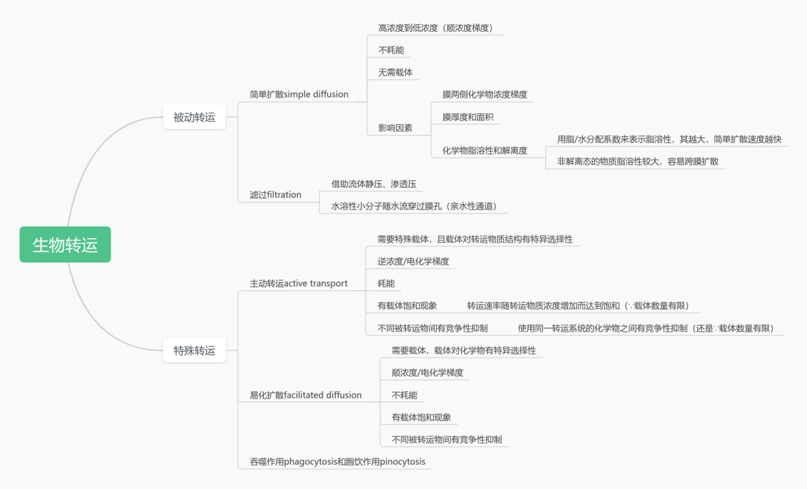
> 🧠 白板：图01-生物转运

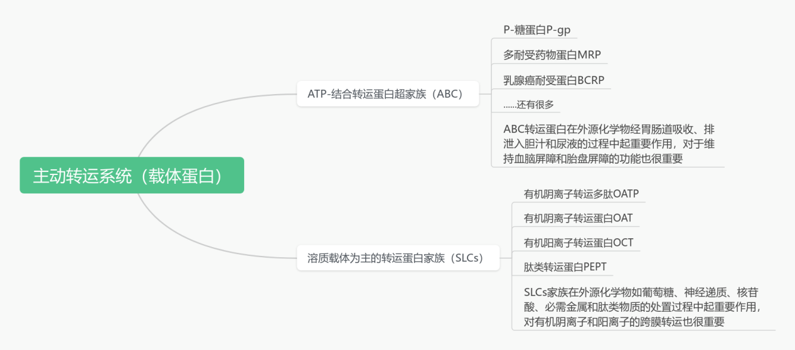
> 🧠 白板：图02-主动转运系统

#### 二、外源化学物的吸收、分布和排泄

##### 吸收及其影响因素

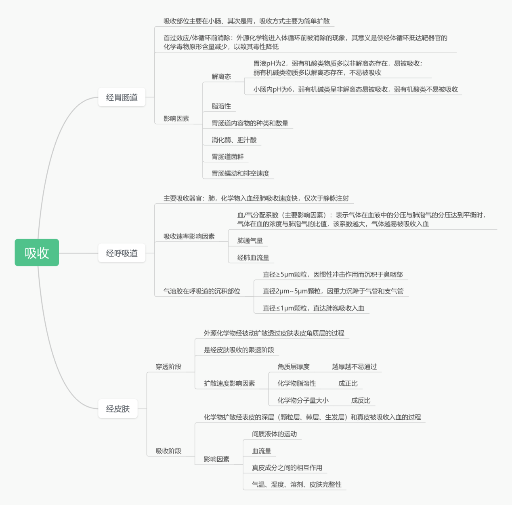
> 🧠 白板：图03-吸收

##### 分布及其影响因素

分布：外源化学物吸收后，随血液、淋巴液分散到全身各组织的过程

影响因素：器官或组织的血流量（初始分布阶段）、对外源化学物的亲和力（最终分布）

蓄积：外源化学物以相对高的浓度富集在某些组织器官的现象

储存库：蓄积部位，主要有血浆蛋白、肝和肾、脂肪、骨骼
- 血浆蛋白

1.白蛋白结合容量最高

2.外源化学物与血浆蛋白的结合是可逆的、暂时的，其结合型与血浆中的游离型维持动态平衡

3.结合型外源化学物因为分子量高，不能透过毛细血管壁，一定程度上减缓急性毒效应，但也延缓其消除时间，增加了毒效应的作用时间

4.不同外源化学物与血浆蛋白的亲和力不同，存在竞争性。高亲和的化学物可将低亲和的化学物从血浆蛋白中置换出来，使血浆游离型低亲和化学物增多
- 肝和肾

1.肝肾对很多化学物都有很高结合能力

2.肝肾细胞存在金属硫蛋白MT，对多种重金属有高度亲和性，主要与Zn2+、Cd2+、Cu2+结合，引起蓄积，对靶器官有保护作用。但过量金属与MT结合，会出现金属中毒
- 脂肪
- 脂溶性有机物（氯丹、DDT、二噁英等）易于蓄积在体脂内
- 外源化学物在脂肪中储存，可减少靶器官中含量，因此对肥胖者毒性要低于消瘦者
- 饥饿促使脂肪动员时，可引起脂肪中储存的外源化学物入血，血中化学物浓度突然升高而中毒
- 骨骼

1.某些外源化学物可在骨骼中达到很高浓度，但对骨可能无损害效应，如铅

2.临床采用金属络合物（依地酸二钠钙）“打三停四疗法”治疗铅中毒，原理如下：给药3天，停药4天为一疗程，该药不能直接促排骨铅，但可以与血铅结合经尿排出，此时身体稳态系统为了体内金属分布的平衡，骨铅会转移一部分到血中，约4天达到饱和，然后就可进行下一疗程。

特殊屏障：血脑屏障、胎盘屏障、血睾屏障、血眼屏障

##### 排泄及其影响因素

########### 经肾（尿）（最重要）

########### 肾小球滤过：脂溶性高的化学物可被肾小管上皮细胞以简单扩散方式重吸收入血，水溶性物质则随尿排出。

########### 尿液的酸化利于弱碱性物质排泄，碱化利于弱酸性物质的排泄。

########### （2）肾小管主动分泌：肾内的转运蛋白家族（OAT、OCT、OATP）可将毒物从血液转运至肾小管细胞，再经ABC转运蛋白将其转运至肾小管管腔

########### 经粪便：仅次于肾，经胆汁排泄是其最重要方式

########### 经肺：排泄速度与吸收速度成反比，在血中溶解度低，就受血流量限制，血中溶解度高，就受通气量限制（排出速度受溶解度低的那一方限制，吸收速度则相反，受溶解度高的那一方限制）

########### 血中溶解度低的气体排泄快，排出速度受血液灌注率限制

########### 血中溶解度高的气体排泄慢，排出速度受通气量限制

########### 其他：脑脊液、汗液、唾液、乳汁、毛发、指甲

########### 

##### 毒物动力学

########### 主要指标

########### 1.消减半衰期t1/2：外源化学物血浆浓度减少一半所需时间，反映消除速度。t1/2=0.693/Ke

########### 2.消除速率常数Ke：单位时间内外源化学物从体内消除的量占体存总量的比例

########### 3.表观分布容积Vd：外源化学物在体内达到平衡时，其体内质量D与血浆浓度C的比值

########### 4.曲线下面积AUC：外源化学物从血浆中开始出现至完全消除为止时曲线下面积，AUC越大，消除速度越慢

########### 5.消除率CL：单位时间内有多少升血中的外源化学物被完全清除

########### 6.生物利用度F：外源化学物被机体吸收的比例

########### 

########### 

### 第二节 外源化学物的生物转化

########### 1.生物转化biotransformation：外源化学物在生物体内自发的或经过一定生物转化酶催化发生化学结构改变或生成代谢产物的过程。

########### 2.对多数外源化学物，代谢能够降低毒性，增强水溶性，从而易于经尿或胆汁排泄（代谢解毒/代谢灭活）。但有些（如苯并[a]芘、黄曲霉毒素B1、亚硝胺类物质、苯等）代谢后毒性增强，或从无毒原型物变为有毒代谢物（代谢活化）

########### 3.代谢器官：肝（主要的代谢器官）、肺、小肠粘膜、肾脏皮质、皮肤、睾丸、肾上腺

########### 4.化学毒物的生物转化主要靠体内的生物转化酶来催化，肝细胞表达的生物转化酶类型最多、含量最高。生物转化酶在主要分布在细胞的内质网和胞质中

#### 一、Ⅰ相反应、Ⅱ相反应

########### 

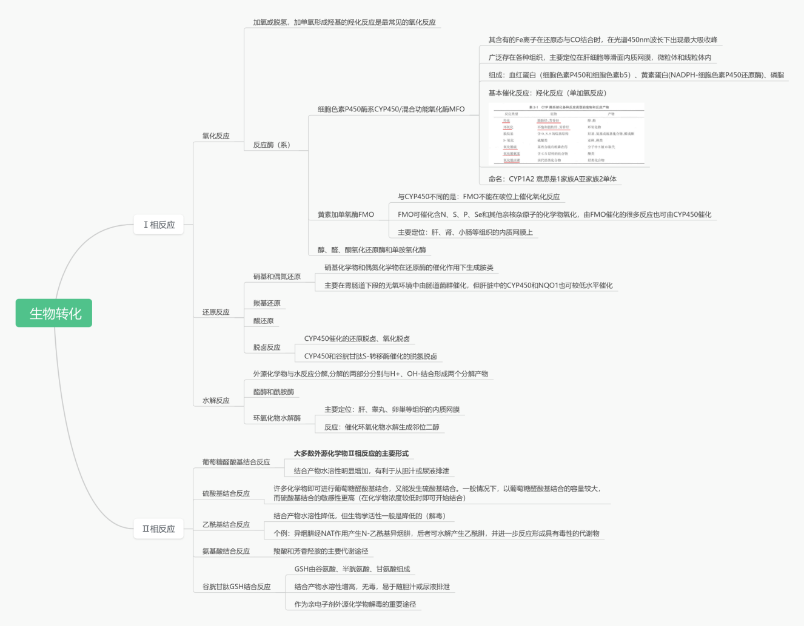
> 🧠 白板：图04-生物转化

########### 

### 第三节 外源化学物代谢的毒理学意义

毒性变化：增毒/活化、减毒/灭活
- 代谢增毒的生物转化酶及其反应类型

活性代谢物一般为高度亲电子性，可诱发基因突变

①CYPs酶催化的羟化、环氧化、脱卤素、脱氢反应：黄曲霉毒素B1在肝细胞内代谢活化为2，3-环氧化物，成为终致突变物和终致癌物

②醇脱氢酶和醛脱氢酶催化的反应：甲醇代谢活化形成甲醛，进一步产生乙酸，可损害视力，导致代谢性酸中毒

③硫酸基转移酶：一些化学物的硫酸基结合物性质不稳定，易于发生异裂反应，形成的正离子有强烈的亲电子性，导致氧化损伤、致突变

④环氧化物水解酶一般是减毒作用，但其催化B(a)P的反应是代谢活化

⑤人体内的甲基转移酶可使化学物的水溶性降低，毒性减弱。但含有甲基化酶的环境微生物催化金属毒物转变为甲基结合物（如汞转变为甲基汞），由于脂溶性增强，其可透过血脑屏障损害人体CNS
- 代谢减毒的酶及其反应

①谷胱甘肽S-转移酶GSTs催化的谷胱甘肽结合反应：水溶性增强，毒性减弱

②葡萄糖醛酸转移酶UGTs催化的葡萄糖醛酸基结合反应：水溶性增强，毒性减弱

③硫酸基结合反应：水溶性增强，毒性减弱（前提是代谢产物稳定，不易发生异裂反应）

④乙酰基结合反应：一般是水溶性减弱，毒性减弱

溶解性变化：水溶性增强、脂溶性增强

1.脂溶性增强：甲基结合反应、乙酰基结合反应

2.水溶性增强：Ⅰ相反应一般是增加代谢物水溶性，CYPs酶、醇脱氢酶、环氧化物水解酶

Ⅱ相反应中葡萄糖醛酸基、氨基酸、谷胱甘肽、硫酸基结合反应都可增加水溶性

影响外源化学物代谢的因素：生理因素、代谢酶的遗传多态性、生物转化酶的诱导与抑制

## 第三章 外源化学物毒作用影响因素及机制

### 外源化学物毒作用影响因素

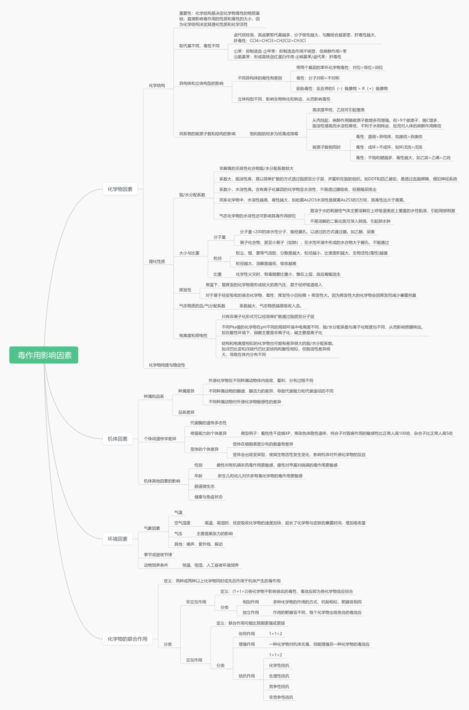
> 🧠 白板：图05-毒作用影响因素

### 毒作用机制

#### 终毒物与靶分子的相互作用

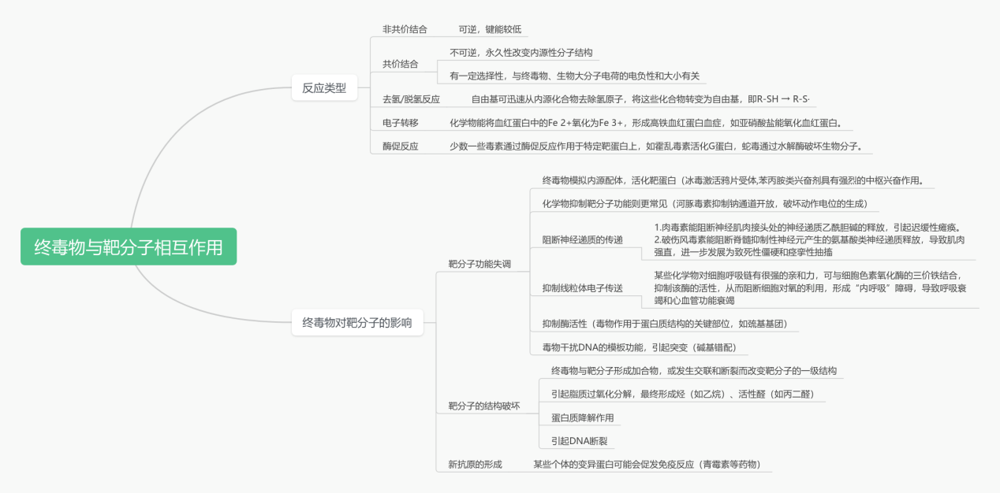
> 🧠 白板：图06-终毒物与靶分子相互作用

#### 细胞功能障碍

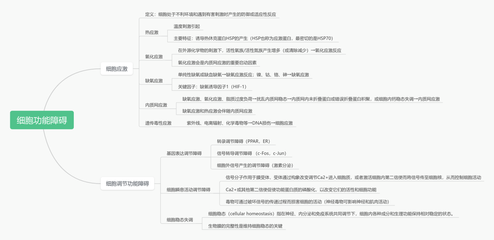
> 🧠 白板：图07-细胞功能障碍

#### 修复障碍

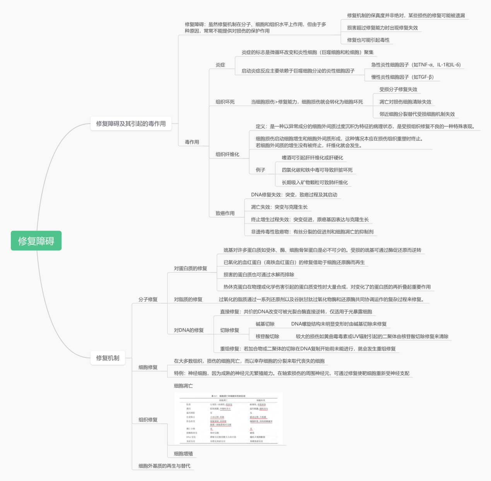
> 🧠 白板：图08-修复障碍

#### 外源化学物毒作用的表观遗传机制

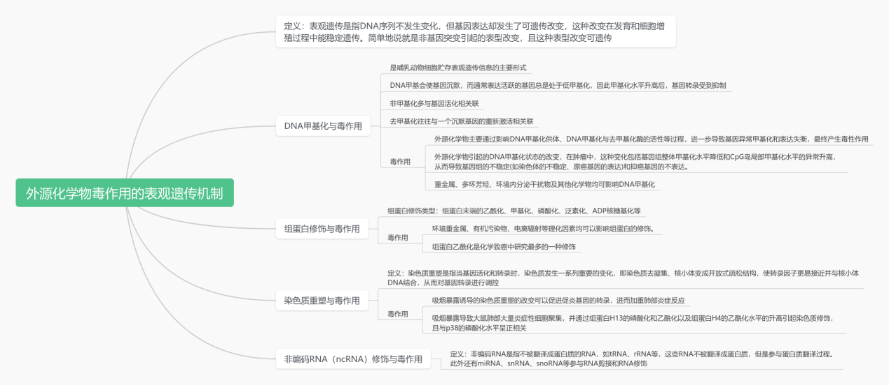
> 🧠 白板：图09-表观遗传机制

## 第五章 一般毒性作用

### 急性毒性作用及其评价

LD50：急性毒性最重要的评价参数，可依据其大小对外源化学物的毒性分级

#### 急性毒性及其试验

急性毒性acute toxicity：人或实验动物一次或1天内多次某外源化学物暴露引起的毒效应

“急性”指的是接触时间短，而非效应快速。

经口或注射途径染毒时，“一次”指瞬间给予动物染毒

经呼吸道吸入或皮肤染毒时，“一次”指动物在特定时间内持续外源化学物暴露的过程

“一天内多次”指外源化学物毒性很低，需1天内多次染毒才能充分了解其毒性，一般不超3次，每次间隔6-8h

急性毒性试验：评价外源化学物急性毒效应的试验，也是观察外源化学物对机体毒效应的第一步。

目的：
- 评价受试物的急性毒性：可得到LD50/LC50，进行急性毒性分级和评价
- 观察中毒表现，初步评价外源化学物对机体的毒效应特征、靶器官、剂量-反应关系，估计其对人体损害的危险性
- 为深入研究亚慢性、慢性毒性及毒作用机制提供科学依据

#### 急性毒性试验方法

> 🧠 白板：图10-急性毒性试验方法

#### 三、急性毒性的分级和评价

> 🧠 白板：图11-急性毒性分级

### 局部刺激试验和皮肤致敏试验

局部刺激试验分为眼刺激试验、皮肤刺激试验

#### 一、眼刺激试验

眼原发性刺激试验：观察眼表面暴露受试物后，引起眼睛可逆性炎症变化

眼腐蚀性：眼睛表面暴露受试物后，引起眼睛不可逆性组织损伤

常用Draize眼试验，首选家兔

#### 二、皮肤原发性刺激试验

包括单次和多次皮肤刺激试验，完整皮肤和破损皮肤刺激试验

观察终点：皮肤刺激、皮肤腐蚀

皮肤刺激：皮肤暴露受试物后，引起皮肤可逆性炎症变化

皮肤腐蚀：皮肤暴露受试物后，引起皮肤不可逆性组织损伤

Draize皮肤试验：常用家兔、豚鼠

#### 皮肤致敏试验

首选豚鼠

### 短期、亚慢性和慢性毒作用

#### 一、蓄积作用

蓄积作用是发生慢性毒作用的基础

定义：外源化学物低剂量多次进入靶器官或体内逐渐增加并贮存的现象
- 物质蓄积：能用化学方法测得机体内存在该化学物原形或代谢产物，如铅汞锰
- 损伤蓄积/效应蓄积/功能蓄积：体内不能测出其原形或代谢产物，却发生慢性毒效应
- 蓄积系数K=ED50(n)/ED50(1)     高度蓄积1明显蓄积 3中等蓄积 5轻度蓄积

ED50(n)：多次染毒使半数动物出现效应的剂量，试验常以死亡为观察的效应

ED50(1)：一次染毒使半数动物出现效应的剂量，试验常以死亡为观察的效应

#### 二、（定义）短期、亚慢性和慢性毒作用

短期重复剂量毒性：实验动物或人连续暴露外源化学物14~30天出现的中毒效应

亚慢性毒性：实验动物或人连续较长时间(约1/10生命周期)暴露外源化学物出现的毒效应

慢性毒性：实验动物或人长期或终生暴露外源化学物出现的毒效应

#### 三、（目的）短期、亚慢性和慢性毒性试验
- 了解长期暴露受试物的毒效应谱、毒效应特点、靶器官和机制
- 了解长期暴露受试物毒效应的可能性
- 探讨重复暴露受试物毒效应的剂量-反应关系，初步确定NOAEL和LOAEL，为制定人类暴露安全限量提供建议值
- 亚慢性毒性试验可以为慢性毒性试验提供合适的观察参数
- 观察不同动物对受试物的毒效应差异，可为研究结果外推到人提供科学依据

#### 四、短期、亚慢性毒性试验设计

> 🧠 白板：图12-短期亚慢性毒性实验设计

#### 五、慢性毒性试验设计

> 🧠 白板：图13-慢性毒性试验设计

亚慢性毒性试验和慢性毒性试验的异同

同：试验动物选择，染毒途径，剂量选择，分组，观察参数

异：染毒期限

#### 六、对亚慢性/慢性毒性试验结果的评价

1.明确化学物的毒效应

2.确定毒效应的敏感参数

3.确定亚慢性/慢性毒性的NOAEL、LOAEL，评价受试物的亚慢性/慢性毒性

当试验组和对照组的实验结果间的差异有统计学意义时，应通过以下指标来进一步判断是否具有生物学意义：

剂量反应关系、时效关系、组间差异、重现性、相关指标的变化、差异的有效性、性别差异、历史对照的作用

## 致突变作用

### 概述

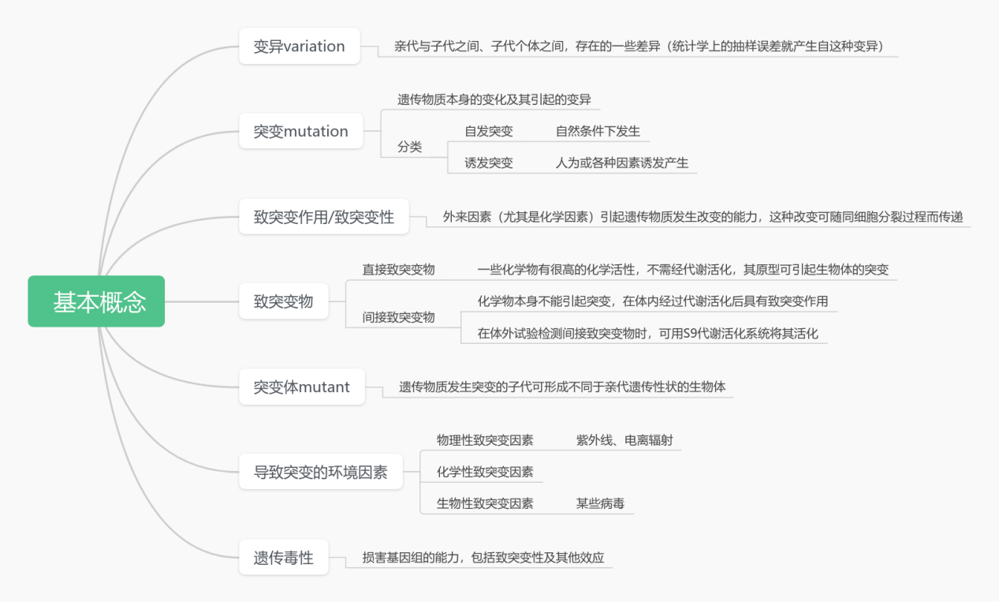
> 🧠 白板：图14-致突变基本概念

### 外源化学物致突变的类型及后果

#### 致突变类型

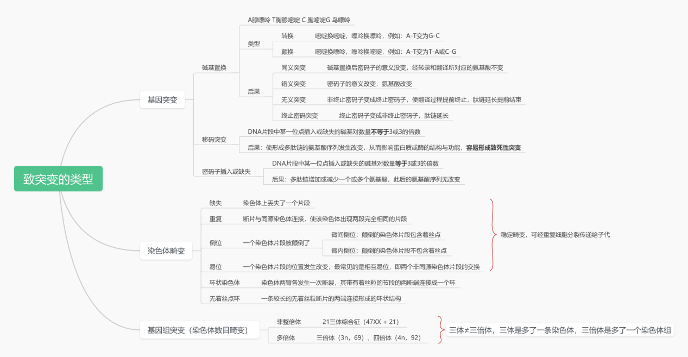
> 🧠 白板：图15-致突变的类型

#### 突变的后果

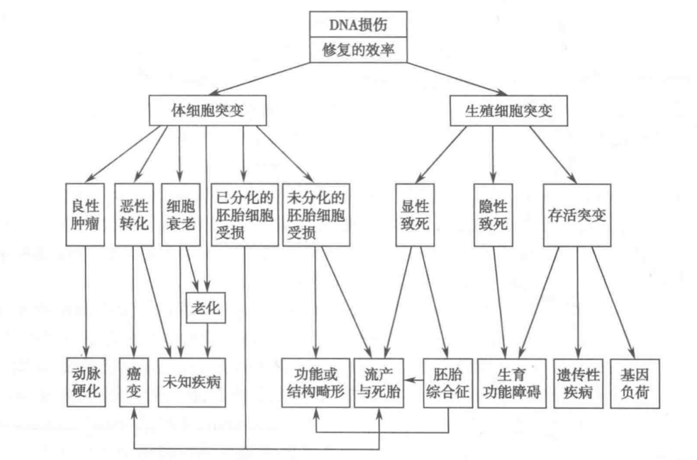
> 🧠 白板：图16-突变的后果

基因库：某物种在特定时期能够将遗传信息传至下一代处于生育年龄群体含有的基因总和。

遗传负荷：一种物种的群体中每一个携带的可遗传给下一代的有害基因的平均水平。

### 外源化学物致突变作用的机制

基因突变和染色体畸变的靶分子：DNA

染色体数目改变（多倍体和非整倍体）靶部位：有丝分裂或减数分裂的细胞结构，如纺锤丝

#### 一、作用于DNA

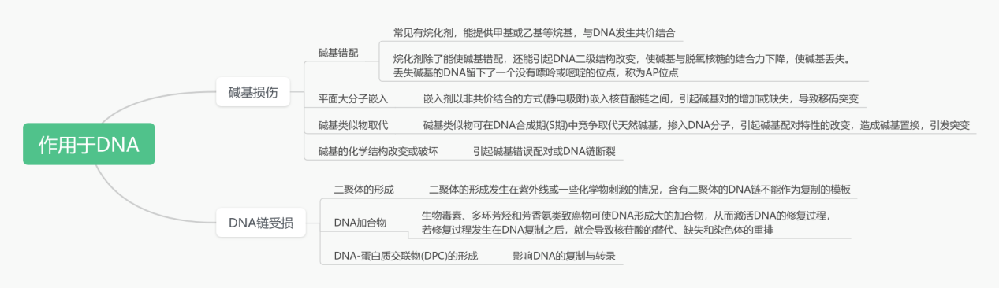
> 🧠 白板：图17-作用于DNA

#### 二、影响细胞分裂过程

染色体分离异常产生非整倍体和多倍体

非整倍体: 第Ⅰ/Ⅱ次减数分裂时同源染色体/姐妹染色单体不分离而形成。若受影响的仅为一条染色体或一对染色体，则再分裂后的子细胞中分别形成三体和缺体

多倍体：①有丝分裂期，染色体单体不能分离，形成一个四倍体细胞

②减数分裂错误，配子为2倍体，从而产生一个多倍体的受精卵

③一个卵子被多个精子受精

外源化学物通过以下机制影响细胞分裂：

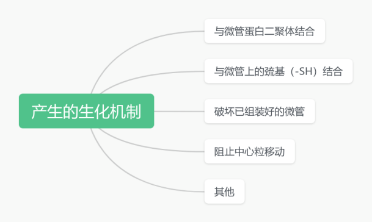
> 🧠 白板：图18-影响细胞分裂的生化机制

#### 三、其他

1.DNA的高保真复制：该过程需要多种酶类参与，且任何环节受损都会影响DNA复制的高保真性，引起突变。

例如：一些氨基酸类似物破坏DNA合成有关的酶，而诱发突变

2.DNA修复：该过程是清除受损的DNA片段，合成新片段来替换。

例如：化学毒物破坏光修复的光裂合酶、切割修复的DNA糖基酶和切除核酸酶

#### 四、DNA损伤修复与突变

外源化学物损伤DNA之后，并非都会表现为突变。如果DNA被准确无误的修复，这种损伤不会引起突变。若损伤不能被修复或修复过程发生了错误，并传递到后代的细胞或个体，引起突变。

### 观察外源化学物致突变作用的基本方法

#### 一、观察项目的选择

遗传学终点：基因突变、染色体畸变及反映致突变过程中发生的其他事件统称为遗传学终点

1.观察的效应终点类型

致突变试验能反映的遗传学终点：基因突变、染色体畸变、染色体组畸变（多倍体和非整倍体）、原发性DNA损伤

2.成套观察项目入选原则

没有一种致突变试验能涵盖所有的遗传学终点，因此需要一组试验配套使用

遗传毒理学成套观察项目入选原则：

①一组试验系统应包括全部的遗传学终点

②要包括多种不同进化程度的物种，至少应包括原核细胞、真核细胞两个系统

③既有体内试验，又有体外试验（补充代谢活化系统S9）

#### 二、常用的致突变试验

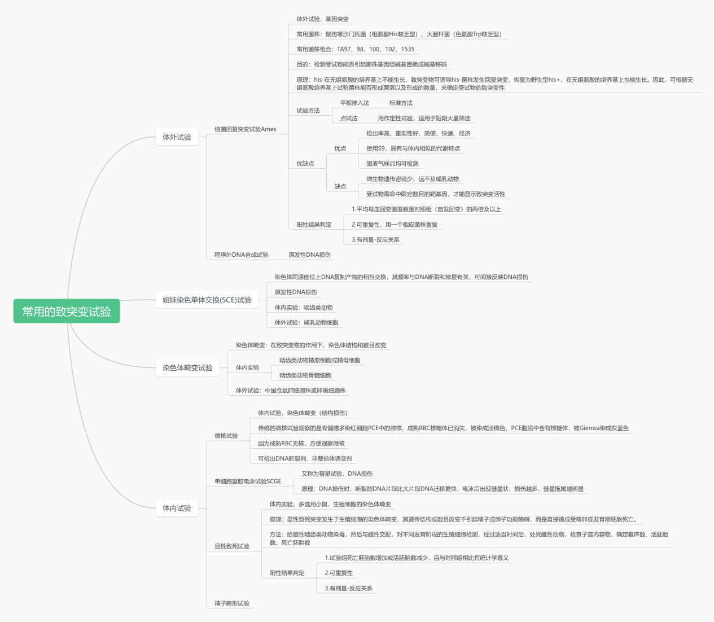
> 🧠 白板：图19-常用的致突变试验

#### 三、对照组的设立

> 🧠 白板：图20-对照组

#### 四、结果判定

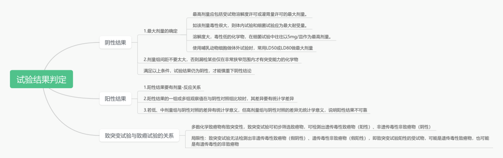
> 🧠 白板：图21-试验结果判定

## 致癌作用

化学致癌：外源化学物使正常细胞发生恶性转化而发展成肿瘤的过程

化学致癌物：引发癌的外源化学物

### 化学致癌物的分类

#### 二、根据化学物理化特性和作用机制进行分类

按理化性质：金属、类金属、有机致癌物

按化学结构：将有机致癌物进一步分为多环芳烃类、芳香胺类致癌物等

按来源：真菌毒素、植物毒素、药物致癌物

按致癌物对遗传物质作用的机制：遗传毒性、非遗传毒性致癌物

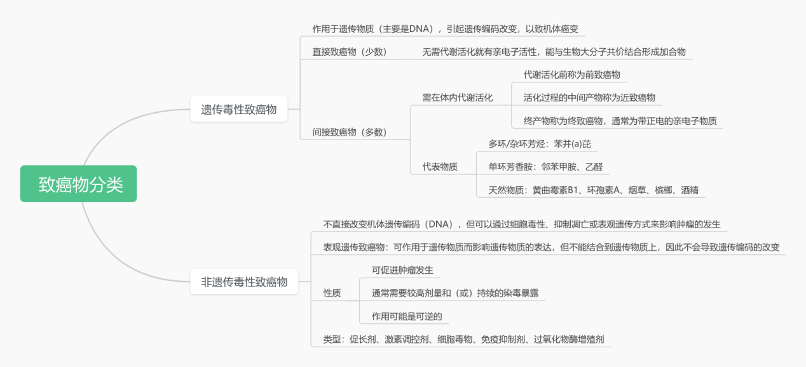
> 🧠 白板：图22-致癌物分类

#### 三、根据化学物对人类致癌的危险性进行分类

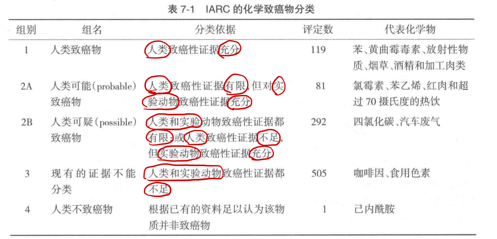
> 🧠 白板：图23-IARC化学致癌物分类

#### 四、根据化学物对人类致癌的靶器官进行分类

### 化学致癌机制

#### 一、多阶段致癌过程

致癌是多因素引起的、多基因参与的多阶段过程

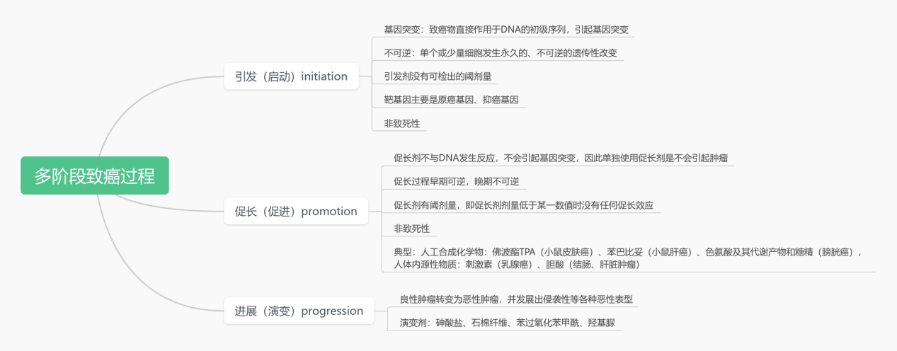
> 🧠 白板：图24-多阶段致癌过程

只有启动剂不致癌，只有促长剂也不致癌，必须是先启动剂、再促长剂才会致癌，且促长剂通常有阈剂量，不重复多次以一定剂量暴露于促长剂也不会致癌

#### 二、与化学致癌相关的机制

1.体细胞突变学说（遗传损伤机制）

原癌基因Ras的激活成为癌基因

抑癌基因P53被抑制

2.非突变致癌机制（表观遗传致癌机制）

（1）肿瘤表观遗传学变异①DNA甲基化②组蛋白修饰③非编码RNA

（2）免疫抑制：二噁英、多氯联苯

（3）内分泌激素干扰：环境内分泌干扰物EEDs能改变机体内分泌功能并对机体及后代引起有害效应，如DDT、二噁英、多氯联苯

### 化学致癌物的毒理学检测方法

#### 定量构效关系分析

与已知致突变物比较，可以快速筛选同系物和相似结构的化学物

#### 遗传毒性试验（致突变试验）

有一定的假阳性（遗传毒性非致癌物）、假阴性（非遗传毒性致癌物）

#### 细胞恶性转化试验

观察终点：细胞恶性变→细胞恶性变不代表一定形成肿瘤→阳性结果仅能提示受试物有致癌的潜能

方法：用受试物处理细胞→将处理后的细胞接种到裸鼠皮下，形成肉眼可见的肿瘤

优点：1.可检出非遗传毒性致癌物，弥补遗传毒性试验的不足

2.相较于哺乳动物体内致癌试验，其操作便捷，更为经济

缺点：体外试验无法完全复制体内的代谢途径，对于间接致癌物，需要添加辅助的代谢酶，如S9

#### 哺乳动物致癌试验

1.哺乳动物中期/短期致癌试验（6-9月）

观察终点：癌前病变（如腺瘤、瘤性增生结节）

常用：①小鼠肺肿瘤诱发试验（引发剂：乌拉坦；促癌剂：丁基羟甲苯BHT）②小鼠皮肤肿瘤诱发试验③大鼠肝转化灶诱发试验④雌性SD大鼠乳腺癌诱发试验

缺点：由于试验期较短，且只关注靶器官，未检查其他器官和系统，所以阴性结果需慎重，不能排除受试物的致癌性。（因为可能该致癌物引起了靶器官之外的器官/系统的癌变）
- 哺乳动物长期致癌试验（1.5-2年）

#### 人群流行病学调查（20年）

是确定人类致癌物的唯一手段

通常先通过动物致癌试验确定动物致癌物，或先通过描述流行病学调查或临床观察发现可疑人类致癌物，再进行分析性流行病学研究（病例对照研究、队列研究）

根据观察终点不同可分为：肿瘤流行病学调查、生物学标志流行病学调查
- 肿瘤流行病学调查：以肿瘤发病率或病死率为观察终点，

如果调查结果为阳性，且能够重复并有剂量-反应关系，则可确认为人类致癌物

如果是阴性，不能完全确定为非致癌物，因为可能是暴露时间短或水平低所致

> 🧠 白板：图25-哺乳动物长期致癌试验

## 生殖与发育毒性作用

### 概述

#### 生殖与发育

#### 生殖毒性与生殖毒理学

生殖毒性：外源因素对(亲代)生殖过程的影响及损害作用。包括对生殖能力和后代发育的有害影响，主要表现为生殖系统器官(睾丸、附睾、前列腺、卵巢、子宫等)变化、月经周期、性行为和功能改变，以及对生育力和妊娠结局的影响

#### 发育毒性与发育毒理学

发育毒性：外源因素或母体健康状况对胚胎或胎仔发育至出生后青春期前子代发育产生的有害作用，包括：

1.发育生物体死亡：受精卵未发育即死亡/胚泡未着床即死亡，或着床后生长发育至一定阶段死亡，然后被吸收或自子宫排出

2.结构异常：活产胎儿/胎仔出生时某器官表现出结构异常，包括畸形和变异

畸形：永久性结构改变，可能对生存、生长或功能有害

变异：不同于正常结构的改变，可能不影响生存或健康

3.生长迟缓：胚胎和胎仔的发育过程较正常缓慢，低于正常对照组均值的2个标准差

4.功能缺陷：胎儿/胎仔的生理、生化、代谢、免疫、神经活动和行为的缺陷或异常

发育毒理学：研究这些有害影响的原因、作用机制及其规律，以及评价发育毒性的科学

发育毒物的暴露可发生在孕前(双亲)、孕期和出生后个体发育至成熟的阶段

胚胎毒性：外源性理化因素造成的着床前期到器官形成期结束的所有毒性表现

胎儿毒性：器官形成期结束后的因素引起的任何毒性表现

发育毒性：外源因素或母体健康状况对胚胎或胎仔发育至出生后青春期前子代发育产生的有害作用

母体毒性：环境毒物对妊娠母体的有害效应，表现为增重缓慢、功能异常、临床症状、死亡。常用增重减慢和死亡率表示

### 生殖毒性作用及其机制

#### 雄性生殖毒性作用

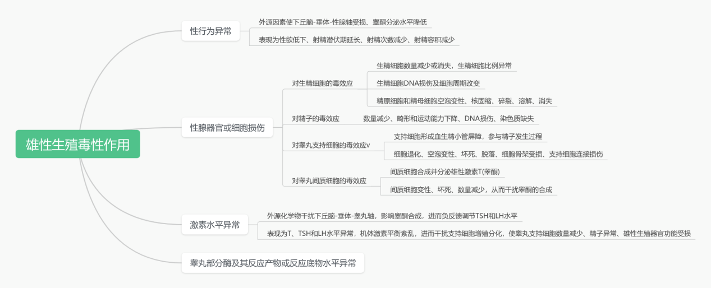
> 🧠 白板：图26-雄性生殖毒性作用

#### 二、雌性生殖毒性作用

#### 三、生殖毒性作用机制

### 发育毒性作用及其机制

#### 不同发育阶段的发育毒作用特点

> 🧠 白板：图27-不同发育阶段的发育毒作用特点

#### 发育毒性作用的影响因素

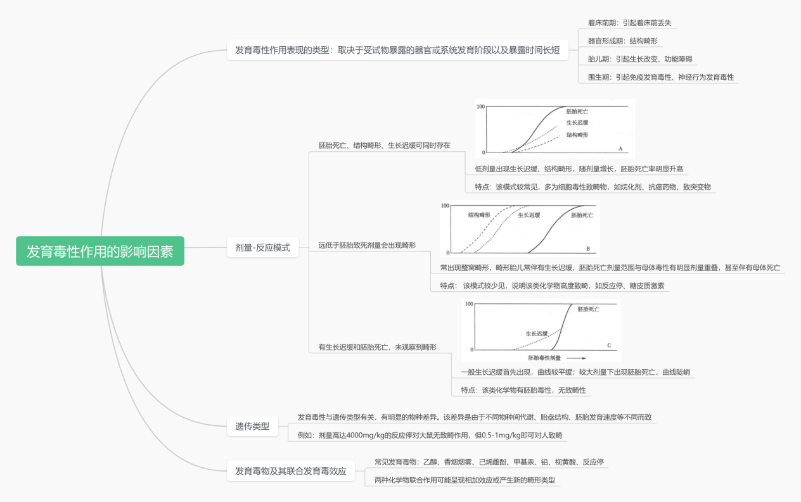
> 🧠 白板：图28-发育毒性作用的影响因素

#### 发育毒性作用机制

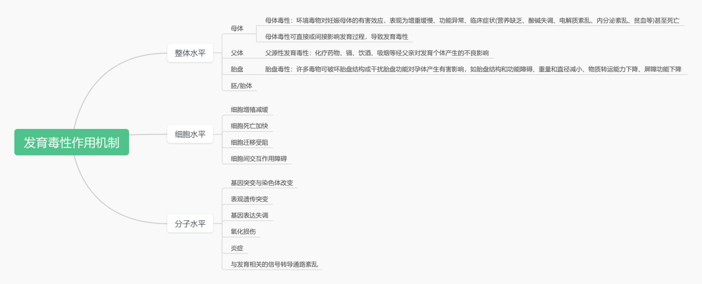
> 🧠 白板：图29-发育毒性作用机制

### 生殖发育毒性研究方法

#### 动物整体生殖毒性试验
- 三段生殖毒性试验

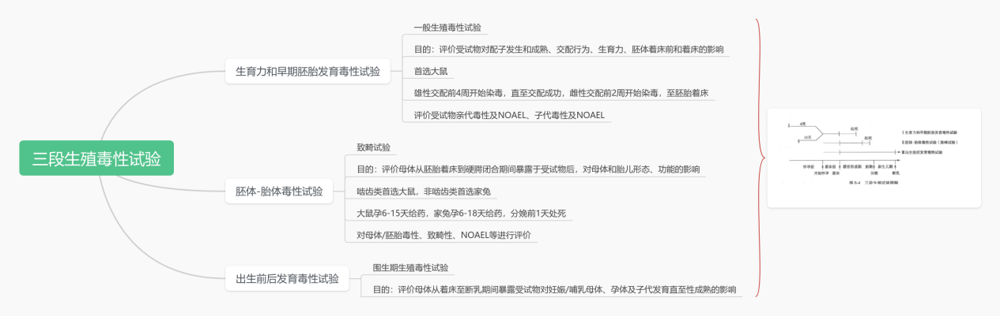
> 🧠 白板：图30-三段生殖毒性试验
- 一代生殖毒性试验

评价受试物对亲代青春期前后和常年动物亚慢性暴露的影响
- 多代生殖毒性试验

能观察一代生殖毒性试验未能观察到的子一代的毒效应

#### 体外试验
- 发育毒性体外初筛试验
- 雄性生殖毒性体外试验
- 雌性生殖毒性体外试验

#### 人群流行病学调查
- 观察性研究
- 实验性研究
- 数学建模研究

## 第九章 管理毒理学

### 概述

#### 毒理学工作者在化学品管理中的作用
- 对相关法律法规的制定 提供技术支持和技术咨询
- 对化学物分类、分级、标签管理 提供技术支持和技术咨询
- 在现有化学物质中，提出基于健康和环境原因需优先管理的化学品
- 在优先管理化学品的卫生标准和环境标准的制订中，通过体内外试验、人体观察、流行病学调查，阐明其对人体健康的影响，确定剂量-反应关系，在制订安全限值中起关键作用
- 对新化学品根据有关法规、规范进行安全性毒理学评价，并参与其专业技术审核
- 对重要的环境污染物和化学物进行健康风险评估
- 参与化学事故的应急救援

#### 管理毒理学的概念的范围

概念：将毒理学的原理、技术和研究成果应用于外源化学物的管理，以防止外源化学物对人体健康和环境产生潜在危害的应用学科

范围：①收集、处理和评价流行病学、实验毒理学数据 ②利用毒理学对外源化学物毒作用规律的研究成果，对保护健康和环境做决策 ③支持发展标准测试方案和新测试方法，促进决策程序的科学化

#### 三、管理对毒理学的影响

（一）通过颁布安全性毒理学评价相关的检测指标或指南，赋予相关管理部门法定权威性，不仅提高了执行力，而且促进了管理毒理学的发展

（二）动物保护原则：对实验动物必须爱护，不得戏弄或虐待

3R原则：替代replacement、减少reduction、优化refinement
- 涉及人体试验应遵循《赫尔辛基宣言》、《人体生物医学研究国际伦理指南》、中国《药物临床试验质量管理规范》的伦理原则，建立伦理审查委员会和知情同意原则尤为重要

### 安全性毒理学评价

#### 一、安全性毒理学评价：是应用规定的毒理学程序和方法，经动物试验和暴露人群观察，检测评价某种外源化学物的毒性及潜在健康危害，对该物质能否投放市场做出取舍的决定，或提出人类的健康安全接触条件，即对人类使用这类物质的安全性做出评价的过程

各类化学品或产品的行政管理单位

国家FDA：食品、保健食品、化妆品、医疗器械

农业部：农药、微生物肥料

卫生部：水及涉水产品、消毒剂

环境保护部：化学品

#### 二、四阶段试验

> 🧠 白板：图31-安全性毒理学评价四阶段

安全系数SF（不确定系数UF）一般取100

安全限值=NOAEL/安全系数

### 风险评估

风险度/危险度：个体或特定群体中某种剂量或某一浓度的化学物质所致的有害作用出现的概率

风险大小：用在一定期间内可能受到有害因子影响的个体数与暴露于有害因子的个体总数之预期比例来表示

风险评估：对有害因子的不良影响发生的概率进行评估的过程，分为健康风险评估和环境风险评估

#### 健康风险评估

定义：

收集大量个人健康信息，分析其生活方式、环境、遗传等危险因素与健康状态之间的量化关系，预测个人在一定时间内发生某特定畸变或因该疾病致死的可能性。即对个人的健康状况及未来患病或死亡危险性的量化评估。

目的：
- 在于估计特定事件发生的可能性，帮助个体综合认识健康风险，鼓励和帮助人们纠正不健康的行为和习惯，而不在于做出明确的诊断
- 并据此按人群的需求提供有针对性的控制与干预，以帮助政府、企业、保险公司和个人，用最少的成本达到最大的健康效果，并评价这些措施的效果

四步骤：危害识别、剂量-反应关系评定、暴露评价、风险特征分析

#### 一、危害识别

指识别可能产生有害作用的因素的种类和性质

目的：
- 基于已知的资料和作用模式来评价对人有害作用的证据充分性
- 确定人体暴露化学物的潜在有害作用及其产生的可能性
- 产生这种有害作用的确定性和不确定性

主要方法：证据权重法

#### 二、剂量-反应关系评定

确定待测物暴露剂量与群体健康效应发生率之间的关系

剂量-反应关系评定是定性/定量评估的综合过程，解决的问题是阐明化学物种类和剂量与效应之间的关系。

有阈值化学毒物的评定，要推测RfD/RfC

无阈值化学毒物的评定，需查询斜率因子，作为非致癌性或致癌性风险计算的基础
- 给予剂量：机体经消化道、呼吸道、皮肤等实际摄入、吸入或皮肤接触的化学毒物的量
- 应用剂量：直接与机体的吸收屏障接触的可供吸收的量
- 吸收剂量：被吸收入体内的量，又称为内剂量
- 送达剂量：吸收剂量中能到达所关注的器官组织的部分
- 生物有效剂量：送达剂量中能到达有害效应作用部位的部分，又称靶剂量
- 有阈化学物：一般为非遗传毒性物质，达到一定剂量才引起健康损害，在阈值以下不会发生健康效应
- 无阈化学物：一般为遗传毒性毒物，在任何暴露水平下都具有理论上的健康效应
- RfD：日平均接触剂量的估计值，人群在终生接触该剂量水平下，预期一生中发生非致癌或非致突变效应的危险度可降低至不能检出的程度。RfD=NOAEL或LOAEL/安全系数

LOAEL：观察到有害作用的最低水平   NOAEL：未观察到有害作用的水平

9.基准剂量BMD：一个可使化学毒物有害效应的反应率稍有升高（常选5%）的剂量的95%可信限的下限值

#### 三、暴露评估

确定人群接触总量，描述接触特性，包括暴露来源、途径、路线及其存在的不确定性

暴露估计的内容：①界定暴露人群②大气扩散模式及多介质传输模式 ③暴露测量 ④选择暴露环境 ⑤选择暴露参数 ⑥总暴露剂量的估计

#### 四、风险特征分析

根据前三步骤所得的结果，分析待测物在接触人群中引起健康效应的发生率

风险特征分析的内容：①致癌风险 ②慢性非致癌风险

健康效应分类：①致癌性②致生殖细胞突变③发育毒性（致畸性）④器官/细胞病理学损伤
