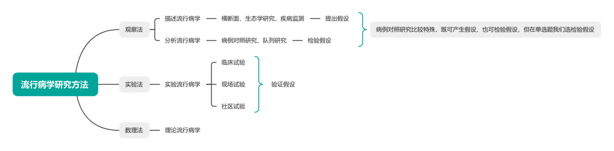

# 一、绪论

> 来源：流行病学.docx · 2026-10-13 由 docx 转 Markdown（保留原大纲层级 / 表格 / 公式转为 LaTeX）
> 医学内容请以教材、指南与任课教师为准复核，不可用于临床决策。

## 1.流行病学的定义和特征
定义：流行病学是研究人群中疾病和健康状况分布及其影响因素，研究防制疾病和促进健康的策略和措施的科学
六大特征

| 特征 | 内涵 |
|---|---|
| 群体 | 研究人群中的疾病现象和健康状态 |
| 对比 | （最重要）对比是流行病学的核心 |
| 概率论和数理统计学 | 目的在于科学地揭示疾病和健康的本质 |
| 社会心理 | 研究疾病的病因和流行因素时，应全面考察对象的生物、心理和社会生活状况 |
| 预防为主 | 坚持预防为主的方针，着重一级预防 |
| 发展 | 流行病学的定义、任务是不断发展的，研究方法也在不断完善 |

## 2.流行病学的研究内容
从最开始以传染病为主的研究内容发展起来，目前已扩大到全面的疾病和健康状况，包括三层次：疾病、伤害、健康
## 3.流行病学的研究方法：

## 4.流行病学的用途：
①疾病预防和健康促进 ②疾病的监测 ③病因和危险因素研究 ④疾病自然史的研究 ⑤疾病防治效果的评估
## 补充：
## 流行病学任务的三个阶段
①第一阶段为“揭示现象”，揭示流行或分布的现象，通过描述流行病学来实现
②第二阶段为“找出原因”，从分析现象入手找出流行与分布的规律和原因，通过分析流行病学来检验或验证所提出的病因假说
③第三阶段为“提供措施”，利用前两个阶段的结果，找出预防或控制的策略和措施，可通过实验流行病学来验证
## 流行病学的三要素：原理、方法、应用
原理：①疾病与健康在人群中的分布，其中包括了疾病的流行现象 ②疾病的发病过程，其中包括机体的感染过程和传染病的流行过程 ③人与环境的关系，即疾病的生态学 ④病因论，特别是多因论 ⑤病因推断原则 ⑥疾病防制的原则和策略，包括疾病的三级预防 ⑦疾病发展的数学模型
（了解）流行病学与其它医学学科的关系：与基础医学的关系、与临床医学的关系、与卫生统计学的关系、与非医学学科的关系

---

相关：[索引](索引.md) · 流行病学 MOC
