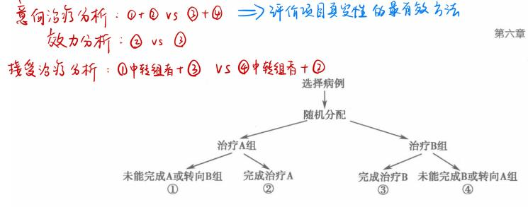

# 七、实验流行病学

> 来源：流行病学.docx · 2026-10-13 由 docx 转 Markdown（保留原大纲层级 / 表格 / 公式转为 LaTeX）
> 医学内容请以教材、指南与任课教师为准复核，不可用于临床决策。

## 概述：
### 实验流行病学experimental epidemiology ：是指研究者根据研究目的，按照预先确定的研究方案将研究对象随机分配到实验组和对照组，人为地施加或减少某种处理因素，然后追踪观察处理因素的作用结果，比较和分析两组人群的结局，从而判断处理因素的效果。
实验性研究experiment study：研究者能够人为给予干预措施的研究。实验性研究能够较好地控制非处理因素（混杂因素）的影响，避免人为造成的偏倚。
### 特点：（前瞻、随机、对照、干预，缺1不可，缺1个以上就属于类实验）
①前瞻性研究，即必须直接跟踪研究对象，这些对象虽不一定从同一天开始，但必须从一个确定的起点开始追踪。（确定的起点例如被诊断出某病、因某病入院、出院）
②必须施加一种或多种干预处理，作为处理因素可以是预防某种疾病的疫苗、治疗某病的药物或干预的方法措施等。
③研究对象是来自一个总体的符合纳入排除标准并签署知情同意的人群，通过随机分配形成实验组和对照组，从而保证实验开始时，两组在有关各方面相当近似或可比，这样实验结果的组间差别才能归之于干预处理的效应。
随机分配是为了平衡两组间的混杂因素，提高可比性。
### 用途：
①可以作为确证因果关系的最终手段。但在实践过程中，出于伦理学的考虑，不可能迫使人群暴露于某种危险因素，因此很少采用实验流行病学设计来确证危险因素的病因作用。
②评价疾病的防治效果（主要用途）
Ⅰ在疾病预防或保健研究中，可以评价单一干预措施（疫苗预防传染病）；或综合干预措施（饮食调节、适当运动等措施预防慢性病）；以及评价保健策略和政策实施的效果。（现场试验、社区试验）
Ⅱ在疾病治疗研究中，可以评价单一药物、联合用药、手术或治疗方案的效果。（临床试验）
### 主要类型：
#### ①临床试验clinical trial：又称随机对照试验试验randomized controlled trial或随机临床randomized clinical trial RCT，强调以病人个体为单位进行试验分组和施加干预措施，病人可以是住院和未住院的病人。通常用来对某种药物或治疗方法的效果进行检验和评价。
#### ②现场试验field trial：也叫人群预防试验prevention trial，是以尚未患病的人为研究对象。与临床试验一样，现场试验中接受处理或某种预防措施的基本单位是个体，而不是亚人群。
#### ③社区试验community trial：也叫社区干预项目community intervention program CIP，是以人群作为整体进行试验观察，常用于对某种预防措施或方法进行考核或评价。整体可以是一个社区或某一人群的各个亚人群，如某学校的班级、某工厂的车间或某城市的街道等。
现场试验的三项原则：随机、对照、盲法
#### 三种试验类型异同点

| 研究分类 |   | 临床试验 | 现场试验 | 社区试验 |
|---|---|---|---|---|
| 相同点 |   | ①都属于实验流行病学研究 ②都有人为干预 ③都随机分组 |   |   |
| 不同点 | 研究对象 | 病人 | 非病人 | 人群 |
|   | 干预单位 | 个人 | 个人 | 人群 |
|   | 研究场所 | 医院 | 社区、学校、工厂 | 社区 |
|   | 研究目的 | 对某种药物或治疗方法的效果进行检验和评价 | 常用于极常见和极严重的疾病的预防研究 | 常用于对某种预防措施或方法进行考核或评价 |
|   | 实例 | 氯吡格雷联合阿司匹林与阿司匹林单独治疗急性非致残性脑血管事件高危人群研究 | 大剂量VC预防感冒的效果评价 预防脊髓灰质炎的Salk疫苗试验 | 食盐中统一加碘来预防地方性甲状腺肿 |

#### 三种试验的特点

|   | 临床试验 | 现场试验 | 社区试验 |
|---|---|---|---|
| 特 点 | ①研究对象：病人 ②研究场所：多在医院 ③多为治疗性试验 ④研究对象尽可能在基线特征方面一致 ⑤随机分配治疗措施，并尽可能做到分配方案的隐藏。对分配的治疗不依从者，应当测量程度与原因 ⑥尽可能使用盲法 ⑦如果对于所研究的疾病没有可接受的疗法，可应用安慰剂进行比较 | ①研究对象：非病人 ②研究场所：社区、学校、工厂等 ③多为预防性试验 ④通常需要较多的研究对象 ⑤以个体为单位随机分配措施 ⑥对分配措施不依从者，应当测量程度与原因 ⑦尽可能使用盲法 | ①研究场所：社区 ②以社区人群或某类人群组/亚人群组为单位分配干预措施 ③常用于对某种预防措施或方法进行考核或评价 ④一般采用整群随机分配措施的方法保证比较组之间尽可能具有可比性 ⑤如果研究只包含两个社区，则要求干预社区与对照社区间基线特征有类似分布 |

## 设计与实施：
### 基本实施步骤
$\text{确定研究问题}\to \text{确定试验现场}\to \text{选择研究对象}\to \text{估计样本含量}\to \text{随机化分组与分组隐匿}\to \text{设立对照}\to \text{盲法的应用}\to \text{确定结局变量及其测量方法}\to \text{确定试验观察期限}\to \text{收集资料}$
### 确定研究现场：
现场试验和社区试验在选择试验现场时应考虑以下几点
①试验现场人口相对稳定、流动性小，并有足够的数量
②试验研究的疾病在该地区有较高且稳定的发病率
③评价疫苗的免疫学效果时，应选择近期未发生该疾病流行的地区
④试验地区有较好的医疗卫生条件，卫生防疫保健机构较健全，登记报告系统较完善，医疗机构及诊断水平较好等
⑤试验地区领导重视、群众愿意接受、有较好的协作配合条件等
### 确定研究问题:PICO
P：病人patient 或人群population ，病人的定义不仅包括疾病的诊断标准，还应考虑年龄、性别、病程、既往史、治疗史等信息
I：干预intervention
C：对照control ，干预和对照应考虑治疗的强度、频率、途径等
O：结局outcome ，结局要定义测量的方法和施加
### 选择研究对象的原则：（有利无害、发病率高、坚持到底依从好）
①对干预措施有效的人群 ②预期发病率高的人群 ③干预对其无害的人群 ④能将试验坚持到底的人群 ⑤依从性好的人群
### 样本量：
影响样本量大小的主要因素：
①实验组与对照组结局事件指标的数值差异大小：差异越小，n越大
②显著性水平$\alpha\text{：}\alpha\text{越小，}n\text{越大}$
③把握度power$\left(1-\beta\right)\text{：}\beta\text{越小，}\left(1-\beta\right)\text{越大，}$n越大
④单侧检验或双侧检验：双侧检验需要更大样本
⑤研究对象的分组数量：分组数量越多，n越大
样本大小的计算：
①计数资料：如发病率、感染率、死亡率、病死率、治愈率等
${N}_{\text{实验}}={N}_{\text{对照}}=N=\frac{{\left[{Z}_{1-\frac{\alpha}{2}}\sqrt{2\hat{P}\left(1-\hat{P}\right)}+{Z}_{\beta}\sqrt{{P}_{1}\left(1-{P}_{1}\right)+{P}_{2}\left(1-{P}_{2}\right)}\right]}^{2}}{{\left({P}_{1}-{P}_{2}\right)}^{2}}$
${P}_{1}\text{：对照组发生率} \text{；}{P}_{2}\text{：实验组发生率} \text{；}\hat{P}=\frac{\left({P}_{1}+{P}_{2}\right)}{2}$
②计量资料：如身高、体重、血压、血脂、胆固醇等
${N}_{\text{实验}}={N}_{\text{对照}}=N=\frac{2{\left({Z}_{1-\frac{\alpha}{2}}+{Z}_{\beta}\right)}^{2}{\sigma}^{2}}{{d}^{2}}\text{（}N\geq 30\text{）}$
$\sigma\text{：估计的标准差} \text{；}d\text{：两组均值之差}$
### 随机化分组与分组隐匿：
随机化的目的：平衡实验组和对照组中各种已知和未知的混杂因素（使两组中混杂因素分布一致），提高两组的可比性，避免造成偏倚
随机化分组的方法：（和随机抽样类似，简单随机XX、分层随机XX、整群随机XX，区别就是这个多一个区组随机分组，抽样多一个系统抽样）
①简单随机分组simple randomization：
研究对象以个体为单位用掷硬币、抽签、随机数字表等方法进行分组
②区组随机分组block randomization：
当研究对象人数较少，而影响实验结果的因素又较多，简单随机分组不易使两组具有较好的可比性时，采用区组随机化法进行分组。基本方法：将条件相近的一组受试对象（如年龄、性别、病情相近）作为一个区组，每一区组内的研究对象数量相等（一般4-6例），然后应用单纯随机分配方法将每个区组内的研究对象进行分组。
③分层随机分组stratified randomization：按研究对象特征，即可能产生混杂作用的某些重要因素（如年龄、性别、病程、病情等）先进行分层，然后在每一层内进行简单随机分组，然后再合并成实验组和对照组。
④整群随机分组cluster randomization：按社区或团体分配，即以一个家庭、一个学校、一个医院、一个村庄或居民区等为单位随机分组。这种方法比较方便，但必须保证两组资料的可比性。
分组隐匿allocation concealment：
为了防止征募病人的研究者和病人在分组前知道随机分组的方案，一种防止随机分组方案提前解密的方法叫随机分组治疗方案的隐匿，简称分组隐匿，采用分组隐匿的随机分组叫隐匿随机分组concealed random allocation
随机分组四个原则：
①随机数字的分配必须在确定纳入一个病人后才能进行
②随机分配方案必须隐匿
③一个病人随机数字的分配必须一次完成，一旦确定绝对不能更换
④一个病人的分组时间应尽可能接近其治疗开始的时间
### 对照：
#### 设立对照的必要性/为什么要设立对照/对照的作用
因为在实验过程中，实验者观察到的干预措施的效果往往是多种因素的效应交织在一起的综合作用，合理的对照能成功将干预措施的真实效应客观地、充分地暴露或识别出来。通常干预实验地效应受以下几方面因素的影响：
①不能预知的结局unpredictable outcome：由于个体生物学差异的客观存在，往往导致同一种疾病在不同个体中表现出来的疾病特征不一致，也就是疾病的发生、发展和结局的自然史不一致。不同病型或病情的患者，对治疗的反应可能也不同。对于一些疾病自然史不清楚的疾病，其“疗效”也许是疾病发展的自然结果，不设立可比的对照组，则很难与治疗措施的真实疗效区分开来。
②向均数回归regression to the mean：临床上常见，一些极端的临床症状或体征，有向均数回归的现象。例如血压特别高的人，即使不治疗，一段时间后再测量，可能会降低一些。
③霍桑效应Hawthorne effect：在实验研究中，被研究者由于知道自己成为了特殊被关注对象后，所出现的改变自己行为或状态的一种倾向，与他们所接受的干预措施的特异性作用无关，是病人渴望取悦于他们的医师，使医师感到其治疗活动是成功的。这是病人的一种心理、生理效应，对疗效产生正向效应的影响。当然，有时因厌恶某医师或不信任某医院会产生负向效应。
④安慰剂效应placebo effect：安慰剂placebo是一种无论在外观、颜色、味觉、嗅觉上均与积极治疗的药品无从辨别的物品，但没有特定已知的治疗成分。目前已知的安慰剂可使三分之一的病人增强信心、减轻病情、减少不适症状，称为安慰剂效应。是某些疾病病人由于依赖医药而表现的一种正向心理效应。
⑤潜在未知因素的影响
#### 对照类型
根据对照措施来区分：
1.标准疗法对照（有效对照）：是临床试验最常用的对照，是以常规或现行的最好疗法（药物或手术）作对照。适用于已知有肯定疗效的治疗方法的疾病。（应试指南本章单选25题）
2.安慰剂对照：在所研究的疾病尚无有效的治疗药物或使用安慰剂后对研究对象病情无影响时使用。（无效对照，这个无效是指对照对于研究对象的病情没有影响）
根据研究对象接受单一对照措施还是交替接受干预和对照措施：
1.平行对照：在实验过程中将研究对象随机分为A和B两组，分别给予干预措施和对照措施，中间不更换干预措施。
2.交叉对照：在实验过程中将研究对象随机分为A和B两组，在第一阶段，A组人群给予干预措施，B组为对照组，经过一段时间的干预后，两组对换，B组接受干预措施，A组作为对照。
其他类型
1.自身对照：指试验前后以同一人群作比较（疫苗接种前后，高血压治疗前后）
2.历史对照、空白对照等非均衡对照，因此类对照缺乏可比性，除某些特殊情况外，一般不宜采用。
3.相互对照：在实验中不设立额外的对照组，而是通过比较不同实验组之间的相互关系来得出结论。这种方法通常用于观察两个或两个以上因素之间的相互作用和影响。
### 盲法：
#### 定义：为避免偏倚可采用盲法，盲法是指研究者和或研究对象、分析者不知道分组情况，分为单盲、双盲、三盲
#### 分类：

|   | 研究对象 | 研究实施人员 | 资料收集分析者 | 研究设计者 |
|---|---|---|---|---|
| 单盲single blind | 不知道 | 知道 | - | 知道 |
| 双盲double blind | 不知道 | 不知道 | - | 知道 |
| 三盲triple blind | 不知道 | 不知道 | 不知道 | 知道 |

不论几盲，研究对象肯定是盲，研究设计者肯定是知道分组情况
#### 盲法的四个层次：
①负责分配病人到治疗组的人不知道病人接受什么治疗，才不会按照自己的意愿而是按照顺序将病人选入试验。
②病人本身也不应该知道自己接受什么治疗，才不会改变自己的依从性或对症状的报告。
③在研究中照顾病人的医师不知道每个病人接受什么治疗，才不会对他们作不同的处理。
④研究实施者在评价结果时无法区分谁是治疗组，这样才不会影响测量。
### 确定结局变量及其测量方法：主要（主要终点、1-2个、样本量、规定标准）、次要（代替/次要终点、多些）
### 确定试验观察期限：
### 收集资料：随访观察内容（执行情况、影响因素、结局变量）、收集途径（访问、检测、单位获取、环境调查）
### 以上三点均在书本110页
## 资料的整理与分析：
#### 资料整理：
$\text{随机抽样}\to \text{排除}\to \text{随机分组}\to \text{退出}$
随机抽样：指总体中每个个体都有相同的机会被抽取作为研究对象
随机分组：所有研究对象都有同等概率被分到实验组或对照组
①排除exclusions：（分组前被排除）
是指在随机分组前研究对象因各种原因未被纳入。排除不会影响研究结果的内部真实性，但可能影响研究结果的外推。被排除的研究对象越多，结果推广的面越小。因此，从评估潜在的受试者到真正随机分组研究对象的过程中，被排除者及其排除原因的资料需要整理。
排除的原因：1.对干预措施有禁忌、2.无法追踪、3.可能失访、4.拒绝参加试验
②退出withdrawal：（分组后退出）
指研究对象在随机分配后从实验组或对照组退出。
退出的影响：造成原定的样本量不足，使研究功效/把握度降低，易产生选择偏倚。
退出的原因：
1.不合格ineligibility：在资料整理时，一般要把不合格的研究对象剔除，包括不符合纳入标准者、一次也没有接受干预措施或没有任何数据者。
2.不依从noncompliance：研究对象在随机分组后，不遵守试验所规定的要求。实验组不遵守干预规程，相当于退出或脱落实验组，对照组不遵守对照规程而私下接受干预规程，相当于加入实验组。研究对象不遵守试验规程的原因一般如下：a.试验或对照措施有副作用 b.研究对象对试验不感兴趣 c.研究对象的情况发生改变。 对于不依从者，不能剔除，应采用ITT分析。还要调查不依从的原因与程度并详细记录。
3.失访loss to follow-up：研究对象因迁移或与本病无关的其他疾病死亡等而造成失访。在实验流行病学研究中应尽量设法减少失访，一般要求失访率不超过10%，在试验在出现失访时，尽量用电话、短信或专门访视等进行调查。调查失访的原因，详细记录失访发生的时间。资料分析时须对失访者的特征进行分析（分析失访者与未失访者的基线特征是否有差别），还可采用生存分析的方法，充分利用失访资料。
补充：
①沾染taint：在样本收集、处理、分析或实验过程中，由于外部因素或操作不当，导致对照组额外接受了实验组的药物和措施，使得对照组疗效提高，人为地夸大了对照组疗效的现象，导致实验组和对照组的差异减小。（对照组接受实验组的干预措施，人为夸大对照组疗效，使对照组和实验组的差异减小）
②干扰intervention（干预也是这个单词）：实验组从实验外接受了对研究因素有效的药物或措施（非处理措施），提高了实验组的有效率，人为地夸大了实验组疗效，导致实验组和对照组之间的差异扩大。（实验组接受了外界有效影响，实验组疗效被夸大，使对照组和实验组的差异增大）

#### 资料分析：
①意向治疗分析intention to treat analysis，ITT：
指所有病人被随机分入RCT中的任意一组，不管他们是否完成试验，或者是否真正接受了该组治疗，都保留在原组进行结果分析。（这个意向是研究者的意向，不是研究对象的意向，即按照研究者的原设计意图来分析，不管研究对象是否依从）
目的：避免选择偏倚，并使各治疗组之间保持可比性。ITT中，随机化不仅决定治疗的分配，而且决定病人数据的分析。
②遵循研究方案分析：也叫效力分析、依从者分析，只对试验依从的人进行分析，并未完全遵循最初的随机分组。
③接受干预措施分析：也叫接受治疗分析，按病人实际接受的治疗进行分析。
应用：RCT的两个基本目标是获得试验的效力efficacy(理想)和效果effectiveness(实际)。1.试验的效力反映的是在一种理想状态下的治疗效果，即参与试验者真正接受并完成了该种治疗。2.试验的效果是指在一般的临床状态下治疗的实际效果，参加者可能还不依从、改变治疗方式或间断治疗等，ITT分析评价的是给予某种治疗方式后病人的实际结局。（因为ITT考虑到在临床实际中某种干预措施可能会被不遵守，因此ITT是评价项目真实性的最有效方法，依从者分析和接受治疗分析都是理想状态下的治疗效果）
局限性：对于试验的效力来说，1.如果试验中失访、不依从的情况很少，或者各组之间的失访和不依从是均衡的，那么ITT分析可以得到试验效力的有效信息。2.但若不均衡，ITT分析不能够完全评估试验效力，如果试验方法（干预措施）确实有效，ITT可能会低估治疗效果，而依从者分析和接受治疗分析会高估治疗效果。因此在评价试验的效力时，建议同时使用上述三种分析，使RCT结果的解释更为合理。
##### 统计分析数据集：书本114页 FAS、PPS、SAS
#### 治疗效果的评价指标：（临床试验）
有效率：$\text{有效率}=\frac{\text{治疗有效例数}}{\text{治疗的总例数}}\times 100\%\text{（}\text{治疗有效}=\text{治愈}+\text{好转}\text{）}$
治愈率：$\text{治愈率}=\frac{\text{治愈人数}}{\text{治疗人数}}\times 100\%$
病死率：$\text{病死率}=\frac{\text{因某病而死亡人数}}{\text{患该病人数}}\times 100\%$
N年生存率：$N\text{年生存率}=\frac{N\text{年存活的病例数}}{\text{随访满}N\text{年的病例数}}\times 100\%$
#### 预防效果的评价指标：（现场试验、社区试验）
保护率protective rate PR：$=\frac{\text{对照组发病}/\text{死亡率}-\text{实验组发病}/\text{死亡率}}{\text{对照组发病}/\text{死亡率}}\times 100\%$ 越大说明效果越好，实验组中有XX% 受到保护
效果指数index of effectiveness IE：$=\frac{\text{对照组发病}/\text{死亡率}}{\text{实验组发病}/\text{死亡率}}$ 越大说明预防效果越好，对照组发病率是实验组的XX倍
抗体阳转率：$=\frac{\text{抗体阳性人数}}{\text{检查总人数}}\times 100\%$
抗体滴度几何平均数：
相对危险度降低RRR：$\frac{\text{对照组发病}/\text{死亡率}-\text{实验组发病}/\text{死亡率}}{\text{对照组发病}/\text{死亡率}}\times 100\%$（相对危险度降低就是保护率PR，与归因危险度百分比$AR\%$类似）
绝对危险度降低ARR：$=\text{对照组发病}/\text{死亡率}-\text{实验组发病}/\text{死亡率}$ （与归因危险度AR类似）
#### 需治疗人数NNT number needed to treat ：$NNT=\frac{1}{ARR}$
指预防1例不良事件，临床医师在一段时间内应用某一疗法需要治疗的病人数（简：治多少人才能预防1例） NTT越小说明该疗法效果越好 ，NNT为负数时表示：在特定时间内，用某种干预引起1例不良事件所需要的人数（NNH）
NNT相较于其他指标的优点：书本116页
1.当有害事件的基线危险很低或很高时，仅用相对危险度指标（RR、PR/ARR）会高估或低估治疗的绝对影响
2.绝对危险度指标（AR/RRR）则考虑了病人基线危险的不同，但由于其以小数或分数的形式表示，不易被医生和病人理解，难以用于临床实践。
3.因此我们引出了NNT，NNT是AR的倒数，其含义直观易懂，易被接受。
（对照组事件发生率：CER 实验组事件发生率：EER）

| 指标 | 公式 | 数学关系 |
|---|---|---|
| 相对危险度RR(一般小于1，因为是保护因素) | $EER/CER$ | $\text{互为}$倒数 |
| 效果指数IE | $CER/EER$ |   |
| 保护率PR/相对危险度降低ARR | $\frac{\left\vert CER-EER\right\vert }{CER}$ |   |
| 绝对危险度降低RRR | $\left\vert CER-EER\right\vert $ | 互为倒数 |
| 需治疗人数NTT | $\frac{1}{\left\vert CER-EER\right\vert }$ |   |

## 优缺点及需注意的问题：
#### 优点：（标准化、混杂偏倚减小、前瞻性研究）
①研究者根据试验目的，预先制定试验设计，能够对选择的研究对象、干预因素和结果的分析判断进行标准化。
②按照随机化的方法，将研究对象分为实验组和对照组，做到了各组具有相似的基本特征，提高了可比性，降低了混杂偏倚。
③试验为前瞻性研究，在整个试验过程中，通过随访将每个研究对象的反应和结局自始至终观察到底，实验组和对照组同步进行比较，最终能做出肯定性的结论。
#### 缺点：（难度大、结果难以推论到总体、依从性不好）
①整个实验设计和实施条件要求高、控制严、难度大，在实际工作中有时难以做到。
②受干预措施适用范围的约束，所选择的研究对象代表性不够，以致会不同程度地影响试验结果推论到总体。
③研究人群数量较大，试验计划实施要求严格，随访时间长，因此依从性不易做得很好，影响试验效应的评价。
#### 类实验quasi-experiment：一个完全的实验流行病学研究必须具备随机、对照、干预、前瞻四个基本特征，如果一项实验研究缺少其中一个或几个特征，这种实验就叫类实验，或自然实验natural experiment。根据类实验是否设立对照组，可分为两类：
①不设平行对照组：其对比是通过下列两种方式进行的：一种是自身前后对照，即同一受试者在接受干预措施前后比较（比较高血压患者服药前后血压变化）；二是与已知的不给该项干预措施的结果比较（已知我国携带乙肝的母亲发生HBV母婴传播的概率为40%，在现阶段观察乙肝疫苗阻断母婴疫苗的效果）
②设对照组：虽然设立了平行对照组，但研究对象的分组不是随机的。类实验常用于研究对象数量大、范围广而实际情况不允许对研究对象作随机分组的情况。（社区试验常属于类实验）
#### 伦理问题：实验流行病学研究必须在试验中遵循伦理道德，在开始人群试验前，必要时应先做动物实验，初步验证此种实验方法合理、效果良好、无危害性。特别是设置对照时，必须以不损害受试者身心健康为前提。在一般情况下，研究者应将实验目的、方法、预期效果以及危害告知受试者及其家属，征得他们的同意，此即知情同意。
#### 预试验pilot study：在正式试验前，应先在小范围做一次少量人群的预试验，其目的
是检验试验设计的科学性和可行性，以免由于设计不周，盲目开展试验而造成人力、物力和财力的浪费。
#### 研究注册问题：临床试验注册制度，是指在临床试验实施前就在公共数据库公开试验设计信息，并跟踪和报告试验结果。这不仅可以增加试验信息的透明度、减少发表偏倚，而且有利于保障试验质量、增加试验的规范性和结果的可信度，已经成为当今临床试验发展的主流。
#### 结果报告的完整透明问题：试验报告应遵循试验报告统一标准指南，以提高试验报告质量，使报告能反映试验真实实施过程。
实验流行病学试验设计
①基本特征：随机、对照、干预、前瞻
②原则：随机化、对照、重复、盲法
③三要素：处理因素、受试对象、试验效应
随机分组和匹配在控制混杂偏倚中的优缺点

|   | 随机化分组 | 匹配 |
|---|---|---|
| 优点 | 使潜在混杂因素在各组间的分布均衡，从而使组间基线状况具有良好的可比性，从而使处理因素的真实差异得以显现 | ①提高检验效能/研究效率 ②控制混杂因素 ③减少所需样本量 |
| 缺点 | 如果样本量较小，常难以达到所需效果 | ①费时费力，收集资料更加复杂 ②如果匹配数目过多，难以找到合适对照 ③对于已匹配的因素，无法分析其与疾病的关系 ④可能出现匹配过度的问题 |

---

相关：[索引](索引.md) · 流行病学 MOC
