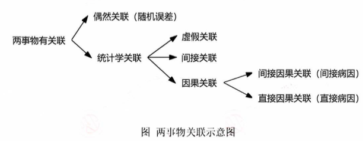

# 九、病因与因果推断

> 来源：流行病学.docx · 2026-10-13 由 docx 转 Markdown（保留原大纲层级 / 表格 / 公式转为 LaTeX）
> 医学内容请以教材、指南与任课教师为准复核，不可用于临床决策。

## 病因的定义和因果关系
### 病因cause of disease ：引起疾病发生的原因，即能够影响未来疾病发生的因素或事件。
### 因果关系的基本条件：
①时间顺序temporality：时序性，因事件在果事件之前
②关联关系association：果事件随着因事件的变化而变化
③因变性consequential change：果事件的变化是由于因事件的变化引起的
以上三个必须同时满足，缺一不可
### 医学实践中因果关系的类型：
①病因和疾病的关系
②治疗和效果的关系
③治疗和副作用（不良反应）的关系
### 因果关系的多样性
①单因单果：几乎不存在
②单因多果：揭示了病因的多效应性，指出了阻断或控制某个病因可预防多种不同疾病的可能性
③多因单果：揭示了疾病的多因性，同时指出了控制某种疾病的发生和发展可多管齐下的可能性
④多因多果：该种病因现象增加了疾病研究的复杂性和不确定性，也揭示了多种途径预防疾病的可能性
⑤直接病因direct cause/immediate cause：有些病因可直接引起疾病的发生，最后引起疾病的病因叫做直接病因
⑥间接病因indirect cause/remote cause：一些病因通过作用于一个或多个其他病因，并由后者直接引起疾病的发生，直接引起疾病的病因以前的病因叫做间接病因
$\text{间接病因}\to \text{直接病因}\to \text{疾病}$
### 传统因果观与现代因果观：
传统因果观认为某种特定的原因必然导致某种特定的结果，强调了因果关系的必然性和充分性。
现代病因观认为原因只是使结果发生概率升高的特征或事件，并非决定结果的唯一因素，强调因果关系的概率性和不确定性。
现代因果观的预防医学意义：基于现代因果观的预防医学实践。更加注重对疾病发生概率的降低，而非单纯追求对某种病因的消除。不仅关注直接的病因，还关注可能增加疾病风险的多种因素。
## 病因学说与病因模型
### 病因模型的用途：
①用于阐述病因之间的关系以及病因与疾病的关系
②指示病因的方向以揭示新的病因
③用于说明病因的作用和解释流行病学概念和原理
### 常见的病因学说与病因模型

| 病因模型 | 特征 |
|---|---|
| 瘴气说、微生物说 | 主要针对传染病，属于单病因假说， |
| 三角模型 | 对早期模糊的病因假说进行了明确的界定；对单病因假说的否定和多病因假说的肯定，使病因的探索有了更大方向；更有针对性，增加了成功的概率，也增加了预防和控制传染病的方略 |
| 轮状模型、生态模型 | 病因概念扩展的经典产物，揭示了病因的多元性，扩展了病因的范畴；健康决定因素的生态模型展示了病因与疾病远近的现象，提示了直接病因和间接病因的存在 |
| 病因链、病因网 | 更好地展示病因之间以及病因与疾病之间的复杂关系，如链式关系、协同关系、主次关系、远近关系等；揭示了抓住一个病因可以影响全局的可能性，增加了预防慢性病的选择，也便于分清主次和发现主要矛盾，更有效地预防和控制疾病 |
| 充分-组分模型 | 剥离了病因之间及病因与疾病之间的抽象关系，试图对病因进行更理性的分类，并对它们的作用进行定位 |

判断病原体和疾病关系的科赫法则是微生物说的代表理论，该法则认为疾病的病因是单一的，即一个疾病只有一个病因。还认为有了病因疾病必然会发生。
### 传染性疾病流行的三角模型
epidemiological triad：模型指出，影响传染病在人群中发生和发展的因素是多重的，并归结为三个方面即宿主host、病原体agent和环境environment，三者对传染病流行缺一不可，三者之间相互平等、相互关联、 相互制约。
意义：
①在一定的时间框架内，三者保持动态平衡，使人群疾病的发病率维持一个常态。一旦三者中有一个及以上的因素发生变化，破坏了平衡，人群疾病的发病率就会下降或上升，甚至消失或引起暴发流行。
②寻找可用来切断三角中任何一条（或多条）链索的措施，阻断任何两因素之间的联系，就可以控制疾病的流行。
③揭示了在病原体之外，存在可用来预防和控制传染性疾病的因素；揭示了在病原体不明的情况下预防传染病的可能性，是人类用来控制传染病的重要理论基础。
### 病因的轮状模型
Causation wheel：轮状模型把可患病的人或动物放到了中心的位置，周围是他们生活的物理、化学、生物和社会环境，而传染病的致病因子只是生物环境中的一部分。
意义：
①用新的方式描述了宿主、致病因子和环境的关系，认为宿主、环境和病原体不是对等和分离的关系，他们的重要性也有主次之分，并提示了直接病因和间接病因的存在，以及远端病因和近端病因的区别
②轮状模型也扩充了环境的概念，提示更多的环境因素可以致病，指出了更多的干预靶点，为预防疾病提供了更多的选择
### 健康决定因素的生态模型
也叫生态病因模型Ecological model of causation：是轮状模型的进一步发展，模型中心是人体，包括一个人的性别、年龄、遗传等特征，然后将其他病因归类，并分成不同的层次，每层又包括很多相关但不同的因素，并强调各种因素的相互作用对健康的影响。
意义：
①具有早期轮状模型的特征，但生态病因模型还意味着那些可影响健康但不影响发病的因素也可被利用，进一步拓宽了“病因”的范围和领域，揭示了更多可用来提高健康、预防疾病的因素
②认为个体特征是疾病发生的根本
③表明了直接和间接病因的存在，直接病因和间接病因只是相对疾病的“远近”而言
④最大限度地拓宽了人类对各种可能病因的认识，从而也揭示了更多新的促进健康、预防疾病的方法，尤其强调人们共同暴露的社会生态因素，指出了改善社会生态环境对预防疾病的作用
### 病因链
Chain of causation：时间上先后发生的互为因果的病因之间，以及这些病因与最终疾病之间的关系可用病因链来描述
意义：
①在一个病因链上，去除任何一个病因，就可以切断整个病因链，从而预防疾病通过此病因链发生。这也是最有效的方法，因为不需要针对一个病因链上的所有因素进行干预，就能达到预防的效果。
②一个疾病可能有多个独立作用或相互影响的病因链。（这些病因链构成病因网）
### 病因网
Web of causation：很少疾病只有一个单一的病因链，事实上一个疾病往往存在多个独立或相互关联的病因链，同一疾病不同病因链相互连结、相互交错，形成一个更为复杂的完整的病因关系网，这个从病因到发病的联系的整体网状结构叫做病因网。
用病因网解释疾病预防中的现象：
①去除一条病因链中的任何一个因素就可以完全切断整条病因链，从而预防疾病通过此病因链发生，这使得阻断病因链有了多种选择，增加了预防方法和可能性。（和病因链第一点一样）
②不同的病因链对疾病发生的作用的大小可能不同，有效的预防应切断主要的病因链。
③不同的病因链可能独立地影响疾病的发生，同时切断多个病因链必然可以预防更多的病例。
### 充分病因-组分病因模型Sufficient-component causal model：
充分病因：疾病发生的充分条件，充分病因的形成就等于疾病的发生。充分病因是疾病发生所需要的最低条件或需要的组分病因的最少组合。（只要有一个充分病因存在，疾病就一定会发生）
组分病因：是充分病因的一个组成单位。一个组分病因可以出现在一个疾病的一个或多个充分病因里。组分病因对充分病因缺一不可，但这不等于所有组分病因必须同时存在，而是说它们需要按照一定的时间顺序逐次发生，当最后一个组分病因出现时，充分病因完成，疾病发生。
必要病因：一个疾病的所有充分病因都需要的组分病因，即为必要病因。如果此组分病因不存在，该疾病的任何一个充分病因就不会实现，疾病就不会发生。最典型的必要病因就是传染病的病原体。（必要病因存在不一定疾病发生，疾病发生一定有必要病因）
互补病因：①在同一充分病因内，组分病因彼此形成互补，互为彼此的互补病因。②同一个疾病的所有充分病因也互为彼此的互补病因。
意义：
①回答了病因学说的两个悖论，一是为什么没有某个病因疾病却发生了（酗酒是肝硬化的病因，但不饮酒者也会发生肝硬化），二是某个病因存在疾病却没有发生（吸烟可以引起肺癌，但绝大多数吸烟者一生也不会患上肺癌）。前者是因为绝大多数慢性非传染性疾病没有明显的必要病因，疾病可以通过不同于所关注病因的其他充分病因而发生。后者是因为关注的病因不是充分病因，只有当其互补病因都存在时，疾病才会发生。
②因为任何一个组分病因对于需要它的充分病因都是必要病因，所以除去任何一个组分病因就等于除去了与其相关的所有充分病因，因此就预防了所以可通过该充分病因而发生的病例。如果一个组分病因参与了多个主要的充分病因，那么除去整个组分病因就可以预防大部分的病例。

| 病因分类 | 充分性 | 必要性 | 举例 |
|---|---|---|---|
| 充分且必要 | + | + | 天花病毒与天花，这类病因很少 |
| 充分非必要 | + | - | 飞机失事与死亡 |
| 必要非充分 | - | + | 病原体和传染病 |
| 非必要非充分 | - | - | 高血脂与冠心病，以及绝大多数慢性非传染病的病因 |

## 穆勒法则mill’s canons与流行病学研究设计

| 穆勒法则 | 定义 | 对应的研究设计理念 | 作用 |
|---|---|---|---|
| 求同法 | 在病因研究中，如果所有患同一疾病的病人都具有某一共同的因素，而且其他因素并非每个病人都有，那么该共同因素就可能是该疾病的病因 | 病例系列：病人共有的因素 | 形成病因假设 |
| 求异法 | 在病因研究中，如果未患某病的个体与患有该病的个体相比，除了某一因素外，其他因素均相同，那么这个不同的因素可能是该病的病因 | 病例-对照的概念：病有、非病无 |   |
| (同异)共求法 | 在病因研究中，当患病个体中均具有且只有一个共同因素，非患病个体均没有该因素，即患病组与非患病组相比，唯一区别就是该因素，那么该因素有可能是该病病因 | 病例对照研究、队列研究(病例都有，非病都没有) | 初步验证病因 |
| 共变法 | 当某一现象发生一种变化时，另一现象相应随之发生变化，且不论后者的变化是什么，那么二者间可能存在因果关系 | 剂量反应关系 |   |
| 剩余法 | 如果某一复合现象已确定是由某种复合原因引起的，把其中已确认有因果联系的部分减去，那么，剩余部分也必有因果联系 | 个案发生原因推测、主要病因推测 |   |

队列研究和随机对照研究融合了穆勒的四个法则，并同时验证了因果的时序性和因变性，是在人群验证因果关系最可靠的方法。
但队列研究没办法排除混杂因素的干扰，而随机对照试验通过随机分组的方式保证了比较组间的可比性，彻底排除了混杂。但由于伦理上的考虑，RCT只能用来评估治疗和干预的效果，不能用来直接研究疾病的病因。因此，队列研究是人群中验证病因的最可靠方法，而RCT是在人群中验证因果关系最可靠的方法。
剩余法的两种作用：
①个案发生原因推测：例如心血管病发生原因主要是高血压、高血脂和糖尿病，如果一个人已经发生了冠心病，但他既没有高血脂也没有糖尿病，那么该病人很可能是高血压。
②主要病因推测：如果发现一个疾病的多个已知病因的累积归因百分比很低，说明不能由这些已知病因解释的“剩余”病例占大多数，即该疾病的主要病因还未被发现，探索新病因的研究是有意义的；反之如果一个疾病的多个已知病因的累积归因百分比接近100%，那么可推测已发现的病因是该疾病的主要病因，此时探索新病因的研究的意义就不大了。
## 评价单个研究的真实性
此处的真实性指的是内部真实性internal validity（研究条件下观察的结果与真实的接近程度，即真实性、效度）
外部真实性external validity是指研究能否推广到其他人群的能力（即可靠性、信度）
### ①真实性validity和研究质量
$\text{样本量}\text{↑}\text{⟹随机误差}/\text{抽样误差}\text{↓} \text{⟹}\text{估计结果的精确性}\text{↑} \text{⟹}\text{外部}\text{真实性}\text{↑}$
$\text{研究质量}\text{↑} \text{⟹} \text{偏倚}/\text{系统误差}\text{↓} \text{⟹} \text{内部真实性}\text{↑}$
研究质量：是对研究偏倚控制程度的总体衡量
### ②决定研究质量的因素（本质就是减小偏倚/系统误差、随机误差）
1.研究设计：研究设计是控制偏倚最基本的方法，一项研究的质量首先取决于研究设计的种类。
2.一般偏倚控制措施：收集资料的准确性、组间测量的一致性、样本的代表性、减少失访、足够的观察时间
3.特殊偏倚控制措施：临床试验可使用随机分组、分组隐匿、盲法、意向性分析等。使用得越多，偏倚控制就越好，质量就越高。
4.样本量：$\text{样本量}\text{↑}\text{⟹随机误差}/\text{抽样误差}\text{↓} \text{⟹}\text{精确性}\text{↑} \text{外部}\text{真实性}\text{↑}$
### ③研究质量的评价方法
证据分级hierarchy of evidence ：快速评估真实性
$RCT>\text{队列研究}>\text{病例对照研究}>\text{横断面研究}>\text{病例系列研究}$
## 希尔的病因推断法则Hill’s criteria
必要条件：必须存在，如果没有就可以可以否认因果关系的存在
特异条件：确立因果关系特有的条件，是每一项研究必须提供的信息，但不是论证其他问题的必要条件，如论证诊断的准确性时则不需要
非特异条件：这7项条件缺乏任何一项或所有7项，都不足以否定因果关系
这10项都不是充分条件，即满足了所有10项条件，也不能百分百肯定它是因果关系
①时间顺序temporality：因必须先于果，是任何一项流行病学研究必须提供的证据
②关联强度 strength of association：任何一项流行病学研究必须提供的信息
③剂量-反应关系dose-response relationship：疾病的发生率随可疑病因的强度或数量的变化而变化的现象。
④结果的一致性consistency：指同类研究结果的一致性，一致性越高，因果关系的可能性越大。也叫可重复性repeatability，是不同时间、不同地点、不同人群、不同研究者使用类似的研究方法可重复获得相同或类似结果的可能性。
⑤实验证据experimental evidence：关于某关联的实验性研究证据，例如RCT
⑥生物学合理性plausibility：某病因假设与事实、知识和理论相符合或一致的程度。
⑦生物学一致性coherence：⑥⑦两点非常类似
⑧特异性specificity：指病因与疾病之间的排他性或特异程度。如果一种病因只能引起一种疾病，或只在某特殊人群引起疾病，且该疾病只有一种病因，该病因与疾病的关系具有高度特异性。（此点不适用于慢性病，因为其通常有多种病因）
⑨相似性analogy：指存在已知的类似的病因和疾病的因果关系，由于可以类比的因果关系的存在，将加强新的因果关系的可能性。例如：已知某化学物A有致癌作用，当发现另一种类似的化学物B与同一种癌症也存在关联时，类似的化学物C、D、E...也可致癌的可能性将增大。
⑩预测力predictive performance：利用该理论提出一个对未来或过去的预测，然后再收集数据评估预测的正确性。

|   | 新版 | 旧版 |
|---|---|---|
| 1.时间顺序 | 必要条件且特异条件，是病因推论特有的原则 | 必须 |
| 2.关联强度 |   | 强证据 |
| 3.剂量-反应关系 |   |   |
| 4.结果的一致性/可重复性 | 非特异条件，是科学推论的一般原则。在这些非特异条件里，4.一致性/可重复性是最重要的，其次是5.实验证据和10.预测力 6.7.8.9.不如这三个 4.>5. 10.>6.7.8.9. |   |
| 5.实验证据 |   |   |
| 6.生物学合理性 |   | 有：增强说服力 无：不能排除关联 |
| 7.生物学一致性 |   |   |
| 8.特异性 |   |   |
| 9.相似性 |   |   |
| 10.预测力 |   | 旧版没有 |

## 因果推断的具体步骤和原则
$\text{描述性研究}\text{（}\text{建立病因假设}\text{）}\to \text{分析性研究}\text{（}\text{检验病因假设}\text{）}\to \text{实验性研究}\text{（}\text{验证病因假设}\text{）}\to \text{因果推导}$
①描述性研究：提出病因假设是病因研究的起点，流行病学通过现况调查和生态学研究描述疾病的三间分布特征，比较分布差异的原因而提出病因线索。Mill准则是常用的逻辑推理方式：求同法、求异法、共求法、共变法、剩余法
②分析性研究：流行病学常用的分析性研究方法有病例对照研究、队列研究两种。论证的步骤一般是先做病例对照研究，再做队列研究。前者不受疾病发生频率的限制，可在短时间内得到结果，但该研究是由果推因，因此只能确定两者间的相关性；后者由因到果，通过比较暴露组和非暴露组间的发病率，计算相对危险度，从而更加有效地检验病因假设。
③实验性研究：无论是通过流行病学，还是通过基础医学或临床医学研究方法得到的病因假设，最终仍需回到人群中，用实验流行病学的方法进行验证。所用的研究方法多数是干预试验或类实验，通过干预减少人群中病因因素的存在，疾病的发病率或死亡率就会明显低于对照组或干预前，最终证明病因假设。
④因果推导：1.排除随机误差、虚假联系和间接联系、混杂偏倚；2.判断因果关联（Hill准则）

虚假关联：又叫人为关联，指本来两事件间不存在统计学上的关联，但由于在研究过程中的某些偏倚或机遇，使得两者之间表现出统计学上的关联。在研究过程中，由于未设立对照组、对照组选择不当、观察指标不客观、样本的代表性不强或其他偏倚的存在时，可造成研究因素与疾病间的虚假关联，多半可以通过对研究进行科学的设计和认真的实施得以控制。由机遇导致研究因素与疾病间的虚假关联，可通过统计学检验的方法识别。
间接关联：又叫继发关联，是指两事件间本不存在统计学上的关联，但由于两事件的发生均与另外一因素有关（混杂偏倚），从而导致两事件间有统计学上的关联。如吸烟既可引起肺癌，也可引起冠心病，导致肺癌与冠心病之间存在统计学上的联系。
因果关联：是指一定的原因产生相应的结果。在排除虚假关联和间接关联后，才能对两事件间的因果关联进行判断。因与果在空间上总是相伴存在，在时间上总是先后相随。因果关联的联系方式包括单因单果、单因多果、多因单果、多因多果。

---

相关：[索引](索引.md) · 流行病学 MOC
