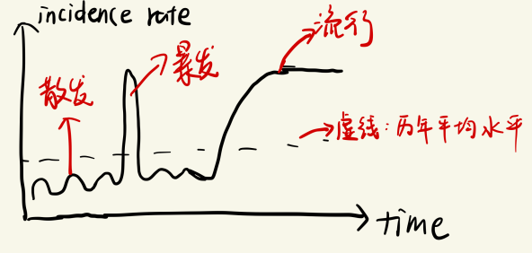
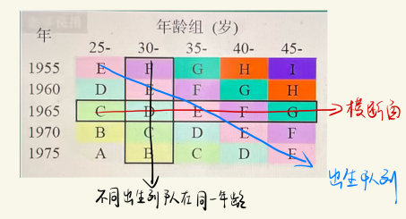
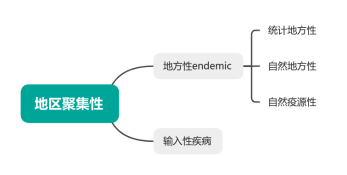

# 二、疾病的分布

> 来源：流行病学.docx · 2026-10-13 由 docx 转 Markdown（保留原大纲层级 / 表格 / 公式转为 LaTeX）
> 医学内容请以教材、指南与任课教师为准复核，不可用于临床决策。

## 1.疾病频率的测量指标：
### （1）发病频率测量指标：

| 发病频率指标 | 公式 | 含义 | 应用 |
|---|---|---|---|
| 发病率 | $\frac{\text{一定时期内某病新发病例数}}{\text{同期该人群的暴露人口数}} \times K$ | 一定时期内，一定范围人群内某病新发病例出现的频率 | ①了解疾病流行特征②探讨病因因素③提出病因假设④评价防制措施效果 |
| 罹患率 | $\frac{\text{一定时期内某病新发病例数}}{\text{同期该人群的暴露人口数}}\times K $ | 在某一局限范围内短时间内的发病率 | 用于食物中毒、职业中毒和传染病的暴发与流行 |
| 续发率/二代发病率 | $\frac{\text{潜伏期内易感接触者中发病例数}}{\text{易感接触者总人数}}\times K $ | 某些传染病在最短潜伏期到最长潜伏期之间，易感接触者中发病人数占所有易感接触者的比例 | ①传染病的流行病学调查②比较传染病的传染力强弱③分析传染病流行因素④评价卫生防疫措施的效果 |

发病率incidence rate：一定时期内，一定范围人群内某病新发病例出现的频率
$\text{发病率}=\frac{\text{一定时期内某病新发病例数}}{\text{同期该人群的暴露人口数}} \times K$
发病率是疾病流行强度的指标，反映疾病对人群健康影响的程度。通过发病率的比较，可①了解疾病流行特征，②探讨病因因素，③提出病因假设，④评价防制措施效果
罹患率attack rate：在某一局限范围内短时间内的发病率
$\text{罹患率}=\frac{\text{一定时期内某病新发病例数}}{\text{同期该人群的暴露人口数}} \times K$
常用于食物中毒、职业中毒、传染病的暴发与流行
续发率secondary attack rate：又称为二代发病率，指某些传染病在最短潜伏期到最长潜伏期之间，易感接触者中发病人数占所有易感接触者的比例
$\text{续发率}=\frac{\text{潜伏期内易感接触者中发病例数}}{\text{易感接触者总人数}} \times K$
常用于传染病的流行病学调查，还可用于比较传染病的传染力强弱，分析传染病流行因素，评价卫生防疫措施的效果
注意事项：①新发病例数：观察期内某一个人多次发病，应计为多个新发病例数
②暴露人口数：即易感人群，$=\text{总人口数}-\text{现患病人数}-\text{获得持久免疫力者}$，在实际应用时，由于不易分辨，因此常用平均人口数代替
③观察时间：一般为1年
④发病专率：发病率按不同人口学特征计算发病专率，在比较不同地区的人群发病率时要用标化发病率（消除了人口年龄性别构成的影响）
### （2）患病频率测量指标：
患病率/现患率prevalence：在一定时间，一定范围人群内某病新旧病例所占的比例。按观察时间的不同，分为时点患病率和期间患病率。时点患病率的观察时间一般不超过一个月。
$\text{时点患病率}=\frac{\text{某一时点某人群中某病新旧病例数}}{\text{该时点人口数}}\times K$
$\text{期间}\text{患病率}=\frac{\text{某观察期内某人群中某病新旧病例数}}{\text{该时期平均人口数}}\times K$
时点患病率的分子只看在那个时点的现患病例，在时点前死掉的病例是不计入的。但期间患病率不一样，期间患病率的分子是把观察期内只要患病过的都算入，不管你在观察期结束时是活的还是死的
引起患病率升高的原因：①易感者迁入②健康者迁出③病例迁入④新发病例增多（发病率升高）⑤治疗水平升高，使患者免于死亡，但未痊愈，导致病程延长⑥未治愈者的寿命延长⑦诊断水平增高⑧报告率增高
引起患病率降低的原因：①健康者迁入②病例迁出③新发病例减少（发病率降低）④病死率增高⑤治愈率增高⑥病程缩短
应用：①反映疾病的现患状况，对于病程较长的慢性病，可反映其流行情况
②估计某病对居民健康危害的严重程度
感染率prevalence of infection：在某时间内受检人群中某病原体现有感染者人数所占的百分比。
$\text{感染率}=\frac{\text{受检者中感染人数}}{\text{受检人数}}\times 100\%$
用于研究传染病或寄生虫病的感染情况和防制工作效果评价，常用于对于隐性感染、病原携带者及轻型或不典型病例的调查,为估计某病的流行态势和制定防制措施提供依据，也是评价人群健康状况的常用指标
### （3）死亡与生存频率测量指标：
死亡率mortality rate：在一定时期内，某人群中总死亡人数在该人群中所占的比例
$\text{（}\text{粗}\text{）}\text{死亡率}=\frac{\text{观察期内某人群总死亡人数}}{\text{同期该人群平均人口数}}\times K$
死亡专率：死亡率按照不同人口学特征分别计算得到，如死因别死亡率，年龄别死亡率，性别死亡率等
应用：①反映一个人群总死亡水平②衡量某一时期、某一地区人群死亡危险性的大小③反映一个地区不同时期人群的健康状况和卫生保健工作的水平④死亡专率可提供某病死亡在人群、时间、地区上变化的信息（三间分布），用于探讨病因和评价防制措施⑤在病死率高和生存时间短并存的情况时，死亡率可反映发病率。如胰腺癌、狂犬病，此时发病率≈该病死亡率，患病率很低（因为得病就几乎必死）
病死率case fatality rate：一定时期内，因某病死亡者占该病病人的比例。
$\text{病死率}=\frac{\text{某时期内因某病死亡人数}}{\text{同期该病的病人数}}\times 100\%$
应用：表示确诊某病者的死亡概率，反映疾病的严重程度以及医疗水平和诊治能力。常用于急性传染病，也可用于慢性病
婴儿死亡率infant mortality rate：婴儿出生后不满周岁死亡人数与出生人数的比率。
$\text{婴儿死亡率}=\frac{\text{某年婴儿死亡总数}}{\text{同年活产总数}}\times 1000\text{\u2030}$
某年婴儿死亡总数 = 上一年出生本年死亡的未满周岁婴儿 + 本年出生本能死亡的未满周岁婴儿
应用：①反映一个国家或地区医疗卫生条件、社会经济实力、人民生活水平以及科技发展水平②衡量人口素质的重要依据之一
生存率survival rate：接受某种治疗的病人或某病病人中，经n年随访尚存活的的病人数所占的比例
$\text{生存率}=\frac{\text{随访满}n\text{年尚存活的病例数}}{\text{随访满}n\text{年的病例数}}\times 100\%$
应用：反映疾病对病人生命的危害程度，可用于评价某些病程较长疾病的远期疗效，如癌症、心血管疾病、结核病等慢性病
### （4）标准化率（放在后面弄）
### （5）各指标的联系与区别：
①发病率与患病率的区别

|   | 患病率 | 发病率 |
|---|---|---|
| 资料来源 | 现况调查、筛检 | 队列研究、疾病报告、疾病监测 |
| 分子 | 某病新旧病例数 | 某病新发病例数 |
| 分母 | 平均人口数（期间患病率） 调查时点人口数（时点患病率） | 暴露人口数（理论） 平均人口数（实际） |
| 观察时间 | 较短，一般为1个月或几个月 | 一般为1年，或更长 |
| 适用疾病种类 | 慢性病、病程较长的疾病 | 各种疾病 |
| 用途 | 疾病现患状况、慢性病流行情况 | 疾病流行强度 |
| 影响因素 | 较多，如影响发病率变动的因素、病后结局（治愈？死亡？）、病程长短 | 较少，如疾病流行情况、诊断水平、疾病报告质量等 |

②发病率、患病率与病程的关系：
$\text{患病率}=\text{发病率}\times \text{病程}$
该公式成立的前提是：在某病的发病率和病程在相当长时间内保持稳定
③发病率与罹患率的区别：罹患率也是测量某人群某病新发病例的频率，但罹患率常用于食物中毒、职业中毒、传染病的暴发与流行，因此观察期较短，可用日、周、月为单位，它的优点是能根据暴露程度较精确地测量发病频率
④死因别死亡率和病死率的区别与联系：
区别：Ⅰ病死率表示一定时期内，某病患者中因该病而死亡的频率；而某病死亡率表示在一定时期内某人群中因该病而死亡的频率
Ⅱ病死率反映的是某疾病对病人生命的威胁程度，受到该疾病严重程度和医疗水平的影响；而某病死亡率反映的是某疾病对人群健康的危害程度
Ⅲ 病死率一般用百分率表示；某病死亡率通常用十万分率表示
联系：Ⅰ在某病病程和发病率处于稳定时，$ \text{病死率}=\frac{\text{某病死亡率}}{\text{患病率}}$
Ⅱ 都为描述生存和死亡频率的指标，都可用于定量研究疾病的分布特征
### （6）疾病负担指标：
①潜在减寿年数potential years of life lost PYLL：
某病某年龄组人群死亡者的期望寿命与实际死亡年龄之差的总和，即死亡所造成的寿命损失。
应用：①测量人群中疾病负担②评价人群健康水平③强调了早死对人群健康的损害④可用于比较不同疾病所致的寿命减少年数，每种疾病所致的寿命减少年数，从而衡量某种死因对人群的危害程度 ⑤可比较不同地区及不同时间 PYLL 的特点及变化趋势 ⑥综合估计导致某人群早死的各种死因的相对重要性
②伤残调整寿命年（21年名解）：disability adjusted life year ,DALY
从发病(发生伤害)到死亡（或康复）所损失的全部健康寿命年，包括因早死所致的寿命损失年(years of life lost,YLL)和疾病所致伤残引起的健康寿命损失年（years lived with disability,YLD）两部分。$DALY=PYLL+YLD$
应用：①比较和评价地区间的卫生健康状况 ②确定不同病种的疾病负担，分析不同人口学特征、不同地区、不同时间的危害程度及变化趋势 ③按DALY大小排序可对不同地区、不同人群、不同病种进行分析，以确定危害人群健康的主要病种及重点人群和地区。
## 2.疾病流行强度：
疾病流行强度：一定时期内疾病在某地区人群中的发病率的变化及其病例间的联系程度。根据发病率水平和病例间联系程度分为四种：
#### Ⅰ散发sporadic：发病率呈历年的一般水平，各病例间在发病时间和地点上无明显联系，表现为散在发生。常见于以下情况：
①常年流行，病后免疫力持久，或因预防接种使人群维持一定免疫水平的疾病，如麻疹
②隐性感染为主的疾病，如脊髓灰质炎、乙型脑炎
③传播机制难以实现的传染病，如斑疹伤寒、炭疽
④潜伏期较长的传染病，如麻风
#### Ⅱ暴发outbreak：在局部地区或集体单位，短时间内突然出现很多症状相同病人的现象。这些人多有相同的传染源或传播途径。大多数病人常同时出现在该病的最短和最长潜伏期之间。如幼托机构的麻疹、手足口病、甲肝等疾病的暴发
#### Ⅲ流行epidemic：在某地区某病的发病率显著超过该病历年的发病率水平，相对于散发，流行出现时的各病例在时间和空间上存在明显联系。当某地出现某种疾病的流行时，提示该地可能存在共同的传播因素，如2009年甲型H1N1流感的流行。
#### Ⅳ大流行pandemic：某病的发病率显著超过该病历年发病率水平，且疾病蔓延迅速，涉及地区广，在短期内跨越省界、国界甚至洲界形成世界性流行。

#### 同源暴发：指某易感人群中的成员同时暴露于某共同的病原体或污染源而引起的暴发，例如一次会餐引起的食物中毒暴发
#### 流行曲线怎么看？
## 3.疾病的分布：
疾病分布distribution of disease：是指疾病在不同人群、不同时间、不同地区的存在状态及其发生、发展规律。主要内容是描述疾病的发病、患病和死亡的群体现象及其特点和规律。
研究疾病分布的意义：了解疾病分布的特点是流行病学的首要任务；掌握疾病分布特点才能探索流行规律及其影响因素，为形成病因假说及探索病因提供线索，为临床医学和卫生服务需求提供重要信息，为制订和评价防制疾病及促进健康策略和措施提供科学依据
### （1）人群分布：（年龄、性别是重要考点）
人群的一些固有特征或社会特征可构成疾病或健康状态的人群特征，这些特征包括：年龄、性别、职业、种族和民族、婚姻与家庭、行为生活方式、宗教信仰、人口流动等
Ⅰ年龄

疾病年龄分布有两种分析方法：两者混淆！！！
①横断面分析cross-sectional analysis：分析同一时期不同年龄组或不同年代各年龄组（其实这两是一个意思）的发病率、患病率或死亡率的变化，
用途：多用于某时期传染病或潜伏期较短疾病的年龄分布分析
②出生队列分析birth cohort analysis：同一时期出生的一组人群称为出生队列，对其随访若干年，以观察发病情况，这种利用出生队列资料将疾病年龄分布和时间分布结合起来描述的方法称为出生队列分析。
用途：在评价疾病的年龄分布长期变化趋势及提供病因线索等方面具有很大意义，它可以明确呈现致病因子与年龄的关系，有助于探明年龄、所处时代暴露特点及经历在疾病的频率变化中的作用。
### （2）地区分布：（地区聚集性、地方性疾病是重点）
疾病的分布特征与一定地域空间的自然环境、社会环境等多种因素密切相关。疾病在不同地区的分布特征反映出致病因子在这些地区作用的差别，根本原因是由于疾病危险因素的分布和致病条件不同所造成。
Ⅰ国家间及不同地区的分布：包括疾病在不同国家间的分布、疾病在同一国家不同地区的分布

Ⅱ城乡分布
Ⅲ地区聚集性endemic clustering：
地区聚集性：某地区发病及患病等疾病频率高于周围地区，该地区疾病频率超过了随机概率（有统计学差异），称为疾病的地区聚集性。若某疾病表现为地区聚集性，提示该地区特定的疾病因子对人群健康产生了影响。
①地方性 endemic：由于自然因素（自然地方性）或社会因素（统计地方性）的影响，某种疾病经常存在于某地区或只在一定范围的人群中发生，而不需自外地输入。分为3类：
1.自然地方性：某些疾病受自然环境的影响只在某一特定地区存在的情况。包括两种情况：一类是疾病与自然环境中的微量元素有关（地方病），如地方性甲状腺肿、氟中毒等；另一类是该地区的自然环境适合某种病原体生长发育和传播媒介生存，使该病只在这一地区存在，如血吸虫病、丝虫病等。
2.统计地方性：由于生活条件、卫生条件和宗教信仰等社会因素使某一地区某些疾病发病率长期显著高于其他地区，与该地自然环境关联甚微。如痢疾等肠道传染病常发生于卫生条件差的地区。
3.自然疫源性：某些疾病的病原体在繁衍种属的过程中不依赖于人，而在野生动物或家畜中传播，人是偶尔介入该环节时受到感染，这种情况称为自然疫源性。如鼠疫、流行性出血热、森林脑炎、SARS等。
②输入性疾病：又称外来性疾病，凡本国或本地区不存在或已消灭的传染病，从外国或其他地区传入时，称为输入性疾病。如艾滋病。
Ⅳ地方性疾病endemic disease：指局限于某些特定地区内相对稳定并经常发生的疾病，也称地方病。一般意义上是指一类由于自然地理环境中人体正常代谢所需的某些微量元素过多或缺乏所致的疾病。如地方性氟中毒、地方性砷中毒、碘缺乏病、大骨节病等。
判断地方病的五条依据：①该地区居民发病率高 ②其他地区居民发病率低，甚至不发病 ③迁入该地区一段时间后，其发病率和当地居民一致 ④迁出该地区，发病率降低，患病症状减轻或自愈 ⑤当地的易感动物也可发生同样疾病（第五点易忘）
### （3）时间分布：（四个都要记）
疾病频率随着时间的推移呈现出动态变化，这是由于随人群所处的自然环境、社会环境、生物学环境等因素的改变所致。通过疾病的时间分布可了解疾病的流行规律，为疾病的病因研究提供重要的线索，验证可疑的致病因素与疾病发生的关系，通过防制措施实施前后疾病频率的变化评价其效果。
Ⅰ短期波动rapid fluctuation：一般指持续几天、几周或几个月的疾病流行或疫情暴发，是疾病的特殊存在方式。一般有明确的原因，多数情况是由于大量人群同时或持续暴露于某共同致病因素，致使人群中疾病病例数在短时间内迅速增多。如集体食堂的食物中毒、职业中毒、伤寒、痢疾等肠道传染病的暴发或流行。自然灾害、环境污染以及社会政治、经济文化因素等也可导致疾病的短期波动
短期波动和暴发的区别：暴发常用于少量人群，是衡量流行强度的指标；短期波动常用于较大数量的人群，是疾病的时间分布
Ⅱ季节性season variation/seasonality：疾病在一定季节内呈现发病率增高的现象。有两种表现形式：
①季节性升高：一年四季均发病，但仅在一定月份发病率升高。如肠道传染病（诺如病毒、手足口，夏秋季高发）、呼吸道传染病（冬春季高发），非传染病也有季节性升高的现象，如克山病、冠心病
②严格的季节性：在某些地区以虫媒传播的传染病有严格的季节性，发病集中在少数几个月内，其余月份没有病例发生。如流行性乙型脑炎
Ⅲ周期性cyclic variation/periodicity：疾病频率按照一定的时间间隔，有规律地起伏波动，每隔数年出现一个流行高峰的现象。
形成周期性的主要原因：一次大规模流行后，人群中免疫人数比例增高，发病率降低。一段时间后，易感者积累到一定数量时，人群易感性增高，新的发病高峰便会再次出现。
影响疾病周期性及间隔时间的常见原因：
①人口密集、交通拥挤、卫生条件差等因素有利于疾病的传播。当有传染源和足够数量的易感者，又无有效的预防措施时，其流行特征呈现一定的周期性。
②传播机制容易实现的疾病：疾病容易传播，人群中新的易感者积累的速度快，特别是新生儿，导致周期间隔短
③病后可形成稳固免疫的疾病：流行后人群免疫水平持续时间长，周期间隔长。
④病原体变异及其变异的速度：变异越快，周期间隔越短。
Ⅳ长期趋势secular trend：也叫长期变异或长期变动，是指一个比较长的时间内，通常为几年或几十年，疾病的临床特征、分布状态、流行强度等各方面发生变化。
长期变异出现的原因：①病因或致病因素的变化、②病原体的变异、③机体免疫状况的该病、④医疗和防制水平的提高、⑤报告及登记制度完善程度
### （4）移民流行病学定义及应用（移民流行病学建议刷题来巩固，不要光理论不实战，绿本有一题就很绕，小难，11年真题选择题第5题、简答题第4题）
Migrant epidemiology 是进行疾病人群、地区和时间分布综合描述的一个典型（三间分布典型例子），由于居住地迁移、气候条件、地理环境等自然因素的变化，生活方式、风俗习惯等社会因素的差异，移民人群的疾病频率会发生程度不同的变化；移民流行病学是探讨疾病病因的一种方法，它是通过观察疾病在移民、移居地当地居民及原居地人群间的发病率或死亡率的差异，从而探讨疾病的发生与遗传因素或环境因素的关系。
意义：常用于肿瘤、慢性病、某些遗传病的病因和流行因素的探讨
研究原则：
①若某病发病率或死亡率的差别主要是环境因素作用的结果，那么该病在移民人群中的发病率或死亡率应该与原居地人群不同，而接近移居地当地居民。
②若某病发病率或死亡率的差别主要是遗传因素作用的结果，那么该病在移民人群中的发病率或死亡率应该与移居地当地居民不同，而接近原居地人群。
遗传度：在多基因遗传病中，易患率的高低受到遗传基础和环境因素的双重影响，其中遗传基础所起作用的大小，一般用百分率表示。

---

相关：[索引](索引.md) · 流行病学 MOC
