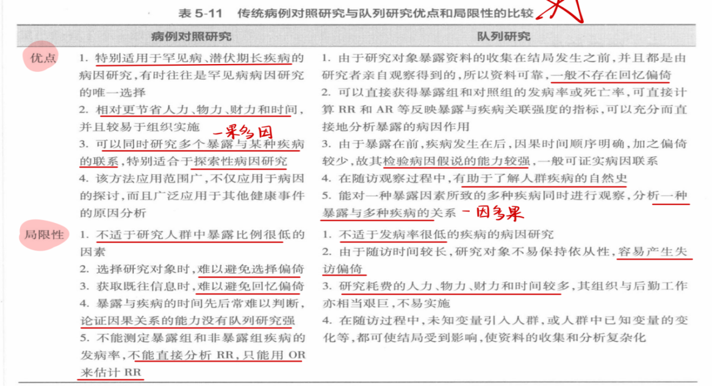

# 六、病例对照研究

> 来源：流行病学.docx · 2026-10-13 由 docx 转 Markdown，2026-10-15 修订公式处理
> 医学内容请以教材、指南与任课教师为准复核，不可用于临床决策。

## 基本原理：
①以当前已经确诊的患有某特定疾病的一组病人作为病例组，
②以不患有该病但具有可比性的一组个体为对照组，（只是不患所研究疾病，可患别的疾病）
③通过询问、实验室检查或复查病史，搜集研究对象既往对各种可能的危险因素暴露史，
④测量并采用统计学检验，比较病例组和对照组各因素暴露比例的差异是否具有统计学意义，
⑤评估各种偏倚对研究结果的影响，并借助病因推断技术，判断某个或某些暴露因素是否为疾病的危险因素，从而达到探索病因（提出病因假设）和检验病因假设的目的。
## 基本特点：
①观察性研究
②研究对象分为病例组和对照组
③由果溯因
④因果联系的论证强度相对较弱：相比于队列研究较弱
## 研究类型：
### ①非匹配病例对照研究：又叫做成组病例对照研究，即在设计所规定的病例和对照人群中，分别抽取一定数量的研究对象进行组间比较，对照的选择没有任何限制与规定。一般对照的人数应等于或多于病例人数。非匹配较匹配法更容易实施，但控制混杂因素的能力较弱。
### ②匹配病例对照研究：在对照的选择上，要求某些因素或特征与病例保持一致，目的是使匹配因素在病例和对照组中保持均衡（混杂偏倚就是由于混杂因素在两组中的分布不均衡），从而排除这些因素对结果的干扰。
匹配的优缺点：这种方法可增加可增加分析时的统计检验能力，提高研究效率，但也增加了选择对照的难度，并且资料整理和统计分析较麻烦。（匹配的主要目的是提高研究效率，次要目的是控制混杂因素）
### ③衍生类型
Ⅰ巢式病例对照研究nested case-control study：队列研究与病例对照研究结合的设计形式，基本设计方法：在队列研究基础上，在一定的观察期中，当所研究疾病的新发病例累积到一定数量，则可将全部病例集中组成“病例组”；在每个病例发病时，从同一队列的未发病者中，按一定匹配条件随机选择对照，集中组成“对照组”；然后抽取病例与对照的基线资料，并检测收集的生物学标本，按匹配病例对照研究的方法进行资料的统计分析。
特点：
①建立在一项真实的队列研究的基础上
②对照是从某一特定时间点所有尚未发病而面临发病危险的队列成员中选择
③病例和对照在随访时间上是匹配的，在进行分析研究结果时控制了时间的影响
④某一时间点选择的对照可能随后发生疾病而变为病例，所以少数研究对象可能兼具病例和对照的双重身份
⑤所得出的比数比可以估计队列的发病密度比，且无论疾病本身的发病率高低
⑥相比队列研究，巢式病例对照研究可以选择较少数量的研究对象而更有效率
⑦巢式病例对照研究兼有队列研究和病例对照研究的优点，相对于病例对照研究的统计效率和检验效率更高，同时还可以了解疾病的发生频率。
优点：（与传统病例对照研究相比，巢式的优点在于）
①有一个明确定义的可供抽样的人群，且可以显著降低选择偏倚
②如果对暴露因素的调查在随访开始时或者其他发病前的时间段已经进行了，也可以减少回忆偏倚
③如果疾病和暴露存在关联，符合因果推断的时间顺序，论证能力更强
④统计效率和检验效率更高，同时可以了解疾病的发生频率
缺点：
耗费人力物力财力时间，研究设计复杂
Ⅱ病例-队列研究case-cohort study：队列研究与病例对照研究结合的设计形式，基本设计方法：在队列研究开始时，在队列中按一定比例随机抽样选出一个有代表性的样本作为对照组；观察结束时，将队列中出现的所研究疾病的全部病例作为病例组，与对照组进行比较。
病例队列研究和巢式病例对照研究的区别

|   | 病例队列研究 | 巢式病例对照研究 |
|---|---|---|
| 对照选择方式 | 在队列研究开始时，从基线纳入的全部队列成员中随机抽取 | 在每个病例发病时，从同一队列的未发病者中，按一定匹配条件随机选择 |
| 对照组作用 | 可作为多种疾病结局的共用对照组 | 不同疾病结局的研究，对照组不同 |

Ⅲ病例-病例研究case-case study：比较的两组均为病例，也称单纯病例研究case only study。适用于研究两组病因的差异部分，而其相同或近似的危险因素将被掩盖或低估；也可用于研究遗传与环境因素之间的交互作用。
Ⅳ病例交叉研究case crossover study：对于事件诱发因素的研究，可采用病例交叉研究，即以每个病例发病之前的一个或多个时间段作为“对照”时间段（自身对照），疾病发生时的暴露情况和同一个个体“对照”时间段的暴露情况进行比较（发病时的暴露与发病前的暴露进行比较）。适用于研究暴露的瞬时效应，即暴露对发生急性事件的影响。只有少数情况适合病例交叉研究。
## 用途：
①用于疾病病因或危险因素的研究：适合潜伏期长以及罕见的疾病。既可广泛探索病因或危险因素（产生病因假设），也可检验病因假设。
②用于健康相关事件影响因素的研究：对与健康相关的医学事件或公共卫生问题的影响因素进行研究，为制定相应卫生决策提供依据（如意外伤害、老年人生活质量、长寿、肥胖与超重）
③用于疾病预后因素的研究：筛选和评价影响疾病预后的因素。（将某疾病的不同结局，如死亡和痊愈，分为病例组和对照组，作回顾性调查，追溯导致某种结局的有关因素，即暴露）
④用于临床疗效影响因素的研究：将发生和未发生某种临床疗效者分别作为病例组和对照组进行病例对照研究，分析不同疗效的影响因素。
## 设计与实施：
### 基本实施步骤：
确定研究目的→明确研究类型（匹配/非匹配）→确定研究对象（病例、对照选择）→确定样本量→确定研究因素（暴露）→资料收集→资料整理和分析
### 明确研究类型：
①如果研究目的是广泛探索病因：采用非匹配、频数匹配的病例对照研究。
②研究目的是检验病因假设，尤其是小样本研究或因病例的年龄、性别等构成特殊，随机抽取的病例组很难与对照组均衡可比时，采用个体匹配的病例对照研究。（个体匹配分为1：1配对和1：r）
### 匹配：
①频数匹配frequency matching：对照具有某种或某些因素或特征者所占的比例与病例组一致或相近（例如对照组女性有1/4，病例组女性也有1/4）
②个体匹配individual matching：以对照与病例个体为单位进行匹配。分为
1：1配对pair matching：一个病例匹配一个对照。总样本量一定时，若两组来源较充足，病例与对照之比为1：1时统计学效率最高
1：r匹配：若研究罕见病或合格病例很少，则采用1：r匹配。随着r增大，效率逐渐增大，但增加幅度越来越小，且工作量显著增大，所以最好别超过1：4。
匹配的注意事项
①匹配变量必须是已知的混杂因素，或有充分理由怀疑为混杂因素，否则不应匹配。
②疾病因果链上的中间变量不应匹配
③只与可疑病因有关而与疾病无关的因素不宜匹配
④同一个研究中，不应该选择很多匹配因素。匹配变量越多，选择合格的对照越难。
⑤匹配过度overmatching：把不起混杂作用的因素作为匹配变量进行匹配，试图使对照组和病例组在多方面都一致，结果导致所研究的因素也趋于一致，反而降低了研究效率。
在病例对照研究中，匹配过度会低估暴露因素的作用
⑥一定不能将研究者感兴趣的研究变量作为匹配因素。
### 病例的选择：
病例的定义：
①病例应符合统一、明确的疾病诊断标准：尽可能使用金标准；对于尚无明确诊断标准的疾病，可根据研究需要自定标准，但要注意均衡诊断标准的假阳性率和假阴性率，使诊断标准宽严适度
②若研究者为了某个特殊的研究目的，可以对研究对象的某些特征做出规定或限制。

|   | 优点 | 缺点 |
|---|---|---|
| 新发病例 | ①包括了不同病情和预后的病人，代表性好 ②病人确诊不久就被调查，对有关暴露的回忆信息较为准确可靠，不受各种预后因素的影响（回忆偏倚较小） | 在一定范围或时间内较难获得预期的病例数，尤其对于罕见病（新发病例不好找，数量不够） |
| 现患病例 | 可以在较小范围或较短时间内得到足够的病例数（容易获得足量的病例数） | 现患病例的患病时间较长，对暴露史回忆的可靠程度较新发病例差，难以区分暴露与疾病发生的时间顺序（回忆偏倚大） |
| 死亡病例 | 对一些主要靠亲友提供资料的疾病（如儿童白血病），并不排除应用死亡病例，只是在资料整理和分析时要充分考虑可能的偏倚 | 死亡病例的暴露信息主要由其家属提供，准确性较差 |

病例选择的类型：
病例的来源：

|   | 医院来源 | 社区人群来源 |
|---|---|---|
| 优点 | 节省费用、合作性好、资料容易获得、信息较完整准确 | 代表性好，结果推及该人群的可信程度较高 |
| 缺点 | 不同医院接收的病人具有不同的特征，如果仅从一所医院选择病例，代表性较差 | 调查工作困难，耗费人力物力较多 |

### 对照的选择：
对照选择的原则：
①对照必须是以与病例相同的诊断标准认为不患所研究疾病的人；
②对照应能够代表产生病例的源人群，即对照的暴露分布与病例源人群的暴露分布一致（要么是病例的源人群，要么是与病例源人群的暴露分布一致的其他人群）
对照的来源：

|   | 优点 | 缺点 |
|---|---|---|
| 医疗机构 | 易于选取、比较合作，可利用档案资料，实际工作常用 | 这种来源的对照暴露分布常常不同与病例的源人群 |
| 社区人群 | 不易出现医院对照所面临的选择偏倚问题 | 实施难度大、费用高，不易配合 |
| 病例的邻居或同一住宅区 | 有助于控制社会经济地位的混杂作用，用于匹配设计 |   |
| 病例的配偶、亲戚、同学、同事 | 有助于控制某些环境或遗传因素的混杂作用，用于匹配设计 |   |

选择医院对照的原则：①因已知的与所研究的暴露因素有关的病种入院的病人不能作为对照
②对照应该由尽可能多的病种的病人组成，以避免因过多地代表某一类病人，而该病种恰好与所研究疾病具有共同的危险因素，从而影响研究结果的真实性。
对照选择的方法：
匹配或非匹配
①非匹配设计：选择对照没有任何限制和要求（直接在对照人群里随机抽取）
②匹配设计：要求对照在某些特征或因素上与病例保持一致，保证对照与病例的可比性，以便对两组进行比较时排除匹配因素的干扰。主要目的是提高研究效率。其次是控制混杂因素的干扰。
### 影响样本量的因素：P₀、OR、α、β 都与n相反：这四个小，n就大
①研究因素在对照组或人群中的暴露率P₀
②研究因素与疾病关联强度的估计值，即比值比OR
③显著性水平α，即第Ⅰ类错误（假阳性）概率，一般取0.05
④检验效能/把握度(1−β)，β是第Ⅱ类错误概率，一般取0.10
## 资料的整理与分析：
### （1）资料整理：书本86页
（2）资料分析：描述性统计+推断性分析
### 描述性统计：
①一般特征描述：对研究对象的一般特征的分布频率进行描述，如年龄、性别、职业、居住地等及病例的临床分型
②均衡性检验：比较病例组和对照组某些基本特征是否相似或相同，目的是检验两组的可比性。

|   | 病例组 | 对照组 |
|---|---|---|
| 暴露 | a | b |
| 非暴露 | c | d |

### 推断性分析/统计性推断：
①非匹配设计资料的分析：
先画四格表
Ⅰ暴露与疾病关联性分析：
检验病例组和对照组对于某因素暴露率的差异是否有统计学意义，即(a/a+c)与(b/b+d)的差异是由抽样误差引起的，还是确实存在真实的差异，即该暴露与疾病存在统计学关联。四格表的χ²检验
${\chi}^{2}=\frac{{N\left(ad-bc\right)}^{2}}{\left(a+c\right)\left(b+d\right)\left(a+b\right)\left(c+d\right)}\text{，}v=1$
当四格表中一个格子理论数≥1但<5，总例数>40时，使用χ²检验的连续校正公式
χ\校正\²=N(|ad−bc|−N/2)²/(a+c)(b+d)(a+b)(c+d)，v=1
考试步骤：先算两组各自的暴露率，然后按照建立假设检验、检验水准、计算χ²值，计算P值，然后得出两组暴露率是否有统计学差异的结论。
Ⅱ关联强度分析：求OR值（比值比odds ratio）
描述暴露与疾病关联强度的之比是RR值，但病例对照研究无法计算发病率，也就无法直接计算RR值，因此用OR值odds ratio来近似估计RR值。OR的含义与RR相同，均指暴露者疾病的危险性（发生疾病风险）是非暴露者的多少倍。

|   | 大于1 | 等于1 | 小于1 |
|---|---|---|---|
| OR | 暴露与疾病是正关联，危险因素 | 无统计学关联 | 暴露与疾病是负关联，保护因素 |

OR值是病例组的暴露比值$\text{（}\frac{a}{a+c}/\frac{c}{a+c}\text{）}$与对照组的暴露比值$(\frac{b}{b+d}/\frac{d}{b+d})$之比
$OR=\text{（}\frac{a}{a+c}/\frac{c}{a+c}\text{）}/(\frac{b}{b+d}/\frac{d}{b+d})=\left(\frac{a}{c}\right)/\left(\frac{b}{d}\right)=\frac{ad}{bc}$
考试步骤：先计算OR值，然后说暴露者（具体暴露）发生疾病的危险性是非暴露者的多少倍，提示正/负相关关系，说明该暴露是疾病的危险因素/保护因素。
Ⅲ OR的95%置信区间：
第二步计算的OR是用一次病例对照研究的资料计算而来，是点估计值，由于存在抽样误差，所以我们还要计算OR的可信区间
$95\%CI={OR}^{1\pm 1.96/\sqrt{{\chi}^{2}}}$
(注意：是1.96/√(χ²)，就算检验时用的是校正卡方，这里仍然用不校正的卡方)
或OR的95%CI=e\lnOR的95%CI\=e\lnOR±1.96√(Var（lnOR）)\=e\lnOR±1.96√(1/a+1/b+1/c+1/d)\
Ⅳ估计 归因危险度百分比AR% 和 人群归因危险度百分比PAR%
当所研究的疾病发病率很低时，OR≈RR，此时用OR代替RR计算AR%和PAR%
$AR\%=\frac{{I}_{e}-{I}_{0}}{{I}_{e}}=\frac{RR-1}{RR}\approx \frac{OR-1}{OR}\times 100\%$
$PAR\%\approx \frac{{P}_{e}\text{（}OR-1\text{）}}{{P}_{e}\text{（}OR-1\text{）}+1}\times 100\% ,$
Pₑ是人群的暴露率，我们用对照组的暴露率来代表，Pₑ=b/b+d
答题：AR%是指在暴露人群中由于该暴露因素引起的某病发病占全部该病发病的百分比，
PAR%是指在一般人群中由于该暴露因素引起的某病发病占全部该病发病的百分比。

| 对照组 | 病例组 |   |
|---|---|---|
|   | 有暴露 | 无暴露 |
| 有暴露 | a | b |
| 无暴露 | c | d |

②1：1配对资料的分析：
先画四格表
Ⅰ暴露与疾病关联性研究
Mcnemar χ²检验
χ²=(b−c)²/b+c（适用于大样本：b+c≥40）
χ²=(|b−c|−1)²/b+c（适用于小样本：b+c<40）
Ⅱ关联强度研究：
OR=c/b（病有/病无）
Ⅲ OR的95%CI
$95\%CI={OR}^{1\pm 1.96/\sqrt{{\chi}^{2}}}$
(注意：是1.96/√(χ²)，就算检验时用的是校正卡方，这里仍然用不校正的卡方)
或OR的95%CI=e\lnOR的95%CI\=e\lnOR±1.96√(Var（lnOR）)\=e\lnOR±1.96√(1/a+1/b+1/c+1/d)\
③非匹配资料的分层分析stratification analysis：
我们可以用匹配设计来控制一些混杂因素，但对于那些未被匹配的混杂因素，需用分层分析来识别、估计和控制其作用。
分层分析：根据潜在混杂因素（设计者并不知道的混杂因素）的有无或程度，将研究对象分为不同的层，然后在各层中比较病例组和对照组暴露因素的分布。可按某一混杂因素分成若干亚层后，分别计算各层的ORᵢ，并进行齐性检验homogeneity test。
若齐性检验结果显示各层的OR值的差别没有统计学意义，说明各层资料是同质的，可计算总的OR即Mantel−Haenszel OR（简称OR\MH\）
若齐性检验结果显示各层的OR值的差别有统计学意义，提示各层资料不属于同质资料，则不宜计算合并OR值，应进一步分析分层因素与暴露因素之间的交互作用interaction。
混杂因素的识别？
将该因素与暴露因素进行χ²检验以及关联强度计算，发现该因素与暴露因素有关联；然后再将该因素与疾病发生进行χ²检验以及关联强度计算，发现该因素与疾病发生也有关联；同时该因素并不是暴露因素与疾病发生的因果链中的一环，那么可认为该因素是混杂因素，然后就可以对其进行分层分析。
考试步骤：
第一步：计算各层的ORᵢ和不考虑分层的OR
第二步：发现各层的ORᵢ均比不分层时的OR大，说明该因素起了一定的混杂作用。
第三步：对各层ORᵢ进行齐性检验，显示各层的OR值的差别没有统计学意义，说明各层资料是同质的，可计算χ\MH\²、OR\MH\、OR\MH\的95%CI
第四步：OR\MH\高于不分层的OR，说明由于混杂因素的作用，减弱了暴露因素和疾病的联系强度
混杂因素引起的偏倚是正偏倚还是负偏倚，取决于混杂因素对结局的影响是否和暴露因素一致，若混杂因素增强了暴露因素和疾病的联系强度，则属于正偏倚；若混杂因素减弱了暴露因素和疾病的联系，则为负偏倚

|   | 混杂正偏倚（增强暴露与疾病的联系强度） | 混杂负偏倚（减弱了暴露与疾病的联系强度） |
|---|---|---|
| 暴露是危险因素OR\暴露\>1越大越好 | OR\暴露+混杂\>OR\暴露\ | OR\暴露+混杂\\<OR\暴露\ |
| 暴露是保护因素 OR\暴露\<1越小越好 | OR\暴露+混杂\\<OR\暴露\ | OR\暴露+混杂\>OR\暴露\ |

| 组别 | 暴露分级 |   |   |   |   |
|---|---|---|---|---|---|
|   | X0 | X1 | X2 | X3 | ...... |
| 病例组 | a0（c） | a1 | a2 | a3 |   |
| 对照组 | b0（d） | b1 | b2 | b3 |   |
| 合计 |   |   |   |   | N |

④剂量反应关系的分析：
对于分级资料，即暴露因素不同水平的资料
第一步：R×C列联表
第二步：χ²检验，判断病例组和对照组暴露分布的差别是否有统计学意义
第三步：计算各暴露水平的OR值，以最低水平的暴露组为参照组，其余暴露水平各组分别与参照组进行比较，计算各组OR值。发现OR值随着暴露水平的增加而递增，呈现明显的剂量反应关系。
第四步：χ²趋势检验，检验剂量反应关系是否有统计学意义
⑤研究功效/把握度power：
拒绝无效假设的能力，即当无效假设不成立时，该假设被拒绝的概率。（发现正确的H1的能力/概率），一般认为power应该在80%以上
## 常见偏倚及其控制：
### 选择偏倚：
一项病例对照研究所选择的研究对象只是源人群的一个样本，由于选入的研究对象与未选入者在某些特征上存在差异而引起的系统误差。
#### ①入院率偏倚admission rate bias/伯克森berkson's bias：
在以医院为基础的病例对照研究中常发生这种偏倚，即当选择医院的病人作为病例和对照时，病例组只是该医院或某些医院的特定病例而不是全体病人的随机样本，对照组是医院的某一部分病人而不是全体目标人群的随机样本，病人对医院以及医院对病人都有一定的选择性，特别是因为各种疾病的入院率不同可导致病例组和对照组在某些特征上的系统误差。
如何控制入院率偏倚？
1.尽可能在社区人群中选择病例和对照，保证较好的代表性（？避免入院率偏倚的方法就是不在医院选，这样就没有入院率偏倚了，难绷）
2.如进行以医院为基础的病例对照研究，最好能在多个不同级别、不同类型的医院选择一定时期内连续观察的某种疾病的全部病例或随机样本，在与病例相同的多个医院、多个科室、多个病种的病人中选择对照。（病例要在多个医院里选择，包括不同级别、不同类型；对照要在与病例相同的多个医院、科室、病种里选择）
3.与所研究的暴露因素有关的病种就诊的病人不宜作为对照，以便减少入院率偏倚。（例如研究吸烟与肺癌的关系，那么患有肺气肿的病人就不宜作为对照组，因为肺气肿的病人吸烟的概率更高，即导致对照组的暴露比例偏高）
#### ②现患病例-新发病例偏倚prevalence-incidence bias/奈曼Neyman bias：
1.如果调查对象选自现患病例，即存活病例，特别是病程较长的现患病例，得到的一些暴露信息可能只与存活有关，而未必与该病的发生有关，从而错误地估计了这些因素的病因作用；
2.另一种情况是，某病的幸存者由于疾病而改变了原有的一些暴露特征（如某些生活习惯），当他们被调查时容易误将这些改变过的暴露特征当作疾病前的状况（和回忆偏倚类似），从而导致这些因素与疾病的关联误差。
控制奈曼偏倚：尽量选择新发病例作为研究对象
#### ③检出症候偏倚detection signal bias/暴露偏倚unmasking bias：
某因素虽然不是所研究疾病的病因，但有该因素的个体容易出现某些症状或体征，并常因此而就医，从而提高了所研究疾病的早期病例的检出率。若病例组中包含较多这种早期病例，致使过高地估计了病例组的暴露程度，而产生的系统误差即为检出症候偏倚。
控制方法：在医院中收集病例时，最好包括不同来源的早、中、晚期病人。
#### ④时间效应偏倚、无应答偏倚、选择性转诊偏倚等
### 信息偏倚：
又称为测量偏倚或观察偏倚或错误分类偏倚，是在收集整理信息过程中，由于测量暴露与结局的方法有缺陷造成的系统误差。
#### ①回忆偏倚recall bias：由于研究对象对暴露史或既往史回忆的准确性和完整性存在系统误差引起的偏倚。是病例对照研究中最常见的偏倚。
控制回忆偏倚的方法：
1.充分利用客观记录资料，问卷调查时重视提问方式，适当采用一些调查技巧。
2.选择新发病例作为调查对象。（选择偏倚中的现患-新发偏倚也是因为研究对象对暴露史的 回忆不准确引起，所以这两者有些类似。）
#### ②调查偏倚investigation bias：既可来自于调查者，也可来自于调查对象。1.病例与对照的调查环境与条件不同，2.调查者对病例与对照采取不同的询问方式，或对暴露测量方法、采用的仪器设备或试剂不统一、不准确等均可产生调查偏倚。
控制调查偏倚的方法：
- 做好调查员的培训，统一对病例和对照的提问方式和调查技术，尽可能使用量化或等级化的客观指标，由同一调查员调查病例和对照，调查环境尽量一致。
- 调查员向被调查对象讲清楚调查的目的，尽量取得他们的信任与合作。
- 使用的设备、试剂应精良、统一，使用前应校准，在使用过程中要经常进行检查。
### 混杂偏倚confounding bias：
懒得写了，和队列那边的一样
控制方法：
1.研究设计阶段：对研究对象采取匹配或限制等方式
2.资料分析阶段：分层分析或多因素分析
## 病例对照与队列的异同点：

|   |   | 病例对照 | 队列 |
|---|---|---|---|
| 同 |   | ①都是分析性研究 ②都可进行疾病病因或危险因素的研究 |   |
| 异 | ①研究情况 | 一果多因 | 一因多果 |
|   | ②主要偏倚类型 | 回忆偏倚、选择偏倚 | 失访偏倚 |
|   | ③适用情况 | 适用于潜伏期长以及罕见病的病因研究 不适于研究人群中暴露比例很低的因素 | 不适于发病率很低的疾病的病因研究 |
|   | ④资料收集 | 大多为现成资料 | 研究者亲自观察得到 |
|   | ⑤时间顺序判断 | 暴露与疾病的时序性难以判断 | 前因后果 |

## 病例对照研究与队列研究的优点与局限性：

## 现况研究、队列研究、病例对照研究的比较

| 研究类型 | 横断面研究 | 队列 | 病例对照 |
|---|---|---|---|
| 分类 | 描述性研究 | 分析性研究 | 分析性研究 |
| 观察的次数 | 单点观察同时收集暴露与疾病史资料 | 基线确定暴露、 前瞻确定结局 | 单点观察 |
| 暴露方向信息 | 不知道暴露与疾病的先后 | 基线收集暴露信息，前瞻收集结局信息 | 回顾性收集暴露信息 |
| 数据来源 | 抽样调查数据、第二手数据（学校记录、全国调查） | 暴露与结局的原始数据、某些设计的第二手数据 | 患者的原始数据、第二手数据（医院登记、医学记录） |
| 观察单位 | 个体 | 个体 | 个体 |
| 危险度测量 | 患病估计 | RR | OR |
| 优点 | 能在短时间内完成 | 略 |   |
| 缺点 | 暴露与结局的时序性无法确定，仅可作一些初步的比较分析 |   |   |
| 应用 | 可为后续的分析性或实验研究提供线索 | 检验病因假设 评价预防措施效果 研究疾病自然史 新药上市后监测 | 1.疾病病因或危险因素的研究 2.健康相关事件影响因素的研究 3.疾病预后因素的研究 4.临床疗效影响因素的研究 |

---

相关：[索引](索引.md) · 流行病学 MOC
