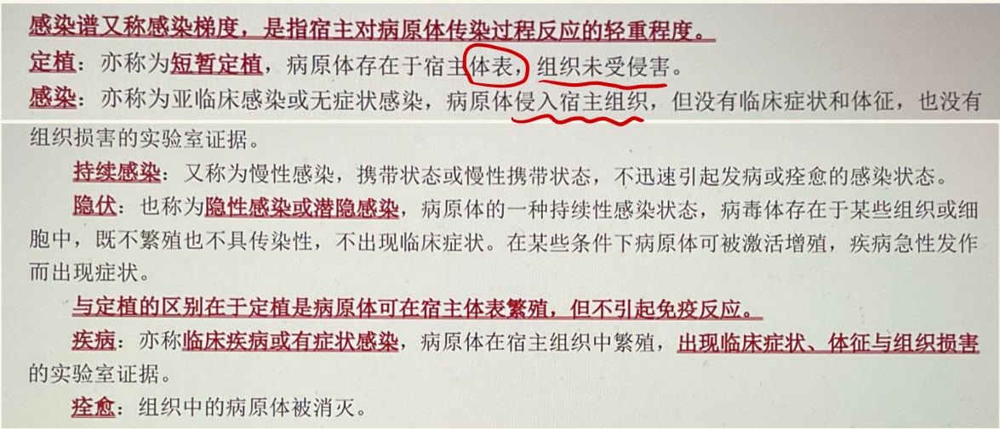
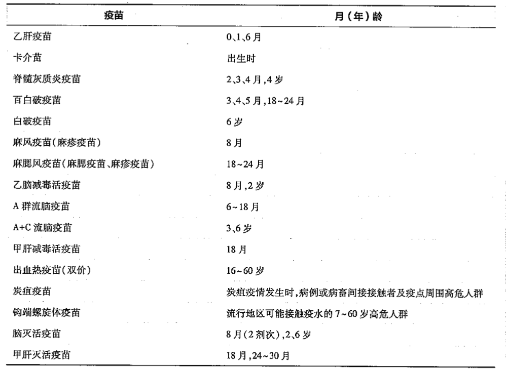

# 十、传染病流行病学

> 来源：流行病学.docx · 2026-10-13 由 docx 转 Markdown（保留原大纲层级 / 表格 / 公式转为 LaTeX）
> 医学内容请以教材、指南与任课教师为准复核，不可用于临床决策。

传染病：由病原体引起的，能在人与人、动物与动物以及人与动物之间相互传播的疾病。病原体通过感染人、动物或储存宿主直接或间接地引起传播，感染易感者。
传染病流行病学：在人类与传染病长期斗争过程中应运而生，并在控制传染病方面发挥了重要作用。旨在研究人群中传染病的发生、发展规律及其影响因素，并制定预防、控制和消灭传染病的策略和措施。
## 传染过程：
### 病原体pathogen：
定义：能够引起宿主致病的各类生物，包括病毒、细菌、真菌、立克次体（斑疹伤寒）、支原体（肺炎、泌尿系统感染）、衣原体（沙眼）、螺旋体（梅毒）、软病毒（疯牛病）等各类微生物以及寄生虫（血吸虫）等。病原体侵入宿主机体后能否致病，与病原体的特征、数量、侵入的门户以及 在机体内的定位密切相关。
#### （一）病原体特征：
①传染力infectivity：病原体侵入宿主体内生存繁殖，引起感染的能力。常用二代发病率/续发率来测量，不同病原体的传染力有很大差异。
②致病力pathogenicity：病原体侵入宿主后引起疾病的能力。与病原体相关的致病力取决于病原体在体内的繁殖速度、所致组织损伤的程度以及病原体产生毒素的毒性。致病力可用暴露者中发生临床疾病者的比例来衡量。
③毒力virulence：病原体感染机体后引起严重病变的能力。毒力强调引起疾病的严重程度，可用病死率和重症病例比例来评价。
④抗原性antigenicity/免疫原性immunogenicity：病原体引起宿主产生特异性免疫的能力。（常用于疫苗评价，某毒株能否用于研发疫苗）
#### （二）病原体变异：
①抗原性变异：病原体基因突变导致其抗原性变异，从而使人群原获得的特异性免疫失去作用，导致疾病发生流行。（抗原转换+抗原漂移）
②毒力变异：毒力增强或毒力减弱。病原体的减毒株可用于制备疫苗。毒力太强会导致宿主死亡，使病原体无法繁殖传播，因此毒力变异倾向于减弱。
③耐药性变异：病原体从对某种抗菌/抗病毒药物敏感变成不敏感或耐药。（$\text{敏感}\to \text{耐药}$）耐药性变异可通过耐药基因或基因突变传给后代，也可通过微生物共生而转移给其他微生物。（质粒、性菌毛、接合）
#### （三）病原体在宿主体外的生存力：
大多数病原体在外界的生存力较弱，但也有一些病原体有较强的生存力（能形成芽孢的细菌、HBV等）外环境的诸多因素不利于病原体的生长繁殖，如光、热、干燥、氧、放射性等
### 宿主host：
定义：在自然条件下能被传染性病原体寄生的人或动物。
#### （一）宿主的防御机制：①②属于非特异性免疫
①皮肤黏膜屏障：第一道防线
②内部屏障：吞噬作用+体液屏障，前者是吞噬细胞，有吞噬、清理进入机体内微生物和清除衰老细胞、识别肿瘤细胞的作用。后者是正常体液中的杀菌、抑菌物质，如补体、溶菌酶、防御素等
③特异性免疫反应
细胞免疫：T细胞介导，T细胞受到抗原刺激后，增殖、分化、转化为效应T细胞/致敏T细胞，当相同抗原再次进入机体细胞中时，效应T细胞对抗原有直接杀伤作用，其释放的细胞因子有协同杀伤作用。
体液免疫：B细胞介导，主要通过产生抗体来发挥效应。

| 抗体类型 | 作用 |
|---|---|
| IgM | 感染早期、近期感染 |
| IgG | 感染后期（快恢复了）、既往感染、可通过胎盘屏障 |
| IgA | 黏膜表面抗体，对黏膜表面的抗原产生中和作用 分泌性IgA(sIgA)还存在于母亲的乳汁，它是继IgG之后（IgG可通过胎盘传导给胎儿），第二种从母体传导给孩子的抗体 |
| IgE | I型超敏反应、寄生虫感染 |
| IgD | 不清楚 |

#### （二）宿主的遗传易感性
#### （三）宿主的其他因素：年龄、免疫水平、营养状况、职业、个人习惯、生活方式等，例：①预防接种使机体产生特异性抗体，提供宿主抵抗能力（免疫水平）；②饲养员、屠宰工人和畜牧业者容易患布鲁菌病（职业）；③共用针具吸毒的静脉吸毒者，易患HIV和HBV（行为习惯）；
### 传染过程：
Infectious process：病原体进入宿主机体后，与机体相互作用、相互斗争的过程。传染过程是个体现象，也是传染病发生、发展、直至结束的整个过程。（流行过程是群体现象）
### 感染谱spectrum of infection/感染梯度gradient of infection：
#### 定义：指宿主对病原体传染过程反应的轻重程度，包括隐性感染、显性感染、严重临床症状或死亡。反映传染过程的结局。
#### 分类：
①以隐性感染为主的传染病：隐性感染者所占的比例较大，只有少数人在感染后出现明显的临床症状，重症和死亡病例罕见，呈现“冰山”现象。（冰山现象的定义）如脊髓灰质炎、流行性脑脊髓膜炎和乙型脑炎等。隐性感染必须通过实验室检测才能发现。
②以显性感染为主的传染病：有明显的临床症状和体征的感染者居多，隐性感染较少，重症和死亡病例极少，如水痘、麻疹等。
③以死亡为主的传染病：大多数感染者出现严重的临床症状和体征，常以死亡为结局，如狂犬病
了解不同传染病的感染谱，有助于制订相应的防制对策和措施：隔离对于以隐性感染为主的疾病意义不大，但对于以显性感染为主的疾病作用明显

隐伏：疱疹病毒

|   | 进入宿主 | 症状/体征 | 组织损害 | 增殖 |
|---|---|---|---|---|
| 定植 | - | - | - | + |
| 感染/无症状感染/亚临床感染 | + | - | - | + |
| 持续感染/慢性感染 | + | +、慢 | +、慢 | + |
| 隐伏/隐性感染 | + | - | - | - |
| 疾病 | + | + | + | + |

## 流行过程：
### 定义：epidemic process是指病原体从传染源排出，经过一定的传播途径，侵入易感者机体而形成新的感染，并不断发生、发展的过程。（传染源+传播途径+易感者+新的感染）
#### 基本环节：必须具备传染源、传播途径、易感人群三个基本环节，三个环节相互依赖，协同作用，共同影响传染病的流行。缺少其中任何一个环节，传染病就不能在人群中传播和流行。
### 传染源：
#### 定义：source of infection 是指体内有病原体生长、繁殖，并能排出病原体的人和动物，包括传染病病人、病原携带者和受感染的动物。
#### 分类：
①病人：体内有大量病原体，又具有某些有利于病原体排出的临床症状，可排出大量病原体，增加易感者受感染的机会，因此病人是重要的传染源。（症状+排出病原体）
②病原携带者carrier：指感染病原体无临床症状但能排出病原体的人（无症状+排出病原体），包括带菌者、带毒者和带虫者。按其携带状态和临床分期可分为三类：

| 潜伏期病原携带者 | 潜伏期内携带并可向外排病原体的人，一般在潜伏期末即可排毒 | 白喉、麻疹、痢疾、霍乱、梅毒、AIDS |
|---|---|---|
| 恢复期病原携带者 | 临床症状消失后仍能在一段时间内向外排出病原体的人。常出现间歇性排出病原体的现象，需要连续三次检查阴性，才能确定病原携带状态解除。 | 乙肝、伤寒、霍乱 暂时性病原携带者：症状消失<3个月 慢性病原携带者：症状消失>3个月 |
| 健康病原携带者 | 从未患过传染病，但能排出病原体的人。这种携带者只有通过实验室检查才能证实 | 乙肝、流行性脑脊髓膜炎 |

病原携带者作为传染源的意义取决于携带者的类型、排出病原体的数量及持续时间、携带者的职业、行为习惯、生活环境、活动范围和卫生防疫措施等
③受感染的动物：脊椎动物与人类之间可以自然传播的疾病和感染称为人畜共患病。如鼠疫、狂犬病、血吸虫病，人畜共患病zoonosis分类：

| 以动物为主 | 主要在动物间传播，在一定条件下可以传给人，人与人之间一般不传播 | 狂犬病、森林脑炎、钩端螺旋体病 |
|---|---|---|
| 以人为主 | 一般在人群中传播，偶然感染动物 | 人型结核、阿米巴痢疾 |
| 人畜并重 | 人和动物均可作为传染源，并可互为传染病 | 血吸虫病 |
| 真性人畜共患病 | 病原体必须以动物为中间宿主、人为终宿主，即病原体的生活史必须在人和动物体内协同完成，缺一不可 | 牛绦虫、猪绦虫病、囊尾蚴病 |

### 传染病各时期的定义和流行病学意义

|   | 定义 | 流行病学意义 |
|---|---|---|
| 传染期communicable period | 病人排出病原体的整个时期，传染期长短影响疾病的流行特征 | ①传染期长，续发病例陆续出现，持续时间可能较长 ②传染期短，续发病例常成组成簇出现 ③决定传染病病人隔离期限的重要依据 ④宿主感染病原体后，并不是立刻具有传染性，而需经过一定的时间 |
| 潜伏期incubation period | 病原体从侵入机体到最早临床症状或体征出现的这段时间。不同传染病的潜伏期长短不一，但同一种传染病有固定的潜伏期 | ①判断病人受感染时间 ②确定接触者的留验、检疫和医学观察期限。一般为平均潜伏期加上1-2天，严重的可按该病的最长潜伏期予以留验和检疫 ③确定免疫接种时间 ④评价防治措施的效果 ⑤影响疾病的流行特征：潜伏期短通常暴发形式，潜伏期长流行时间较长 |
| 临床症状期clinical stage | 病人出现特异性临床症状和体征的时期。病人体内有大量病原体生长繁殖，又有许多利于病原体排出的临床症状 传染性最强的时期 |   |
| 恢复期convalescent period | 病人的临床症状已消失，机体处于逐渐恢复的时期。此期病人开始产生免疫力，清除体内病原体，一般不再具有传染性（麻疹、水痘）。但有些传染病（乙肝、痢疾）病人在恢复期仍可排出病原体。少数传染病病人甚至可终生排毒（伤寒） |   |

计算某病的潜伏期长短：用中位数
艾滋病窗口期：从HIV进入人体到血液中产生足够量的、能用检测方法查出HIV抗体之间的这段时期，称为窗口期。在窗口期虽然测不出HIV抗体，但体内已经有HIV病毒了，可以通过HIV核酸检测查到，因此处于窗口期的感染者同样具有感染性。
### 传播途径：

| 传播媒介route of transmission | 病原体从传染源排出后，侵入新的易感宿主前，在外环境中所经历的全过程。传染病可通过一种或多种途径传播 | 传播因素和传播媒介均是外界病原体进入易感宿主体内所借助的媒介物，不属于传播途径 |
|---|---|---|
| 传播因素 | 在外界的病原体进入易感宿主体内所借助的无生命物质，如水、土壤、空气、食物等 |   |
| 传播媒介vector | 在外界的病原体进入易感宿主体内借助的活的生物，如虫媒 |   |

注意：在预防肠道传染病的综合措施中，应以切断传播途径为主
#### ①经空气传播air-borne transmission
是呼吸道传染病的主要传播方式，包括经飞沫、飞沫核和尘埃传播。
(1)经飞沫传播droplet transmission:含有大量病原体的飞沫在传染源呼气、打喷嚏、咳嗽时经口鼻排入环境，易感者直接吸入飞沫后引起感染。由于大的飞沫迅速降落地面，小的飞沫在空气中短暂停留，局限于传染源周围，因此飞沫传播主要累及传染源周围的密切接触者。这种传播在一些拥挤而且通风较差的公共场所如车站、公共交通工具、电梯、临时工棚等较易发生，是对环境抵抗力较弱的流感病毒、百日咳杆菌和脑膜炎双球菌常见的传播方式。
(2)经飞沫核传播droplet nucleus transmission:飞沫核由飞沫在空气中失去水分而剩下的蛋白质和病原体所组成。飞沫核可以气溶胶的形式在空气中漂流，存留时间较长。一些耐干燥的病原体如结核杆菌等可以这种方式传播。
(3)经尘埃传播dust transmission:含有病原体的较大的飞沫或分泌物落在地面，干燥后随尘埃悬浮于空气中，易感者吸入后可感染。对外界抵抗力较强的病原体如结核杆菌和炭疽杆菌芽胞可通过此方式传播。
流行特征：
1.传播途径容易实现，传播广泛，发病率高；
2.有明显的季节性，冬春季高发
3.在没有免疫预防人群中，发病呈周期性；
4.居住拥挤和人口密度大的地区高发。
#### ②经水传播water-borne transmission
包括饮用水传播和疫水接触传播，一般肠道传染病和某些寄生虫病通过此途径传播。
(1)经饮用水传播：主要是水源水被污染，如自来水管网破损导致污水渗人、粪便或污物污染水源等。城市高层住宅蓄水池的二次污染是目前值得关注的问题。
流行特征：
1.病例分布与供水范围一致，有饮用同一水源史；
2.除哺乳婴儿外，发病无年龄、性别、职业差别；
3.如果水源经常受到污染，则病例终年不断；
4.停用污染水源或采取消毒、净化措施后，暴发或流行即可平息。
(2)经疫水接触传播：通常是由于人们接触疫水(被污染而具有传染性的水体)时，病原体经过皮肤、黏膜侵入机体。如血吸虫病、钩端螺旋体病等。
流行特征：
1.病人有接触疫水史；
2.发病有地区、季节和职业分布差异；
3.大量易感者进入疫区，可引起暴发或流行；
4.加强个人防护和对疫水采取措施对控制疾病传播有效。
#### ③经食物传播food-borne transmission
是肠道传染病、某些寄生虫病和少数呼吸道传染病的传播方式。
作为媒介物的食物可分为两类，即本身含有病原体的食物及被病原体污染的食物。
流行病学特征：
1.病人有进食相同食物史，不食者不发病；
2.病人的潜伏期短，一次大量污染可引起暴发；
3.停止供应污染食物后，暴发或流行即可平息。
4.如果食物被多次污染，暴发或流行可持续较长的时间。
#### ④经接触传播contact transmission
(1)直接接触传播direct contact transmission:是指在没有外界因素参与下，易感者与传染源直接接触而导致的疾病传播，如性传播疾病，狂犬病等。
(2)间接接触传播indirect contact transmission:是指易感者接触了被病原体污染的物品所造成的传播。污染物品是指被传染源的排泄物或分泌物污染的日常生活用品，如毛巾、餐具、门把手、玩具等，因此，这种传播方式又称为日常生活接触传播。手的污染在此类传播中起重要作用。许多肠道传染病、体表传染病及某些人畜共患病均可通过间接接触传播。
间接接触传播传染病的流行特征为：
1.病例多呈散发，但可在家庭或同住者之间传播而呈现家庭和同住者中病例聚集的现象；
2.卫生条件差、卫生习惯不良的人群中病例较多。
#### ⑤经节肢动物传播arthropod-borne transmission
又称虫媒传播vector-borne transmission,指经节肢动物机械携带和吸血叮咬来传播疾病。传播媒介是蚊、蝇、蜱、螨、跳蚤等节肢动物。
(1)机械携带mechanical vector：肠道传染病(如伤寒、痢疾等)的病原体可以在苍蝇、蟑螂等非吸血节肢动物的体表和体内存活数天，但不在其体内发育。节肢动物通过接触、反吐和粪便将病原体排出体外，污染食物或餐具等，感染接触者。
(2)生物学传播biological vector：吸血节肢动物因叮咬血液中带有病原体的感染者，将病原体吸入体内，通过再叮咬易感者传播疾病，如登革热、疟疾等。病原体在节肢动物体内发育、繁殖，经过一段时间的增殖或完成其生活周期中的某阶段后，节肢动物才具有传染性。外潜伏期extrinsic incubation period：从节肢动物吸入病原体到具有传染性的这段时间。
流行特征：
1.有一定的地区性，病例与传播媒介的分布一致。
2.有明显的季节性，病例消长与传播媒介的活动季节一致。
3.某些传染病具有职业分布特征，如森林脑炎常见于伐木工人和野外作业者。
4.有一定的年龄差异，老疫区儿童病例较多；新疫区病例的年龄差异不明显。（因为老疫区年纪较大的人体内有抗体，新生儿和儿童没有抗体；而新疫区都没有抗体）
#### ⑥经土壤传播soil-borne transmission
是指易感者通过接触被病原体污染的土壤所致的传播。传染源的排泄物、分泌物、死于传染病的病人或动物的尸体可直接或间接污染土壤。
流行特征：
1.经土壤传播的疾病主要是肠道寄生虫病(蛔虫病、钩虫病、鞭虫病等)以及能形成芽胞的细菌性疾病(如炭疽、破伤风等)。
2.经土壤传播传染病的流行病学意义取决于病原体在土壤中的存活时间、人与土壤的接触机会、个人卫生习惯和劳动条件等。
#### ⑦医源性传播iatrogenic transmission
是指在医疗或预防工作中，由于未能严格执行规章制度和操作规程，人为地造成某些传染病的传播。
分类：1.易感者在接受治疗或检查时由污染的医疗器械导致的疾病传播；
2.输血、药品或生物制剂被污染而导致的传播，如病人由于输血而罹患乙型肝炎、艾滋病等。
#### ⑧垂直传播vertical transmission
垂直传播是指在怀孕期间和分娩过程中，病原体通过母体直接传给子代。（除了垂直传播，其余类型都属于水平传播）
(1)经胎盘传播：有些病原体可通过胎盘屏障，受感染的孕妇经胎盘血液将病原体传给胎儿引起宫内感染。如风疹病毒、艾滋病病毒和乙型肝炎病毒等。
(2)上行性传播：病原体经过孕妇阴道到达绒毛膜或胎盘引起胎儿宫内感染，如单纯疱疹病毒、白色念珠球菌等。
(3)分娩时传播：分娩过程中胎儿在通过母亲严重感染的产道时受到感染。如淋球菌、疱疹病毒等。
### 人群易感性：

|   | 人群易感性herd susceptibility | 人群免疫力herd immunity |
|---|---|---|
| 定义 | 人群作为一个整体对传染病的易感程度，可用人群中易感者所占比例来表示 | 人群对于传染病病原体的侵入和传播的抵抗力，可用人群中免疫人口所占的比例来表示 |
| 与传染病流行的关系 | 人群易感性高，传染病易于发生和传播； 人群免疫力足够高时，免疫人口不仅自身不发病，而且能够在人群中形成免疫屏障，阻断或终止传染病的流行。 |   |
| 影响因素 | 使易感性升高/免疫力下降 ①新生儿增加 ②易感人口迁入 ③免疫人口减少 ④新型病原体出现或病原体变异 使易感性降低/免疫力增加 ①预防接种（最主要）②传染病流行 |   |

## 疫源地：

| 定义 | Epidemic focus，是指传染源及其排出的病原体向周围播散所能波及的范围，是构成传染病流行过程的基本单位。 | 疫点：通常将范围较小的疫源地或单个传染源所构成的疫源地称为疫点 |
|---|---|---|
|   |   | 疫区：范围较大的疫源地或若干疫源地连成片时称为疫区 |
| 形成条件 | 疫源地形成条件：传染源和病原体能够持续传播 疫源地的范围大小与传染病的病种有关，主要取决于三个因素： ①传染源的存在时间和活动范围 ②传播途径的特点 ③周围人群的免疫状况（还是老三样，传染源+传播途径+易感人群） |   |
| 消灭条件 | 以下三点需要同时具备，才能消灭疫源地： ①传染源被移走（住院、死亡或移至别处）或不再排出病原体（痊愈） ②通过各种措施消灭了传染源排到外环境中的病原体 ③传染源周围的所有易感接触者经过该病的最长潜伏期没有出现新病例或新感染者 |   |
| 疫源地与流行过程的关系 | ①一系列相互联系、相继发生的疫源地构成了传染病的流行过程，②传染病的流行过程取决于传染源、传播途径、易感人群三个环境相互作用后产生的总体效应，③当总效应有利于产生新的疫源地时，流行过程才会延续，④每个疫源地都是由前一个疫源地引起的，它本身又是形成新的疫源地的基础，⑤疫源地是构成流行过程的基本单位，一旦疫源地被消灭，流行过程就宣告结束。 |   |

## 影响传染病流行的因素：书本202
自然因素：气候、地理、土壤、动植物等，许多自然疫源性疾病呈现地方性和季节性特点，主要与气候、地理因素对动物传染源的影响有关
社会因素：人类一切活动，如生存和生活条件、卫生习惯、医疗卫生条件、居住环境、人口流动、生活方式、风俗习惯、宗教信仰等
## 预防策略
我国对传染源防治一直实行预防为主的方针，坚持防治结合、分类管理、依靠科学、全社会参与。

| ①全人群策略population strategy | 以整个人群为对象，采取预防措施。旨在降低整个人群对疾病危险因素的暴露水平，如儿童常规预防接种 |
|---|---|
| ②高危人群策略high-risk strategy | 将有限的卫生资源进行再次分配，用于重点人群，更加符合成本效益原理，如重点人群预防接种 |
| ③双向策略two pronged strategy | 将针对全人群的普遍预防和对高危人群的重点预防联合起来使用 |

## 预防措施
传染病监测+控制传染源+切断传播途径+保护易感人群
### 传染病监测
WHO规定的国际监测传染病（5+1）：流感、脊灰、疟疾、流行性斑疹伤寒、回归热，我国在此基础上增加了登革热
我国法定报告传染病：3类40种，甲类2种，乙类27种（乙类新增新冠），丙类11种

| 甲类2 | 鼠疫、霍乱 |
|---|---|
| 乙类27 | 非典和肺炭疽是乙类甲管、其余炭疽是乙类乙管 新冠、狂犬病、病毒性肝炎、脊灰、禽流感、麻疹、登革热、细菌性和阿米巴性痢疾、肺结核、伤寒、副伤寒、百白破、艾滋、梅毒、淋病、钩端螺旋体病、疟疾、血吸虫病...... |
| 丙类11 | 流感、流行性腮腺炎、风疹、急性出血性结膜炎、麻风病、手足口病、流行性和地方性斑疹伤寒、黑热病、包虫病、丝虫病，除了霍乱、细菌性和阿米巴性痢疾、伤寒、副伤寒以外的感染性腹泻病 |

传染病监测内容：①人口学资料 ②传染病发病和死亡及其分布 ③病原体型别、毒力、抗药性变异情况 ④人群免疫水平的测定 ⑤动物宿主和媒介昆虫种群分布及病原体携带状况 ⑥传播动力学及其影响因素的调查 ⑦防制措施效果的评价 ⑧疫情预测 ⑨专题调查（如暴发调查、漏报调查等）
责任报告单位及报告人：《传染病信息报告管理规范》规定各级各类医疗机构、疾控机构、采供血机构均为责任报告单位。其执行职务的人员和乡村医生、个体开业医生均为责任疫情报告人。

| 责任报告单位 | 各级各类医疗机构、疾控机构、采供血机构 |
|---|---|
| 责任疫情报告人 | 执行职务的人员和乡村医生、个体开业医生 |

诊断和分类：
责任报告人应按照传染病诊断标准及时对传染病病人和疑似病人进行诊断分类，分为五类：
疑似病例、临床诊断病例、实验室诊断病例、病原携带者、阳性检测结果者
登记与报告：
首诊医生在诊疗过程中发现传染病病人、疑似病人和病原携带者后应按照要求规范填写《中华人民共和国传染病报告卡》或通过电子病历、电子健康档案自动抽取符合交换文档标准的电子传染病报告卡。
报告流程与方式：
报告流程：传染病报告实行属地化管理。①传染病报告卡由首诊医生或其他执行职务的人员填写。②现场调查时发现的传染病病例，由属地疾控的现场调查人员填写报告卡。③采供血机构发现HIV两次初筛阳性检测结果也应填写报告卡。
报告方式：①网络直报；②没有条件实行网络直报的医疗机构，在规定的时限内将报告卡报告属地县级疾控
报告时限：

| $2h\text{内}$ | 甲类和乙类甲管（非典、肺炭疽）的传染病病人和疑似病人，或其他传染病和不明原因疾病暴发 |
|---|---|
| $24h\text{内}$ | 其他乙类、丙类 |

2018版

| 城镇6h内、农村12h内 | 甲类、乙类中的艾滋、肺炭疽 |
|---|---|
| 城镇12h内、农村24h内 | 乙类 |
| 24h内 | 丙类 |

### 针对传染源的措施

| 病人 | 五早：早发现、早诊断、早报告、早隔离、早治疗 |
|---|---|
| 病原携带者 | 隔离治疗、职业和行为受限 |
| 接触者 | 留验、医学观察、其他必要预防措施 |
| 动物传染源 | 隔离治疗、捕杀、焚烧、、深埋 |

#### 对病人的措施：

| 甲类、乙类甲管 | 病人必须隔离治疗，隔离期根据医学检查结果确定 疑似病人确诊前，必须在指定场所单独隔离治疗 |
|---|---|
| 其他乙类、丙类 | 病人应根据病情采取隔离和治疗，隔离可在医院或家中 疑似病人应根据病情采取治疗或控制传播措施 |
| 流行性出血热、钩端螺旋体病、布鲁菌病 | 其病人作为传染源的意义不大，不必隔离 |

#### 对病原携带者的措施

| 甲类、乙类甲管 | 隔离治疗 |
|---|---|
| 职业和行为受到一定的限制 | ①久治不愈的伤寒、病毒性肝炎病原携带者不得从事饮食行业 ②艾滋、乙肝、丙肝携带者严禁献血 |

#### 对接触者的措施

| 甲类留验 | 留验，即隔离观察：限制其活动范围，并要求在指定场所进行诊察、检验和治疗 |
|---|---|
| 乙类、丙类医学观察 | 医学观察：在正常工作、学习的情况下，接受体格检查、病原学检查和必要的卫生处理 |
| 应急接种、药物预防 | 对于危害严重且潜伏期长的传染病的密切接触者。①被狗抓伤或咬伤应及时接种狂犬病疫苗 ②医务人员发生HIV职业暴露后，采取预防性用药降低感染HIV的危险性 |

#### 对动物传染源的措施
根据感染动物对人类的危害程度和经济价值，采取隔离治疗、捕杀、焚烧、深埋等措施。此外，还要做好家畜和动物的预防接种和检疫。
### 针对传播途径的措施（消毒、杀虫）
#### 消毒disinfection：采用化学、物理、生物等方法消除或杀灭外界环境中病原体的一种措施。

| 预防性消毒preventive disinfection | 疫源地消毒disinfection of epidemic focus |   |
|---|---|---|
| 在没有发现明确传染源的情况下，对可能被传染病病原体污染的场所和物品进行消毒。 | 对现有或曾经有传染源存在的场所进行消毒 |   |
|   | 随时消毒current disinfection：当传染源还在疫源地时，对其排泄物、分泌物、被污染的物品及场所进行的及时消毒。 | 终末消毒terminal disinfection：当传染源痊愈、死亡或离开后对疫源地进行的彻底消毒，从而清除传染源所播散在外环境种的病原体 |
| 乳制品消毒、饮水消毒、餐具消毒 | 对外界抵抗力不强的病原体：流感、水痘、麻疹等 | 对外界抵抗力强的病原体：鼠疫、霍乱、结核、病毒性肝炎 |

#### 杀虫：用物理、化学、生物等方法杀灭有害昆虫，尤其是传播病原体的媒介节肢动物，如蚊子、苍蝇、跳蚤等。杀虫也可分为预防性杀虫和疫源地杀虫，后者又可分为随时杀虫和终末杀虫。
### 针对易感人群的措施

| 传染病流行前 | 预防接种 | 提高机体免疫力，降低人群易感性。包括主动免疫、被动免疫 |
|---|---|---|
| 传染病流行时 | 药物预防 | 对于某些有特效防护药物的传染病，可作为应急预防措施。如疟疾 缺点：药物预防时间短、效果不巩固，易产生耐药性 |
|   | 个人防护 | ①吸道传染病：避免到人群密集场所，保持通风良好，戴口罩 ②蚊媒传染病：蚊帐、驱蚊剂 ③性传染病：安全套 |

### 暴发、流行时的紧急措施
①限制或停止集市、影剧院演出或者其他人群聚集的活动
②停工、停业、停课
③临时征用房屋、交通工具以及相关设施、设备
④封闭或封存被传染病病原体污染的公共饮用水源、食品及相关物品
⑤控制或扑杀染疫野生动物、家畜家禽
⑥封闭可能造成传染病扩散的场所
## 免疫规划及其效果评价：
### 预防接种immunization/vaccination
是利用人工制备的抗原或抗体通过适宜的途径对机体进行接种，使机体获得对某种传染病的特异免疫力，以提高个体或群体的免疫水平，预防和控制相关传染病的发生和流行。
#### (一)人工自动免疫(主动免疫)
artificial active immunization：指采用人工免疫的方法将疫(菌)苗和类毒素等抗原接种到人体，使机体自身的免疫系统产生对相关传染病的特异性免疫力。
疫苗vaccine是指病原微生物或其代谢产物经处理后，使其失去毒性但保留抗原性，用于预防接种的生物制品。其中细菌或螺旋体制作的疫苗也称为菌苗。
(1)减毒活疫苗live-attenuated vaccine：由减毒或无毒力的活病原微生物制成的疫苗。常用的活疫苗有卡介苗、脊髓灰质炎疫苗、麻疹疫苗等。减毒活疫苗接种到机体后，可引起机体产生特异性免疫反应，且由于免疫记忆获得长期或终生的保护作用。减毒活疫苗可同时引起机体产生体液免疫和细胞免疫，产生全身和局部的免疫效果。与灭活疫苗相比，减毒活疫苗免疫力强，作用时间长，但要注意其潜在的致病危险，减毒株有可能发生逆行突变而在人体恢复毒力。
(2)灭活疫苗inactivated vaccine：选用免疫原性强的病原体，经人工培养后，用理化的方法灭活后制成的疫苗。常用的灭活疫苗有百日咳菌苗、伤寒菌苗、流脑菌苗、霍乱菌苗等。灭活疫苗主要诱导机体产生特异性抗体，产生的免疫力较弱，免疫持续时间较短，需要多次接种才能获得所需的免疫效果。灭活疫苗具有稳定、易保存、有效期长等优点；但其组分复杂，副作用较大。
(3)类毒素toxoid：将细菌外毒素用甲醛处理后，使其失去毒性但保留抗原性制成的疫苗。能刺激机体产生抗毒素，使机体对相应疾病具有自动免疫作用，如白喉类毒素、破伤风类毒素等。
(4)亚单位疫苗subunit vaccine：去除病原体中与激发保护性免疫无关甚至有害的成分，提取病原体中具有免疫原性的抗原成分制备而成的疫苗。如从百日咳杆菌中提取百日咳毒素和丝状血凝素等保护性抗原成分，可制成无细胞百日咳亚单位疫苗。此类疫苗免疫效果好，不良反应发生率低。
(5)合成肽疫苗synthetic peptide vaccine：采用人工方法按照天然蛋白质的氨基酸顺序合成保护性短肽，与载体连接后加入佐剂制成的疫苗。合成肽疫苗一旦合成可大量生产；是较为理想的新型安全疫苗；但合成肽分子小，免疫原性较弱，常需交联载体才能诱导免疫应答
(6)结合疫苗conjugate vaccine：采用化学方法将细菌多糖共价结合在蛋白载体上所制备成的多糖-蛋白结合疫苗，用于提高细菌疫苗多糖抗原的免疫原性。如b型流感嗜血杆菌结合疫苗、脑膜炎球菌结合疫苗和肺炎球菌结合疫苗等。
(7)基因工程疫苗gene engineering vaccine：利用DNA重组技术，把天然或人工合成的遗传物质定向插人细菌、酵母菌或哺乳动物细胞中，纯化后制得的疫苗。包括重组抗原疫苗、重组载体疫苗和DNA疫苗等。
#### (二)人工被动免疫
artificial passive immunization ：是将含有特异性抗体的血清或制剂接种人体，使机体被动地获得特异性免疫力而受到保护。这种免疫方式见效快，但维持时间较短，主要用于紧急预防或免疫治疗。
①免疫血清：是抗毒素、抗菌血清和抗病毒血清的总称。
免疫血清含有大量的抗体，进入机体后可以迅速产生保护作用，但作用时间短。一般用于治疗，也可用于紧急预防。由于免疫血清为动物血清，含有大量异体蛋白，可引发过敏反应，使用前应做过敏试验。
②免疫球蛋白：或称为丙种球蛋白，是用正常人血浆或健康产妇胎盘与脐带血提取制备而成。可用于预防甲型肝炎、麻疹、乙型肝炎等传染病。
类毒素和抗毒素要区分：前者是主动免疫，后者是被动免疫
#### (三)人工被动自动免疫
artificial passive and active immunity：是指同时给机体接种抗原物质和抗体，使机体迅速获得特异性抗体，并刺激机体产生持久的免疫力。通常是在疫情发生时用于保护婴幼儿或体弱接触者的免疫方法，但只能用于少数传染病。例如，白喉流行时，给易感者接触者接种白喉抗毒素和白喉类毒素；给HBsAg阳性母亲所生婴儿在出生时同时注射乙肝免疫球蛋白和乙肝疫苗，以阻断乙肝病毒的母婴传播。
免疫规划的概念和内容
免疫规划：
是指根据国家传染病防制规划，使用有效疫苗对易感人群进行预防接种所制定的规划、计划和策略，按照国家或者省、自治区、直辖市确定的疫苗品种、免疫程序或者接种方案，在人群中有计划地进行预防接种，提高人群的免疫水平，达到预防、控制和消灭相应传染病的目的。
内容：
①国家扩大免疫规划是在乙肝疫苗、卡介苗、脊髓灰质炎疫苗、百白破疫苗、麻疹疫苗、白破疫苗等6种国家免疫规划疫苗基础上，以无细胞百白破疫苗替代百白破疫苗，将甲肝疫苗、流脑疫苗、乙脑疫苗、麻腮风疫苗纳人国家免疫规划，对适龄儿童进行常规接种。
②在重点地区对重点人群进行出血热疫苗接种。
③在重点地区对高危人群实施炭疽疫苗和钩体疫苗应急接种。
④通过实施扩大国家免疫规划，预防乙型肝炎、结核病、脊髓灰质炎、百日咳、白喉、破伤风、麻疹、甲型肝炎、流行性脑脊髓膜炎、流行性乙型脑炎、风疹、流行性腮腺炎、流行性出血热、炭疽和钩端螺旋体病等15种传染病。
免疫程序
Immunization schedule：是指儿童应该接种疫苗的先后次序、起始月(年)龄、剂量、间隔时间和要求，以达到合理使用疫苗的目的。

### 免疫规划的效果评价

| 免疫学效果评价 | 抗体阳转率、抗体平均滴度、抗体持续时间 |
|---|---|
| 流行病学效果评价 | 疫苗保护率PR、效果指数IE |
| 免疫规划管理评价 | 建卡率、疫苗合格接种率、国家免疫规划疫苗覆盖（全程接种）率 |

$\text{抗体阳转率}=\frac{\text{抗体阳转人数}}{\text{疫苗接种人数}}\times 100\%$
$\text{疫苗保护率}=\frac{\text{对照组发病率}-\text{接种组发病率}}{\text{对照组发病率}}\times 100\%$
$\text{效果指数}=\frac{\text{对照组发病率}}{\text{接种组发病率}}$
## 了解：
新发传染病的定义、流行特征、控制策略与措施
定义：造成地区性或国际性公共卫生问题的新识别的和以往未知的传染病
病因：常由新种或新型病原微生物所引起，大致分为两类
①某些疾病早已存在，但未被认为是传染病或未证实病原体，近年来因诊断技术的进步，发现并证实这些疾病的病原体。如军团菌、莱姆病、丙肝、戊肝等
②某些疾病过去可能确实不存在，由于微生物发生的适应性变异和进化，以及病原体来自动物的传染病，如艾滋病、SARS、新冠病毒等
流行特征：
①人畜共患 ②传播方式的多样性 ③预防和诊治困难 ④传播速度惊人，危害严重 ⑤病原体具有较强的变异性 ⑥潜伏期长
应对策略：
①建立完善的传染病监测网络
②改善公共卫生基础设施和加强对相关人员的培训
③加强对新发传染病的科学研究
④针对新发传染病制定相应的法律法规，加大依法防治的力度
⑤保持人与自然的生态平衡

---

相关：[索引](索引.md) · 流行病学 MOC
