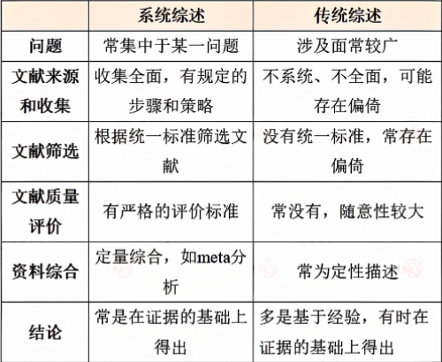
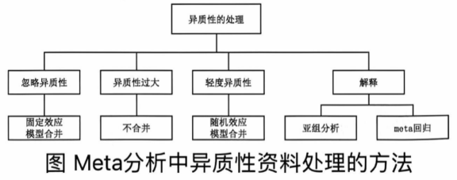

# 十八、循证医学

> 来源：流行病学.docx · 2026-10-13 由 docx 转 Markdown，2026-10-15 修订公式处理
> 医学内容请以教材、指南与任课教师为准复核，不可用于临床决策。

循证医学Evidence-based medicine
是有意识地、明确地、审慎地利用现有最好的证据制定关于个体病人的诊治方案，是最佳的证据、临床经验和病人价值的有机结合。
对定义的诠释：
①任何临床医疗决策的制定仅仅依靠临床经验是不够的，应当基于当前最佳的科学研究成果，并充分考虑病人对治疗的选择、关注和期望，此即所谓的循证临床决策。
②现有最好的证据是指来自临床应用型研究的结果，即来自随机对照试验产生的结果，但经常是现有的最好证据不是来自随机对照试验。
③医生个人的临床经验，即医生通过临床实践获得的处理临床问题的能力。
④病人的价值观，即病人的爱好、兴趣和期望等。
系统综述Systematic review,SR
是应用一定的标准化方法，针对某一特定问题的相关研究报告进行全面、系统的收集，并对它们鉴定、选择和严格评价，从符合纳入标准的研究报告中提取相关资料，做整合性分析，最终得出综合性的结论。

特征：
①有清晰的题目和明确的目的。
②采用综合、全面的检索策略检索文献。
③研究入选和排除标准明确。
④列出所有入选研究。
⑤清楚地表达每个入选研究的特点，并对这些研究方法学的质量进行评价。
⑥阐明所有排除研究的原因。
⑦如可能，使用meta分析合并合格研究的结果。
⑧如可能，对合成的结果进行敏感性分析和亚组分析。
⑨采用统一的格式报告研究结果。
PICO：研究对象participants 、干预措施intervention 、对照comparison 、结局outcome
异质性检验及异质性资料处理的方法
关键要点：不存在异质性(可合并性)、存在异质性(临床异质性、方法学异质性、统计学异质性)、异质性检验方法(Q值、)
不存在异质性：说明这些独立研究的真实效应可能是相同的，具有可合并性。
存在异质性：需要探讨造成差异的可能原因，研究之间是否存在：
①临床异质性(概念上的异质性):如对象特征、诊断、干预、对照、研究地点、评价结局等不同。
②方法学异质性：研究设计与质量方面的差异，如盲法的应用和分组隐藏的不同，或者由于试验过程中对结局的定义和测量方法的不一致而出现的变异。
③统计学异质性：不同试验中观察到的效应的变异性超过了机遇(随机误差)本身所致的变异性。
①通常采用Q统计量，服从于自由度为k−1的χ²分布，Q值越大，其对应的P值越小。若Q>c（1−α）²,则P<α,表明研究间存在异质性。
②用统计量I²定量衡量异质性的大小，I²表示由于由研究间变异占总变异(包括研究间变异及抽样误差的残差)的百分比。
a.当I²=0时，表明研究间的变异仅由抽样误差引起，没有观察到研究间的异质性。
b.I²统计量越大异质性越大，异质性的低、中、高程度分别用I²统计量25%、50%、75%表示。若P>50%,则说明存在比较明显的异质性。

c.如果各研究间无异质性或较低(P>0.1,I²<50%),采用固定效应模型进行资料的合并分析；若存在异质性(P<0.1,I²>50%)时，但合并资料仍然具有临床上的意义，则采用随机效应模型进行合并分析，并谨慎解释研究结果。
系统综述偏倚来源与控制
系统综述的三种偏倚存在于两个层面，即原始研究固有存在的，以及系统综述制作过程中引入的新的偏倚。
信息偏倚
①来源：系统综述的信息主要源于原始研究的集合数据，如果变量的定义不合理或不明确、数据提取的方式不正确、原始信息不准确以及原始研究中有关信息缺失等，都会导致提取的数据不准确，从而引起最终整合结果的信息偏倚。
②控制：要控制系统综述的信息偏倚，需要在定义变量和提取数据上下工夫，必要时应和原作者取得联系，核实可疑的信息或索取缺如的信息。
选择偏倚
①来源：选择偏倚是系统综述中最重要的偏倚来源，原因是实际收集到的研究与“研究总体”之间存在差异。造成实际纳入的研究与“研究总体”存在差异的原因有多种，主要包括纳入和排除标准不当或不明确、文献检索策略和方法不当、发表偏倚、语言偏倚、地区偏倚，以及根据结果人为地纳入或排除个别研究等。
②控制：研究者必须根据研究目的制定明确的纳入和排除标准，如没有明显缺陷，不应中途更改，并在筛选研究中严格执行，尽可能杜绝依据研究结果排除或纳入研究的做法。研究者应按照国际上认可的策略，制定系统严密的文献检索计划。
混杂偏倚
①来源：系统综述的混杂偏倚首先可能来自于原始研究，即使是高质量的随机对照试验，在亚组分析时，不同组的原始研究在其他可能影响效应估计因素的不可比性，仍可能对两组合并效应的比较产生混杂作用。
②控制：如果有足够的高质量研究，控制混杂的首选方法是尽可能地选用混杂作用较小的原始研究，如随机对照试验，或是充分有效地控制了主要混杂因子的观察性研究。
偏倚种类
(1)发表偏倚(Publication bias):是指具有统计学显著性意义的研究结果较无显著性意义和无效的结果被报告和发表的可能性更大。
(2)文献检索偏倚(Location bias):是指在文献检索中采用的检索策略或检索工具不具有代表性，如仅检索中文数据库，语言偏倚如仅收录英文的文章出现的偏倚，因不同语种对发表研究的倾向性不同。
(3)语言偏倚(Language bias):在文献检索偏倚中，将检索限定在某种语言引起的偏倚，称为语言偏倚。
(4)文献库偏倚(Database bias):世界上几个主要的医学文献检索库，虽然包括了3000~4000种杂志，但绝大部分来自发达国家，发展中国家仅占2%,而发展中国家具有阳性结果的研究可能更容易发表在来自印度的30种使用英语的杂志中，从而引入的偏倚，称为文献库偏倚。
(5)引用偏倚(Citation bias):手工检索文献时，通过文章后面所列的参考文献可以进一步查找其他相关文章；在meta分析中这种途径可能带来引用偏倚，因为支持阳性结果的试验比不支持的试验可能更多地被作为参考文献加以引用；杂志的知名度对文章的引用也会产生影响。
(6)多次发表偏倚(Multiple publicationbias):同一研究多次发表会从几方面引入偏倚；首先，阳性结果的研究更容易多次发表或作为会议报告，这就使得这些文章更容易被查到并纳入meta分析中；其次，meta分析中如果包括重复数据会人为地增加了统计学精确性。
(7)有偏倚的入选标准(Biased inclusioncriteria):通常文献入选标准由熟悉所研究领域的调查者来制定，那么这个标准就可能受调查者知识的影响。对入选标准的处理可能导致某些阳性结果的研究被选择，而阴性结果的研究被排除。
(8)权重偏倚(Weighting bias):在对各个研究结果进行整合时，由于使用不恰当的权重而引起的偏倚。产生权重偏倚的原因是由于不同的效应指标赋权的原则不同，使用率差时，事件发生率越低，赋予的权重越大，使用率比时刚好相反，事件发生率越低，赋予的权重越小。当不同效应指标的合并结果相差很大时，应参考以样本盘为权重的合并结果。

---

相关：[索引](索引.md) · 流行病学 MOC
