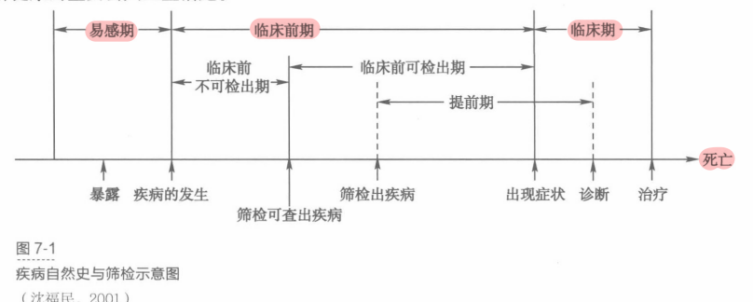
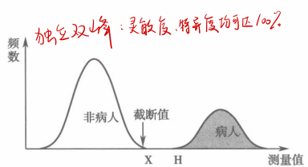
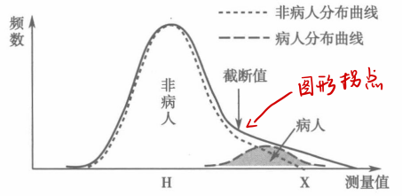
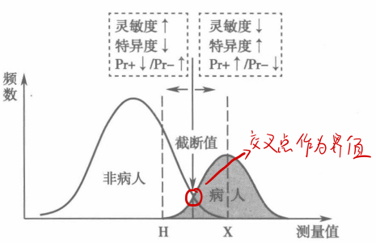
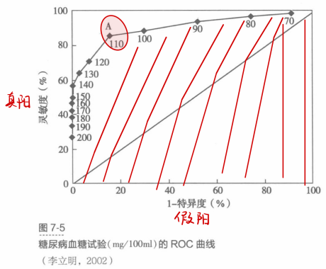
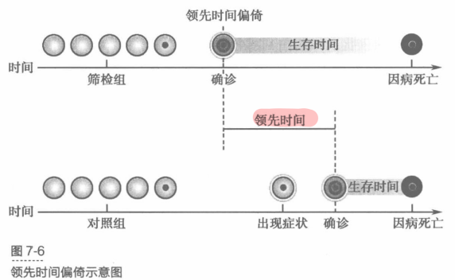

# 四、筛检

> 来源：流行病学.docx · 2026-10-13 由 docx 转 Markdown（保留原大纲层级 / 表格 / 公式转为 LaTeX）
> 医学内容请以教材、指南与任课教师为准复核，不可用于临床决策。

## 基本概念：
筛检或筛查screening ：是针对临床前期pre-clinical stage或早期的疾病阶段，运用快速、简便的试验、检查或其他方法，将未察觉或未诊断疾病的人群中那些可能有病或缺陷、但表面健康的个体，同那些可能无病者鉴别开来的一系列医疗卫生服务措施。又称为“三早”预防，包括对目标疾病的早期发现、早期诊断、早期治疗。（筛检≠筛检试验，筛检试验是筛检所用的检查方法）
目的：
①发现隐匿的病例：在表面健康的人群中筛检出可能患病的个体，并进一步进行确诊和早期治疗，实现二级预防。
②发现高危人群：发现某些疾病的高危个体，从病因学角度采取措施，减少疾病的发生，降低疾病发病率，达到一级预防的目的
③了解疾病自然史，揭示疾病的“冰山现象”
④指导合理分配有限的卫生资源
类型：

| 按照筛检对象的范围分为 | 整群筛检mass screening | 在疾病患/发病率很高的情况下，对一定范围内人群的全体对象进行无差别普遍筛检。 |
|---|---|---|
|   | 选择性筛检selective/高危人群筛检high risk | 选择疾病的高危人群进行筛检 |
| 按照筛检项目的多少分为 | 单项筛检single | 用一种筛检试验筛查一种疾病 |
|   | 多项筛检multiple | 用多种筛检试验筛查一种疾病 |
|   | 多病种筛检multiphasic | 同时在一个人群中开展多种疾病筛检 |
| 按照筛检的目的分为 | 治疗性筛检therapeutic | 如大肠癌、乳腺癌的筛检，可发现和治疗早期病人 |
|   | 预防性筛检preventive | 如高血压的筛检可预防脑卒中 |
| 按筛检组织的方式 | 主动性筛检active | 采取“主动出击”，通过有组织地宣传介绍，动员群众到筛检服务地点进行检查。如新生儿疾病筛查 |
|   | 机会性筛检opportunistic | 属于被动性筛检，是将日常性的医疗服务与筛检结合起来，在病人就医过程中，对非专科就诊的人群进行筛检，如非高血压门诊开展“首诊病人测血压”项目 |

实施原则：
制定筛检计划时，应考虑以下4个方面的原则

| 原则 |   |
|---|---|
| ①筛检的疾病 | 所筛检疾病或相关健康状态应是该地区现阶段的重大公共卫生问题，能对人群健康和生命造成严重危害，现患率或死亡率较高，是人群的主要死因之一 目标疾病的自然史清晰，有足够长的临床前期和可被识别的疾病标识，有早诊断的方法，且早期干预能显著降低死亡率 对疾病不同阶段的干预效果及其不良反应有清楚的认识 |
| ②筛检试验（关键） | 1.筛检试验应准确、简单、经济、安全且容易被受检者接受 2.应有符合不同经济发展和卫生资源水平的筛检方法可供选择 |
| ③疾病治疗 | 对筛查出的不同阶段结局均有行之有效的干预方案，且确保早期治疗的效果应优于晚期治疗 |
| ④筛检项目实施计划及评价 | 目标人群是否明确 筛查-治疗程序是否有效 是否有卫生经济学价值 是否符合公平性、可及性以及伦理学原则 人群获益是否超过伤害 还需对筛查的质量控制、经费保障及项目风险应对机制等方面进行评估 |

## 筛检试验
定义：screening test是用于识别外表健康的人群中那些可能患病个体或具有患病风险个体的方法。即可是问卷、体格检查、内镜与X线等物理学检查，也可是细胞学或生物大分子标志物检测技术。$\text{筛检}\neq \text{筛检试验}$
特征：
①简单性：易学习、易操作，非专业人员经过适当的培训也会操作
②廉价性：在健康收益一定的情况下，筛检试验的费用越低越好
③快速性：很快能得到结果
④安全性：不会给受试者带来创伤
⑤可接受性：易被目标人群接受
⑥真实可靠（补充）
筛检试验与诊断试验diagnostic test的区别

|   | 筛检试验 | 诊断试验 |
|---|---|---|
| 目的 | 区分可能患病者和可能未患病者 | 区分病人和可疑有病但实际无病的人 |
| 对象 | 表面健康的人或无症状的病人 | 病人或筛检阳性者 |
| 要求 | 快速、简便，无创，易于接受，有高灵敏度，尽可能发现所有可能的病人 | 复杂、灵敏度和特异度高，结果具有更高的准确性和权威性 |
| 结果 | 阳性（疑似病例）、阴性（可能无病） | 病例、非病例 |
| 费用 | 经济、廉价 | 一般花费较高 |
| 处理 | 阳性者应进一步作诊断试验以确诊 | 阳性者要随之以严密观察和及时治疗 |

## 筛检试验研究设计
金标准的确定：gold standard 是指当前临床医学界公认的诊断疾病的最准确可靠的方法；使用金标准的目的就是准确区分受试者是否为某病病人。最佳的金标准有病理诊断、活检、手术发现、微生物培养、尸检或特殊检查；也可以是准确性较高的影像诊断、临床综合诊断，结合短时间内重复测量或随访，尽量减少确诊方法的误诊和漏诊。
选择研究对象：
①受试对象应能代表筛检试验可能应用的目标人群，并尽量满足随机化抽样原则
②筛检的目的是发现临床前期或早期的病人，病例选择应包括早期病症轻微的病例
③应考虑疾病的各种临床类型（不同病情程度、不同病程、典型和不典型、有无并发症、是否治疗过）
④非病例组为金标准证实未患有目标疾病者，包括非病人和(或)与目标疾病易产生混淆的疾病病人
样本量计算：
都是反比，$\text{灵敏度}\text{↓} \text{特异度}\text{↓} \text{显著性水平}\alpha\text{↓} \text{容许误差}\delta\text{↓} \text{⇒} n \text{↑}$
$n={\left(\frac{{Z}_{1-\alpha/2}}{\delta}\right)}^{2}\left(1-p\right)p$
估计病例组的n时，p是灵敏度；估计非病例组的n时，p是特异度
筛查结局分类标准或截断值：
①筛检试验的结果需要明确的、有明显区分度的阳性和阴性判断标准
②检测值为分类或等级标准的，可根据专业知识批判阳性或阴性；检测值为连续性指标的，需确定判断阳性结果具体取值，即截断值cut-off value
筛检试验阳性结果截断值的确定
两组人群测量值分布呈现三种状态：①独立双峰分布 ②部分重叠双峰分布 ③单峰连续分布
假设病人的测量值总体上大于非病人，H为病人的最低值，X为非病人的最高值
①独立双峰分布

理论上把截断值选在病人的最小值$H$处，筛检试验的判断准确度可达$100\%$，但实际中很难穷尽病人的最小值，因此我们根据非病人检测值的$99\%\text{~}99.9\%CI\text{上限}$来确定截断值。对发病率极低的疾病，可选择99.9%上限值，既可保证灵敏度达到100%，又避免过高的假阳性检出率。

③单峰连续分布
总人群分布呈单峰型，病人与非病人的分布相互交错，区分度较差，无论截断值如何选取都可能有较大的误判率。因此这类指标通常作为初筛方法，截断值选择图形中的拐点，虽然误诊率(假阳率)较高，但可尽量避免漏诊
②部分重叠双峰分布（重点）

$\text{在}H\text{至}X\text{之间，}1.\text{当截断值向}H\text{移动，灵敏度}\text{↑}\text{特异度}\text{↓}$
$\text{当截断值向}X\text{移动，灵敏度}\text{↓}\text{特异度}\text{↑}$
阳性结果的截断值选在何处，应从以下几个方面考虑：
1.如果疾病预后差，漏诊的后果很严重，且目前有可靠的治疗方法，那么截断值应向提高灵敏度的方向移动，尽可能找出可疑病人，但会增加假阳性。如乳腺癌
2.如果疾病后续诊疗方法不理想，那么截断值应向提高特异度的方向移动，尽可能鉴别出非病人，减少假阳性对参与者的心理压力，如肝癌、胰腺癌。
3.一般而言，筛检试验应综合考虑灵敏度和特异度达到平衡，将临界点选在病人与非病人的分布曲线交界处。实际操作时，使用$\text{受试者工作特征曲线}ROC$来决定最佳截断值。

ROC曲线的基本原理及应用：
基本原理：将病人和非病人的测量值从小到大排序，即可划分一系列截断值，对应每个截断值可计算相应的灵敏度和特异度；绘制1-特异度为横坐标，灵敏度为纵坐标的坐标轴，每个截断值对应的灵敏度和1-特异度值构成坐标点，多个坐标点相连即ROC曲线。距离坐标轴左上角最近的坐标点，可同时满足筛检试验的灵敏度和特异度相对最优，它对应的取值即为最佳截断值（图中A点）。
ROC曲线与横坐标轴构成的曲线下面积area under the curve AUC 的应用：
①反映检测方法的真实性：AUC越接近1.0，检测方法真实性越高；等于0.5时，则真实性最低，无应用价值；
②利用曲线下面积比较多种筛检试验的真实性的优劣。
盲法测量：
保证病例和对照在整个检查流程中所得到的处理一致，一般采用盲法来控制信息偏倚。
## 筛检试验的评价指标：
资料整理

| 筛检 | 金标准 |   |
|---|---|---|
|   | 病例+ | 非病例- |
| 阳性+ | 真阳TP | 假阳FP |
| 阴性- | 假阴FN | 真阴TN |
| 合计 | C1 | C2 |

真true 假 false 阳性positive 阴性negative
灵敏度、特异度竖着算
预测值横着算
### （一）真实性：
Validity ，亦称效度，指测量值与实际值相符合的程度，故又称准确性accuracy

|   | 定义 | 公式 | 作用 |   |
|---|---|---|---|---|
| 灵敏度/真阳 | 实际患病且被筛检试验标准判断为阳性的百分比 | $\frac{TP}{TP+FN}=\frac{TP}{C1}$ | 反映筛检试验发现病人的能力 | 互补，真阳+假阴=1 |
| 漏诊/假阴 | 实际患病，但被筛检试验标准判断为阴性的百分比 | $\frac{FN}{TP+FN}=\frac{FN}{C1}$ | 反映筛检试验漏诊病人的情况 |   |
| 特异度/真阴 | 实际无病且被筛检试验标准判断为阴性的百分比 | $\frac{TN}{TN+FP}=\frac{TN}{C2}$ | 反映筛检试验鉴别排除非病人的能力 | 互补，真阴+假阳=1 |
| 误诊/假阳 | 实际无病，但被筛检试验标准判断为阳性的百分比 | $\frac{FP}{FP+TN}=\frac{FP}{C2}$ | 反映筛检试验误诊病人的情况 |   |
| 正确指数/约登指数 |   | $\text{灵敏度}+\text{特异度}-1$ | 表示筛检试验识别真正病人和非病人的总能力（综合了灵敏度和特异度，指数越大，真实性越高） |   |

| 似然比LR | 阳性似然比+LR | $\frac{\text{真阳率}}{\text{假阳率}}=\frac{\text{灵敏度}}{1-\text{特异度}}$ | 比值越大，试验结果为 + 时为真 + 的概率越大（越大越好） | 似然比是同时反映灵敏度和特异度的综合指标 |
|---|---|---|---|---|
|   | 阴性似然比-LR | $\frac{\text{假阴率}}{\text{真阴率}}=\frac{1-\text{灵敏度}}{\text{特异度}}$ | 比值越小，试验结果为 - 时 为真 - 的概率越大（越小越好） |   |

多种筛检方法进行真实性比较时用的评判指标：约登指数和似然比。约登指数越大、阳性似然比越大，阴性似然比越小，真实性越好。当筛检试验被用于医院、临床诊断时，应尽可能选择特异性高的方法。
### （二）可靠性：
reliability，也称信度、精确度precision 、可重复性repeatability，指在相同条件下用某测量工具重复测量同一受试者时结果的一致程度。
#### ①连续性测量的资料：

|   | 指标 |
|---|---|
| 同一样品或一组同质性样品 | 标准差、变异系数，这俩指标越小，说明精密度越高 |
| 一批不同质样品 | ①进行两次重复测量，用两次测量值的相关系数r来评价一致程度，r≥90% 可认为筛检方法一致性好 |
|   | ②配对t检验，差异无统计学差异可认为重复测量的一致性较好 |

#### ②分类测量的资料（重点）：
先整理为配对四格表形式，评价指标有符合率、Kappa值；分布差异检验用配对${\chi}^{2}$检验

| 第二次检测 | 第一次检测 |   | 合计 |
|---|---|---|---|
|   | 阳性 | 阴性 |   |
| 阳性 | A | B | R1 |
| 阴性 | C | D | R2 |
| 合计 | N1 | N2 | N |

符合率：agreement：又称一致率consistency rate
$\text{符合率}/\text{一致率}=\frac{A+D}{N}\times 100\%$
Kappa值：相较于一致率，Kappa值考虑到了机遇因素的影响，更加客观。
$Kappa=\frac{\text{实际观察一致率}-\text{机遇一致率}}{1-\text{机遇一致率}}$
$\text{实际观察一致率}=\frac{A+D}{N} \text{；机遇一致率}=\frac{{A}_{\text{理论}}+{D}_{\text{理论}}}{N}=\frac{\left(\frac{{R}_{1}{N}_{1}}{N}\right)+\left(\frac{{R}_{2}{N}_{2}}{N}\right)}{N}$

| Kappa取值 | $-1$ | $-1\text{~}0$ | $=0$ | $0\text{~}1$ | $1$ |
|---|---|---|---|---|---|
|   | 两结果完全不一致 | $\text{机遇一致率}>\text{实际一致率}$ | 实际一致率完全是由机遇所致 | $\text{实际一致率}>\text{机遇一致率}$ | 两结果完全一致 |
|   | 一致性比随机水平还差，这种情况较为罕见 |   |   | 0 差 0.4 中度 0.75 好 1 |   |

#### 影响筛检试验可靠性的因素：
①受试者生物学变异：由于个体生物周期等生物学变异，使得同一受试者在不同时间获得的临床测量值有所波动。例如血压在一天内不同时间的测量值存在差异
②观察者：由于测量者之间、同一测量者在不同时间的技术水平不一，判断尺寸掌握差异，预期偏倚等均可导致重复测量的结果不一致。
③实验室条件：重复测量时，测量仪器不稳定，试验方法本身不稳定，不同产家、同一产家生产不同批号的试剂盒的纯度、有效成分的含量、试剂的稳定性等均有不同，由此可能引起测量误差。
### （三）预测值：
Predictive value：估计受检者为病人和非病人的可能性，反映了筛检试验实际应用到人群筛查后，获得的收益大小。(预测值横着算，真实性指标竖着算)
直接计算法：

| 筛检 | 金标准 |   | 合计 |
|---|---|---|---|
|   | 病人 | 非病人 |   |
| 阳性 | A | B | R1 |
| 阴性 | C | D | R2 |
| 合计 | N1 | N2 | N |

阳性预测值positive predictive value Pr+：筛检发现的阳性者中患目标疾病的人所占的比例
$\text{阳预}=\frac{A}{A+B}=\frac{A}{{R}_{1}}\times 100\%$
阴性预测值negative predictive value Pr-：筛检发现的阴性者中不患目标疾病的人所占的比例
$\text{阴预}=\frac{D}{C+D}=\frac{D}{{R}_{2}}\times 100\%$
间接计算法：
在医院开展的，基于病例-非病例设计的筛查试验研究，病例组和非病例组的构成比不能代表目标人群的现患与未患比例，因此不能直接计算预测值。根据Bayes公式估算预测值（记住分母就能记住整个公式）
$\text{阳预}=\frac{\text{真阳率}\times \text{患病率}}{\text{真阳率}\times \text{患病率}+\left(\text{假阳率}\right)\left(1-\text{患病率}\right)}$
$\text{阴预}=\frac{\text{真阴率}\times \left(1-\text{患病率}\right)}{\text{真阴率}\times \left(1-\text{患病率}\right)+\text{假阴率}\times \text{患病率}}$
预测值与真实性指标的关系(前提条件：人群患病率不变)
$\text{灵敏度}\text{↑}=\frac{A}{A+C}\text{↑} \text{⟹} C\text{↓} \text{⟹} \text{阴预}\text{↑}=\frac{D}{C\text{↓}+D}\text{↑}$
$\text{特异度}\text{↑}=\frac{D}{B+D}\text{↑} \text{⟹} B\text{↓} \text{⟹} \text{阳}\text{预}\text{↑}=\frac{A}{A+B\text{↓}}\text{↑}$
预测值与人群患病率的关系（前提条件：灵敏度和特异度一定）
$\text{患病率}\text{↓} \text{⟹} \text{病例}\text{↓}\text{非病例}\text{↑} \text{⟹} \text{阳预}\text{↓} \text{阴预}\text{↑}$
## 筛检效果评价阶段及研究方法
①第一阶段（现场干预研究）：一般采用随机对照试验，将研究对象以个体或整群随机的方式分为两组，干预组需要接受连续周期性的筛查，对照组接受常规的医疗服务。
②第二阶段（筛检示范区建设阶段）：采用多中心的社区类实验研究，连续观察筛查的中、远期效果生物学指标、卫生经济学效果指标及筛查和治疗的不良反应事件发生情况等，探索筛检在实际环境中的运作机制。
③第三阶段（验证和应用阶段）：采用观察性的研究方法，进一步验证真实条件下筛查所取得的远期生物学效果、卫生经济学效益及项目的可持续性。常用的方法有回顾性队列研究、病例对照研究、生态学研究。
## 筛检项目评价内容及指标
#### ①收益yield
##### 定义：也称收获量，指经筛检后能使多少原来未被发现的病人（或临床前期病人、高危人群）得到诊断和治疗。反映人群在短期内因筛检得以早诊早治的获益情况。
##### 评价指标：
##### 阳性预测值：最常用的收益指标。$\text{阳预}\text{↑} \text{⟹}\text{筛查出的阳性者中真病人的比例}\text{↑}\text{说明筛查具有较高的效率}$（阳预小，即筛检试验阳性结果的正确率很低，产生大量假阳性，此时即使不考虑经济成本，筛检也是没有意义的）
##### 转诊率或筛查阳性率：筛查阳性人数占目标人群的比例，$\text{灵敏度}\text{↑}\text{或特异度}\text{↓} \text{⟹} \text{筛查阳性率}\text{↑}$ 该指标不宜太高，否则不符合卫生经济学原则
##### 早诊/早治率：$\text{筛检}>\text{正常医疗程序} \to \text{收益较好}$
##### 提高筛检收益的方法：
##### 1.高危人群策略
##### 疾病在某些年龄、性别、种族及主要危险因素暴露特征人群中有较高的患病率，在这些高危人群中开展筛检可提高阳性预测值，更符合低成本高效益的原则。
##### 2.选择合理的筛查方案
##### （1）选择高灵敏度方法
##### （2）采用联合试验（重要考点，联合试验的大题非常难）
联合试验：在实施筛检时，可采用两种及以上筛检试验检查同一受试对象，以提高筛检的灵敏度或特异度，增加筛检的收益。

|   | 设置方法 | 应用条件 | 灵敏度 | 特异度 |
|---|---|---|---|---|
| 串联试验/系列试验serial test | 一组筛检试验按一定的顺序相连，初筛阳性者进入下一轮筛检，全部筛检试验均为阳性者才定为阳性 |   | $\text{↓}$ | $\text{↑}$ |
| 并联试验/平行试验parallel test | 全部筛检试验同时平行开展，任何一项筛检试验结果阳性即可判为阳性 | 若手头上可用的方法灵敏度都不足，可使用该方法提高灵敏度 | $\text{↑}$ | $\text{↓}$ |

（重要考点）串联试验初筛用灵敏度较高的方法（漏诊率最低），确诊用特异度较高的方法（误诊率最低）
##### （3）设置合理的筛检起始年龄和时间间隔
起始年龄根据人群最大获益的时点而定：宫颈癌的筛检，从30岁以后开始，可发现92%的早期癌，因此筛检的起始年龄为30岁
筛查间隔根据方法的准确性而定：若筛检方法的灵敏度和特异度均高，筛查间隔可较长；若方法的灵敏度较低，则需要提高筛查频率来减少漏诊的情况
#### ②生物学效果指标
根据筛查能改善疾病的中间或终末结局状态的观察终点来设定
##### 1.结局测量指标
（1）归因死亡率：是评价筛查人群长远期的终点结局指标
$\text{归因死亡率}AR=\text{未参加筛检人群死亡率}-\text{筛检人群死亡率}$
（2）治愈率、复发率、病死率、生存率、生存时间：评价筛查人群早期或中期获益的中间结局指标
##### 2.关联指标
（1）随机对照试验：效果指数IE、保护率PR、归因危险度AR/绝对危险度降低ARR
（2）观察性研究：归因死亡危险率比RR（队列研究）、优势比OR（病例对照研究）
##### 3.需筛检人数number needed to be screened NNBS：$NNBS=\frac{1}{AR}$ 表示减少一例目标疾病病例的死亡，需要筛检多少人，越小越好。
#### ③卫生经济学评价
##### 1.筛查成本：cost是在提供卫生服务过程中所消耗的资源。
##### 2.成本-效果分析：效果effectiveness，是健康改善方面所取得的生物学效果，如复发率、死亡率等下降，生存期延长。只关心病人能存活多久。
##### 3.成本-效用分析：效用utility，是综合了生物学效果和人们对结果主观感受和功能状况的指标。不仅关心病人能存活多久，还关心存活的质量。
##### 4.成本-效益分析：效益benefit，是将健康改善的结局用货币价值来衡量。
##### 5.卫生经济学模型：常用马尔可夫模型

#### ④安全性和伦理学评价
#### ⑤项目可持续性评价
## 筛检评价中的偏倚：
### 领先时间偏倚lead time bias：
领先时间lead time 是指临床前筛查诊断的时点（年龄）至常规临床诊断时点（年龄）之间的时间间隔。如果筛检只是提前了发现疾病的时点，但并未改变筛查人群的死亡时点（年龄），也会观察到筛查人群比不筛查人群生存时间更长的假象。
人话：筛检实际上并没有延长患者的生存时间
### 病程偏倚length bias：
疾病被检出的可能性和疾病的进展速度有关。如果筛查组中疾病进展缓慢的病人占较大比例时，可能观察到筛查组较未筛查组生存概率更高或生存时间更长，此时，筛查的效果被高估，及产生了病程偏倚。
人话：发展快的疾病（病程短、生存时间也短）被筛检发现的机会小，发展慢的疾病（病程长、生存时间长）被筛检发现的机会大，因此造成筛检可延长生存时间的假象
### 过度诊断偏倚over diagnosis bias：
筛查发现过多的早期病例而增加了诊断治疗的负担，这种现象称为“过度诊断”。因为筛检，这些惰性病例被发现、确诊患病、并被计入病人总体中，导致经筛检发现的病人有较多的生存者或较长的平均生存期，从而高估了筛查效果，即产生了过度诊断偏倚。
人话：过度诊断发现了很多惰性病例，这些病例可能终生疾病无进展，病人可能在出现该目标疾病临床症状之前就死于其他疾病。筛查组内的惰性病例很多，就会导致筛查组似乎生存时间更长的假象。
### 志愿者偏倚volunteer bias：
健康行为可能决定筛查意愿，参加筛查者与不参加者相比可能有更高的受教育程度、个人经济状况更高、更关注自身健康、不良行为的发生率较低，因此参加筛查的人群总的发病或死亡风险可能低于不参加筛查人群。
人话：愿意参加筛查的志愿者群体更加注重健康、经济教育水平一般也较高，所以该群体本身的疾病发生或死亡风险更低

---

相关：[索引](索引.md) · 流行病学 MOC
